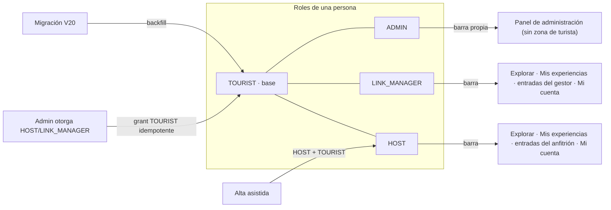

# ADR-0064: Todo anfitrión y gestor de enlace es también turista

- **Estado:** Aceptado (2026-11-11)
- **Proyecto / Módulo:** Intégrate · `backend-api/` — `modules/auth` (`AssistedAccountServiceImpl`, `RoleAssignmentService`, nueva migración Flyway) y `modules/catalog` (altas de anfitrión y de gestor); `frontend-pwa/` — `app/layouts/roleNavigation.ts`, `shared/session/accountPath.ts`. Enmienda ADR-0062 §1 (a qué «Mi cuenta» va quien tiene varios roles) y ADR-0061 (barra del anfitrión y del gestor).
- **Fecha:** 2026-11-11
- **Trazabilidad:** observación del desarrollador del 2026-11-11 («todo anfitrión o gestor de enlace también es turista»), ADR-0007 (cuentas asistidas), ADR-0013 §6 (roles y zonas), ADR-0054 (consentimientos de salud), FE-DIR-001.

## Contexto

Un anfitrión o un gestor también explora el catálogo y reserva como cualquier visitante. Hoy no siempre puede: la pestaña «Mis experiencias» y las rutas de reserva exigen `ROLE_TOURIST`, y el backend protege `/api/v1/bookings/**`, pagos, vouchers y `/api/v1/dev/**` con `hasRole("TOURIST")`. Las cuentas de anfitrión creadas por enrolamiento asistido (`AssistedAccountServiceImpl`, `HOST_ROLES = [HOST]`) nacen **solo** con `HOST`, así que ven «Explorar» pero no «Mis experiencias», y si intentaran reservar recibirían 403. Las cuentas que se autorregistraron como turista y luego recibieron `HOST` o `LINK_MANAGER` sí conservan `TOURIST`: el comportamiento depende de cómo nació la cuenta, no del rol.

Restricciones: el rol vive en `auth.user_roles` con historial de revocación (índice único de roles activos por usuario); `RoleAssignmentService.grant` ya es idempotente; los roles viajan en el token de sesión; el consentimiento `HEALTH_EMERGENCY` ya aplica a cualquier rol (`ConsentLedger.applicablePurposes`) y es precondición del bloqueo de cupo, no del ingreso; el administrador ya recibe `ADMIN + TOURIST` pero nunca ve la zona de turista (ADR-0044).

## Decisión

1. **Regla de dominio:** toda cuenta activa con `HOST` o `LINK_MANAGER` tiene también `TOURIST` mientras tenga alguno de esos roles. `TOURIST` es el rol base de cualquier persona; los demás se suman.
2. **Cuentas nuevas.**
   - `AssistedAccountServiceImpl.HOST_ROLES` pasa a `[HOST, TOURIST]`; la respuesta de aprovisionamiento lista ambos.
   - Los servicios que otorgan `HOST` (`CatalogAdminServiceImpl`) y `LINK_MANAGER` (`LinkManagerAdminServiceImpl`) llaman además a `grant(userId, TOURIST)`, que ya es idempotente y no hace nada si el rol existe.
3. **Cuentas existentes.** Una migración Flyway (`V20`) inserta `TOURIST` en `auth.user_roles` para todo usuario activo y no cerrado que tenga un rol `HOST` o `LINK_MANAGER` vigente y no tenga `TOURIST` vigente. Es idempotente (no duplica gracias al índice único parcial) y no toca usuarios suspendidos, anonimizados ni dados de baja.
4. **Revocar no quita lo base.** Revocar `HOST` o `LINK_MANAGER` deja `TOURIST` intacto (hoy ya ocurre con el gestor revocado; se añade una prueba que lo fija). Nada revoca `TOURIST` mientras la cuenta esté activa.
5. **Consentimientos sin cambio.** (*`requiredPurposes` fue enmendado después por [ADR-0068](ADR-0068-consentimiento-de-victima-solo-con-constancia-previa.md): `SENSITIVE_VICTIM` solo se exige al anfitrión que ya tiene constancia de ese consentimiento.*) `requiredPurposes` y `applicablePurposes` no cambian: el anfitrión asistido conserva `PERSONAL_DATA` + `SENSITIVE_VICTIM` para operar; `HEALTH_EMERGENCY` se le pedirá, como a cualquier turista, al reservar (precondición del bloqueo, ADR-0054). No se otorga nada en su nombre.
6. **Frontend.**
   - `roleNavigation` no cambia de condición (`ROLE_TOURIST` ⇒ «Mis experiencias»), pero ahora la cumplen anfitrión y gestor: ven «Explorar» y «Mis experiencias» además de sus propias entradas. «Mi cuenta» sigue a la derecha de todo (`navOrder`).
   - `accountPathFor` (ADR-0062 §1) se enmienda: el rol de zona manda sobre el de turista. Orden: administrador → anfitrión → gestor → turista. Si no, al volverse turistas todos, el anfitrión y el gestor irían a `/turista/cuenta` y saldrían de su zona, que es justo lo que ADR-0062 quería evitar.
   - Las rutas de reserva (`/reservas/*`, `/mis-experiencias`) siguen exigiendo `ROLE_TOURIST`; no se abren a `HOST` ni `LINK_MANAGER` por separado.
   - Los iconos de la barra del anfitrión ya se corrigieron (calendario, gráfica, montaña); no forman parte de este ADR.
7. **Sesiones abiertas.** Los roles viajan en el token: quien ya tiene sesión recibe `TOURIST` al renovar el token o al volver a ingresar. Se documenta en el manual; no se invalidan sesiones.
8. **Verificación de cierre:**
   - Backend: prueba de integración del enrolamiento asistido (roles `HOST` y `TOURIST`), de alta de anfitrión y de gestor por el administrador, de revocación (`TOURIST` sobrevive) y de la migración sobre datos de ejemplo (anfitrión solo con `HOST`, gestor solo con `LINK_MANAGER`, usuario suspendido); un anfitrión asistido puede abrir `GET /api/v1/bookings/mine` con 200.
   - Frontend: la prueba de `routes.test.tsx` que afirma que un gestor sin turista no ve «Mis experiencias» se reemplaza por la regla nueva (anfitrión y gestor con ambos roles lo ven); pruebas de `accountPathFor` para las cuatro combinaciones; Quality Gate de FE-DIR-001 (5 comandos) en verde.
   - Documentación: `docs/api/openapi.yaml` (`roles` de la respuesta de aprovisionamiento) y `docs/api/endpoints-index.md` si cambia algún rol exigido (no se prevé), manual de usuario y `docs/README.md`.

## Alternativas Descartadas

- **Ampliar los permisos de reserva a `HOST` y `LINK_MANAGER`** (`hasAnyRole`): no toca datos, pero reparte la regla «quién es turista» entre `SecurityConfig` y siete controladores, vuelve ambiguo el rol en las auditorías y obliga a repetir la excepción en cada endpoint futuro. Con el rol real la autorización se queda como está.
- **Mostrar la pestaña solo en la interfaz:** el backend respondería 403 al primer intento de reservar.
- **Otorgar `TOURIST` en el inicio de sesión (al vuelo):** oculta una escritura en una lectura, no deja historial en `user_roles` y rompe la auditoría de cuándo empezó a ser turista.
- **Revocar `TOURIST` al revocar el último rol de zona:** una persona dejaría de poder reservar por haber dejado de ser gestora; no es lo que el desarrollador describió.

## Consecuencias

- **Positivas:**
  - la regla «todos son turistas» se cumple en el dato y no depende de cómo se creó la cuenta;
  - la autorización de reservas no cambia, y las pruebas existentes de acceso siguen válidas;
  - el anfitrión y el gestor pueden explorar y reservar sin una segunda cuenta.
- **Negativas / Riesgos asumidos:**
  - un anfitrión puede ahora reservar **su propia experiencia**; este ADR no lo impide. Si se quiere prohibir (por el aporte 85/15 y la liquidación) es una regla nueva de reservas y se decide aparte;
  - las cuentas asistidas con correo sintético y sin teléfono podrían llegar a una reserva sin los datos que el turista suele dejar; el formulario de reserva ya valida lo necesario y no se relaja;
  - quien tenga sesión abierta no verá «Mis experiencias» hasta renovar el token;
  - la migración modifica datos de producción: se ejecuta primero en `pruebas` (cuenta como un uso de SnapDeploy) y es reversible borrando las filas `TOURIST` creadas por ella, identificables por `created_by` nulo y la fecha de la migración.

## Contrato o Esquema Conceptual

