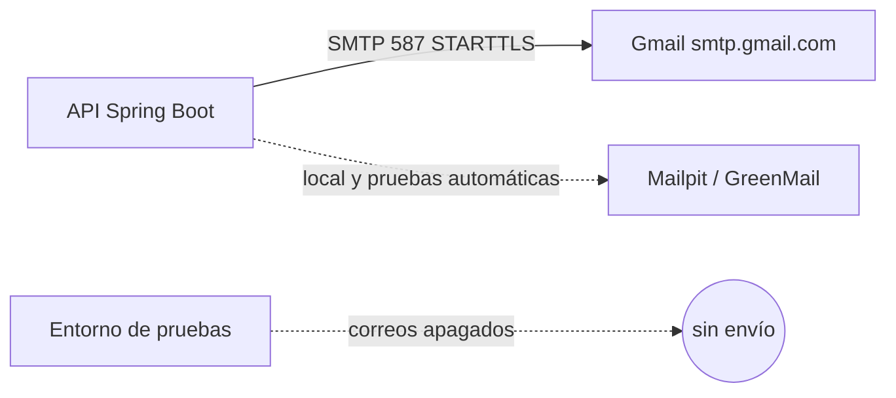

# ADR-0065: Retirar Brevo y enviar el correo real por el SMTP de Gmail del desarrollador

- **Estado:** Aceptado (2026-11-11)
- **Proyecto / Módulo:** Intégrate · infraestructura de correo (`infra/env/.env.example`, guías de despliegue y desarrollo). Sin cambios de código: el backend usa SMTP genérico (variables `SMTP_*` y `MAIL_FROM`).
- **Fecha:** 2026-11-11
- **Trazabilidad:** ADR-0011 §A (transporte SMTP; la viñeta «Demo con destinatarios reales (2026-10-16)» introdujo Brevo), ADR-0027 y ADR-0031 (producción en Hetzner y entorno de pruebas con correos apagados), observación del desarrollador del 2026-11-11 («no estoy utilizando Brevo, estoy utilizando mi correo»).

## Contexto

ADR-0011 adoptó Brevo (`smtp-relay.brevo.com:587`) como relé gratuito para la demo con destinatarios reales. Hoy el desarrollador ya no lo usa: `infra/env/.env.demo` (producción) apunta a `smtp.gmail.com:587` con su cuenta de Gmail como remitente. Aun así, la plantilla `.env.example`, las guías de despliegue (`demo-gratuita.md`, `flujo-local-pruebas-produccion.md`, `guia-desarrollo.md`), un comentario de `compose.demo.yml` y los archivos locales `.env.development`, `.env.demo.pruebas` y `.env.demo.snapdeploy` siguen describiendo o configurando Brevo. Esa información desactualizada confunde (se dio por hecho que el correo salía por Brevo) y obliga a mantener una cuenta y una SMTP key que nadie usa.

Restricciones: mantener las pruebas gratuitas (ADR-0011 §A), no introducir cambios de código, no volcar secretos en Git (SEC-DIR-004) y conservar el historial de decisiones (los ADR no se reescriben).

## Decisión

1. **El correo real sale por el SMTP de Gmail del desarrollador** (`smtp.gmail.com:587` con STARTTLS y contraseña de aplicación), tal como ya hace `.env.demo`. El remitente `MAIL_FROM` es esa misma cuenta de Gmail.
2. **Local y pruebas automáticas** siguen con Mailpit (y GreenMail en memoria); ADR-0011 §A no cambia en esto.
3. **El entorno de pruebas** mantiene los correos **apagados** (`INTEGRATE_NOTIFICATION_DISPATCH_ENABLED=false`, ADR-0031). Si algún día se enciende, usa el mismo SMTP de Gmail.
4. **Se retira Brevo de lo vivo:** la plantilla `.env.example`, las guías de despliegue y de desarrollo, el comentario de `compose.demo.yml`, el docstring del script de datos de demostración y los `.env` locales ignorados por Git. El bloque de Brevo de `.env.example` se reemplaza por el ejemplo de Gmail, que ya existe en esa plantilla.
5. **Los ADR históricos no se reescriben.** Este ADR sustituye solo la viñeta de Brevo de ADR-0011 §A. Se añade a ADR-0011 una línea de «reemplazado parcialmente por ADR-0065»; los diagramas de ADR-0024 a ADR-0027 quedan como fotografía de su momento.
6. **Acción manual del desarrollador:** revocar la SMTP key de Brevo y, si lo desea, cerrar la cuenta. Las variables de `integrate-pruebas` en SnapDeploy conservan el usuario y la clave de Brevo hasta la próxima carga de variables (`snapdeploy.sh env`, que gasta un uso); como allí el envío está apagado, no hay efecto práctico.

## Alternativas Descartadas

- **Mantener Brevo:** exige una cuenta, 2FA y una SMTP key que el desarrollador ya no usa; deja una credencial viva sin necesidad.
- **Gmail API (OAuth 2.0):** exige Google Workspace y no se puede probar contra Mailpit (ya descartada en ADR-0011).
- **Amazon SES u otro relé con remitente verificado:** buena opción para producción, pero requiere dominio propio y verificación; se evalúa con T-2.16 cuando exista dominio.
- **Reescribir los ADR para borrar Brevo:** destruye el registro de por qué se decidió así; se prefiere un ADR que lo sustituya.

## Consecuencias

- **Positivas:** la documentación y la plantilla coinciden con lo que de verdad se usa; desaparece una cuenta y una credencial innecesarias; ninguna prueba ni cambio de código.
- **Negativas / Riesgos asumidos:** Gmail limita el envío (unos 500 correos al día) y Google puede restringir envíos masivos; depende de la verificación en dos pasos y de rotar la contraseña de aplicación; el remitente es una cuenta personal, no un buzón del proyecto. Para volumen o imagen de marca habrá que pasar a SES o a Workspace con dominio.

## Contrato o Esquema Conceptual

