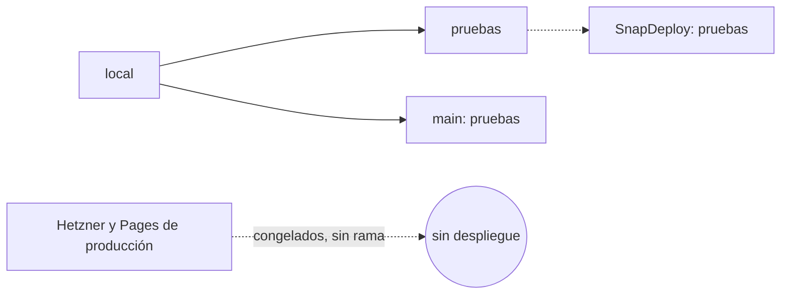

# ADR-0066: `main` pasa a ser rama de pruebas y no hay rama de producción por ahora

- **Estado:** Aceptado (2026-11-11)
- **Proyecto / Módulo:** Intégrate · flujo de ramas y despliegue (`docs/despliegue/flujo-local-pruebas-produccion.md`, `infra/scripts/pages.sh`, `infra/scripts/hetzner.sh`)
- **Fecha:** 2026-11-11
- **Trazabilidad:** sustituye la parte de «`main` = producción» de ADR-0027 y ADR-0031. Observación del desarrollador del 2026-11-11: «quiero que sea esa rama main una rama de pruebas en este momento», «dejar pruebas como está», «no vamos a tener rama produccion por el momento».

## Contexto

Hasta hoy `main` era la rama de producción: `pages.sh deploy produccion` publica desde `main` y el flujo documentado es `local → pruebas → main (producción)`. El desarrollador decide ahora que `main` sea de pruebas, que `pruebas` siga igual y que no exista una rama de producción por el momento.

El estado real que hay que tener presente:
- `main` está en `8a8fc55` y `pruebas` en `cf31e49`. `main` tiene más cambios que `pruebas`, así que dejarlos iguales no es posible sin decidir cuál se fusiona en cuál.
- En Hetzner (producción 24/7, ADR-0027) la base ya no tiene las cuentas reales anteriores: se vació el 2026-11-11 y la demo quedó cargada. El respaldo previo está en una carpeta temporal y no es permanente.
- `hetzner.sh deploy` construye la imagen desde el árbol local y la envía por SSH; no lee ninguna rama.
- `pages.sh deploy produccion` publica con `--branch main`. Qué pasa al cambiar eso depende de la rama de producción configurada en Cloudflare Pages, que no se ha verificado.

## Decisión

1. **`main` es la rama de pruebas.** Recibe integraciones y se prueba desde ahí.
2. **`pruebas` no cambia.** Sigue como hoy, con SnapDeploy y su base propia (ADR-0031).
3. **No hay rama de producción por ahora.** Ninguna rama despliega a producción hasta que se decida otra cosa en un ADR nuevo.
4. **Hetzner y Pages de producción quedan congelados.** No se publica nada en ellos sin un ADR que lo autorice. Se evitan así despliegues accidentales desde `main`.
5. **Pendiente antes de aceptar este ADR, a cargo del desarrollador:** confirmar en el panel de Cloudflare cuál es la rama de producción de Pages y, si el desarrollador lo decide, guardar un respaldo permanente de la base de Hetzner.

## Alternativas descartadas

- **Intercambiar `main` y `pruebas`.** Descartada por ahora: obliga a cambiar a la vez Pages, Hetzner y SnapDeploy.
- **Crear una rama `produccion` ahora.** Descartada porque el desarrollador pidió expresamente que no haya rama de producción por el momento.
- **Reescribir ADR-0027 y ADR-0031.** Descartada: se conserva el historial y este ADR las sustituye en lo que cambia.

## Consecuencias

- **Positivas:** `main` deja de ser un punto de despliegue en vivo, y no se puede publicar a producción por accidente desde `main`.
- **Negativas / riesgos asumidos:** mientras no haya rama de producción, el proyecto no tiene una ruta de despliegue a producción. Los documentos de despliegue y los scripts (`pages.sh`, `hetzner.sh`, la guía de flujo) quedan desactualizados hasta que se aplique este ADR. Hetzner sigue corriendo con la demo y no hay forma gobernada de cambiarlo.

## Contrato o esquema conceptual

