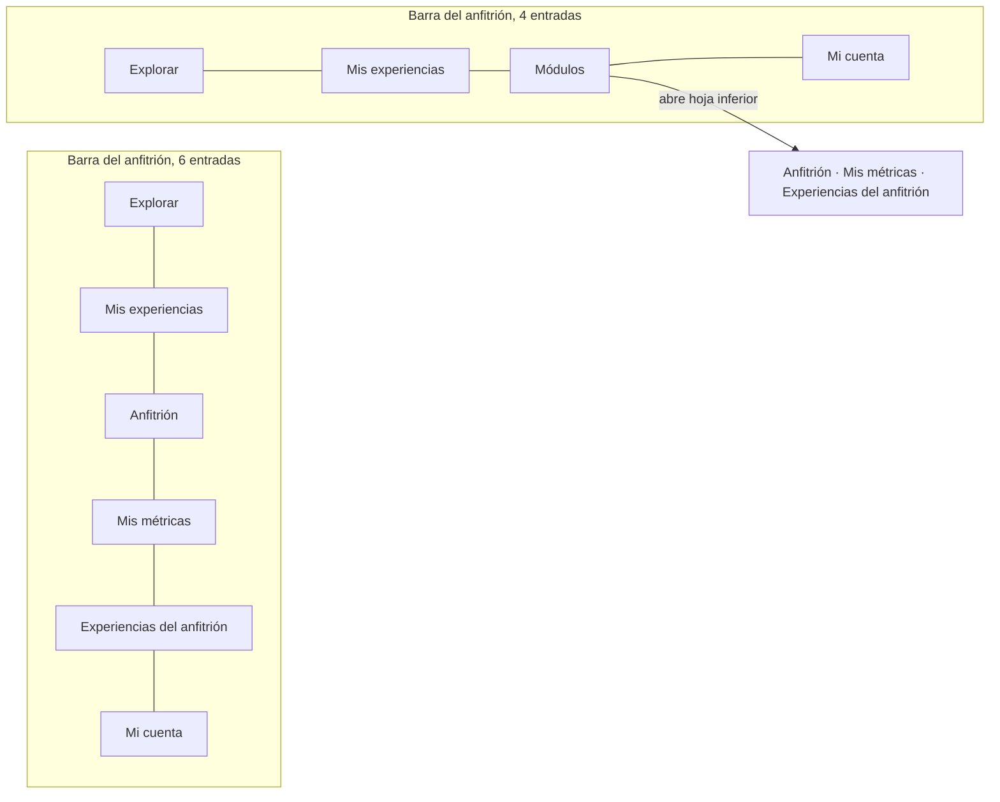

# ADR-0067: Agrupar los módulos del anfitrión y del gestor bajo «Módulos» en la barra móvil

- **Estado:** Aceptado (2026-11-11)
- **Proyecto / Módulo:** Intégrate · `frontend-pwa/` — `src/app/layouts` (`MobileShell`, `DesktopShell`, `AdminModules`, `roleNavigation`, `shell`); enmienda la Directiva 1.6 de `docs/rules/frontend-rules.md` (FE-DIR-001). Sin cambios de backend, de tokens ni de tipografías.
- **Fecha:** 2026-11-11
- **Trazabilidad:** observación del desarrollador del 2026-11-11 («el navbar de anfitriones tiene muchas cosas y en móvil se pierde; podemos agregar lo mismo que hicimos en admin: un módulo desplegable»); ADR-0044 y ADR-0045 (consola de administración con «Módulos»), ADR-0061 (operación del anfitrión y del gestor), ADR-0064 (anfitrión y gestor también son turistas), FE-DIR-001 Directiva 1.

## Contexto

Desde ADR-0061 y ADR-0064, la barra de navegación inferior del anfitrión tiene 6 entradas: Explorar, Mis experiencias, Anfitrión, Mis métricas, Experiencias del anfitrión y Mi cuenta. El gestor tiene otras 6 y una persona con ambos roles llegaría a 9. En el celular (320–480 px) esa barra no cabe: hoy se resuelve con desplazamiento horizontal (`overflow-x-auto`), así que las últimas entradas quedan fuera de la vista y el usuario no sabe que existen.

El administrador ya resolvió lo mismo en ADR-0044: su barra móvil muestra solo «Resumen», «Módulos» y «Mi cuenta», y «Módulos» abre una hoja inferior (`BottomSheet`) con el resto. Ese patrón está implementado en `AdminModules` y validado, pero cableado solo para la lista del administrador.

## Decisión

1. **Los módulos propios de un rol de zona se agrupan bajo «Módulos» en la barra móvil**, con el mismo patrón del administrador. La barra de quien tiene el rol de anfitrión o de gestor queda: **Explorar, Mis experiencias, Módulos y Mi cuenta** (4 entradas). Quien no tiene rol de zona no ve cambios.
2. **«Módulos» abre una hoja inferior** con las entradas del rol: para el anfitrión, «Anfitrión» (reservas), «Mis métricas» y «Experiencias del anfitrión»; para el gestor, «Jornada», «Validar QR» y «Anfitriones». Si la persona tiene ambos roles, la hoja agrupa las entradas bajo un encabezado por rol; con un solo rol no hay encabezado.
3. **«Módulos» se marca como activo** cuando la ruta actual pertenece a uno de sus módulos, y la hoja se cierra al elegir una entrada.
4. **Escritorio:** con un solo rol de zona no cambia (las 6 entradas caben en línea). Con ambos roles de zona se aplica la regla de la Directiva 1.6: la navegación agrupa los módulos bajo «Módulos» cuando el ancho no alcanza (por debajo de `xl`).
5. **Implementación:** se generaliza `AdminModules` para recibir las entradas, el título de la hoja y las rutas que activan el botón, de modo que el administrador conserve exactamente su comportamiento. Las entradas de cada rol salen de una sola definición (`roleNavigation`), sin duplicar rutas.
6. **Documentación:** se enmienda la Directiva 1.6 de FE-DIR-001 para que describa el patrón para todos los roles de zona, no solo para `/admin`.
7. **Calidad:** se cumplen los mismos requisitos de contraste, foco, tamaño táctil (≥ 44 × 44 px) y carga diferida. La prueba de rutas que lista los enlaces del anfitrión se actualiza a la nueva barra y se añaden pruebas del botón «Módulos», de la hoja y del estado activo. Se ejecutan los 5 comandos del Quality Gate (Directiva 7) y se verifica en 320–480 px.

## Alternativas descartadas

- **Mantener el desplazamiento horizontal:** es el problema actual; las entradas quedan ocultas.
- **Menú hamburguesa en la barra superior:** rompe la ubicación en la zona del pulgar que exige la Directiva 1 y sería un patrón distinto al del administrador.
- **Dejar «Anfitrión» visible en la barra y agrupar el resto:** la barra volvería a 5 entradas y a un tamaño táctil ajustado en 320 px; se prefiere la barra de 4 y un toque más para llegar a un módulo.
- **Un menú propio para el anfitrión y otro para el gestor:** duplica código; se reutiliza `AdminModules` generalizado.

## Consecuencias

- **Positivas:** la barra móvil cabe en 320 px y cada módulo es descubrible; un solo patrón para administrador, anfitrión y gestor; menos código duplicado.
- **Negativas / riesgos asumidos:** llegar a un módulo del anfitrión o del gestor cuesta un toque más; «Anfitrión» (reservas), que es la entrada más usada, deja de estar siempre visible. Si se quisiera lo contrario, se ajusta en una sola línea. Las pruebas de navegación existentes cambian de forma.

## Contrato o esquema conceptual

