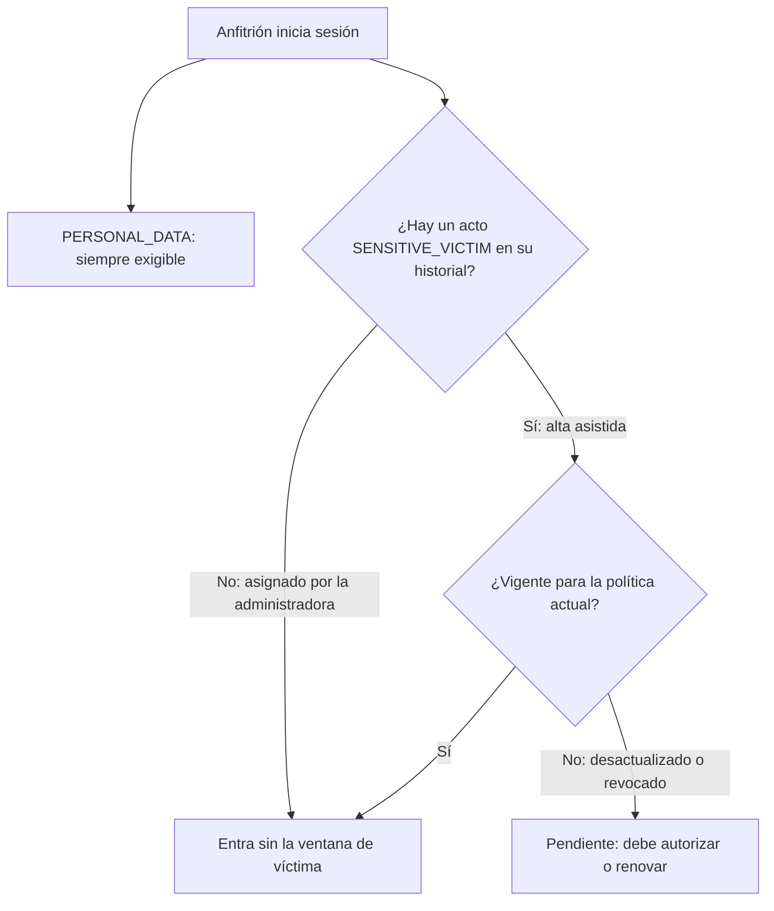

# ADR-0068: Exigir el consentimiento de datos de víctima solo a quien ya tiene constancia de él

- **Estado:** Aceptado (2026-11-11)
- **Proyecto / Módulo:** Intégrate · `backend-api/` — `modules/auth` (`ConsentLedger.requiredPurposes` y sus llamadores `SessionIssuer` y `ConsentServiceImpl`); `docs/api/openapi.yaml` (descripción de `pendingPurposes`). Enmienda ADR-0005 §7 y ADR-0064 §5. Sin migración Flyway y sin cambios de frontend: la PWA ya obedece `pendingPurposes`.
- **Fecha:** 2026-11-11
- **Trazabilidad:** hallazgo **H02** de la «Auditoría funcional de Intégrate» (2026-11-11); ADR-0005 §7 (finalidades exigidas por rol), ADR-0007 §3 (alta asistida con consentimiento físico), ADR-0013 (consentimiento en la PWA), ADR-0054 (aviso de salud), ADR-0064 §5 (consentimientos sin cambio), Ley 1581 de 2012 y Ley 1448 de 2011.

## Contexto

ADR-0005 §7 fijó que `requiredPurposes` es `PERSONAL_DATA` para todos y, además, `SENSITIVE_VICTIM` para quien tenga `ROLE_HOST`. La regla decide **solo por el rol**. Cuando se escribió, todo anfitrión nacía del alta asistida (ADR-0007), que siempre recoge ese consentimiento. Además del alta asistida, la administradora puede asignar el rol de anfitrión a una cuenta registrada por sí misma (`POST /admin/host-profiles`, ADR-0006 y ADR-0047), y esos anfitriones no tienen datos de víctima ni han dado ese consentimiento.

La auditoría lo comprobó en Hetzner: Rosalba, Hernán, Luz Mery, Ovidio y Fabio no pueden usar la aplicación porque la PWA exige autorizar «la condición de víctima del conflicto armado» y «No acepto» cierra la sesión. En los datos, solo José y María tienen registrada esa condición (`catalog.host_profiles.victim_condition_enc`); los otros cinco no. Pedir autorización para tratar un dato que no se trata contradice el principio de finalidad y de minimización de la Ley 1581, y deja sin acceso a quien no tiene por qué darlo.

Restricciones: una prueba de arquitectura (`ModuleBoundariesTest.authDoesNotDependOnCatalog`) prohíbe que `auth` dependa de `catalog`, de modo que el cálculo de consentimientos no puede leer el perfil del anfitrión; la condición de víctima está cifrada; y quien sí tiene datos de víctima debe seguir renovando su consentimiento cuando cambie la política.

## Decisión

1. **`SENSITIVE_VICTIM` es exigible a un anfitrión solo si ya existe en el historial de consentimientos de esa persona al menos un acto de esa finalidad**, en cualquier estado (vigente, desactualizado o revocado). `PERSONAL_DATA` sigue siendo exigible a todos.
2. **Dónde:** `ConsentLedger.requiredPurposes` recibe, además de los roles, las finalidades de las que el usuario tiene constancia. `ConsentLedger.status` ya recorre ese historial (`latest` por finalidad), por lo que no hace falta otra consulta ni depender de `catalog`.
3. **Efecto sobre los anfitriones sin datos de víctima** (asignados por la administradora): no tienen constancia, `pendingPurposes` queda sin `SENSITIVE_VICTIM` y pueden entrar y operar con solo `PERSONAL_DATA`.
4. **Efecto sobre los anfitriones del alta asistida** (con constancia): nada cambia. Si la política cambia, su consentimiento queda desactualizado y deben renovarlo.
5. **Quien revocó** el consentimiento sigue considerándose con constancia: queda pendiente como hoy. No se cambia ese comportamiento en este ADR.
6. **`applicablePurposes` no cambia:** `SENSITIVE_VICTIM` sigue siendo otorgable solo con `HOST`.
7. **Regla para el futuro:** toda vía que registre datos de víctima de una persona (hoy solo el alta asistida) debe insertar en la misma transacción el acto de consentimiento `SENSITIVE_VICTIM`. Sin ese acto, el dato quedaría tratado sin constancia.
8. **Documentación:** se anota en ADR-0005 §7 y en ADR-0064 §5 que este ADR reemplaza la parte «para `ROLE_HOST`» por la regla de constancia previa, y se ajusta la descripción de `pendingPurposes` en `openapi.yaml`.
9. **Pruebas:** unitarias de `ConsentLedger` (anfitrión sin constancia → solo `PERSONAL_DATA`; con constancia vigente → ninguna; con constancia desactualizada → `SENSITIVE_VICTIM`; con constancia revocada → `SENSITIVE_VICTIM`; turista, gestor y administrador sin cambio) y de integración del inicio de sesión y de `/me/consents` con Testcontainers. Se ejecutan las pruebas de arquitectura. Se repite con cuentas a las que sí les aplica (José y María) y a las que no (Rosalba, Hernán, Luz Mery, Ovidio y Fabio).

## Puntos de decisión para el desarrollador y para quien responda por lo legal

- **A. Validar la regla.** Confirmar que un anfitrión sin datos de víctima no necesita el consentimiento sensible. Este ADR lo propone por minimización de datos, pero no sustituye una revisión legal.
- **B. Revocación.** Hoy quien revoca queda obligado a volver a autorizar para seguir usando la app. ¿Debe poder seguir operando sin que se traten sus datos de víctima? Se deja fuera de este ADR.
- **C. Política legible.** El mensaje del consentimiento enlaza a una política que hoy apunta a una dirección que no existe (hallazgo **H01**). Para que la persona pueda conocer la política antes de decidir, H01 debe resolverse; este ADR no lo hace.

## Alternativas descartadas

- **Leer la condición de víctima del perfil del anfitrión:** es la fuente de verdad, pero está cifrada y vive en `catalog`; `auth` tendría que depender de `catalog` y descifrar en cada inicio de sesión. Lo prohíbe `authDoesNotDependOnCatalog`.
- **Dejar de exigir `SENSITIVE_VICTIM` a todos:** deja de renovar el consentimiento de las víctimas cuando cambia la política, que es justamente lo que ADR-0007 y la Ley 1448 piden proteger.
- **Dejar la regla y mejorar solo el mensaje:** sigue bloqueando a quien no tiene esos datos, que es el problema de H02.
- **Una columna nueva en `auth.users` con el indicador:** duplica un dato sensible en claro y exige una migración; el historial de consentimientos ya dice lo mismo.

## Consecuencias

- **Positivas:** los 5 anfitriones bloqueados recuperan el acceso; se pide autorización solo cuando existe tratamiento de datos de víctima; no hay migración, ni cambios de frontend, ni dependencias nuevas entre módulos.
- **Negativas / riesgos asumidos:** la exigencia pasa a depender de que cada vía que registre datos de víctima inserte su consentimiento (decisión 7); hoy solo hay una. El alta asistida registra siempre ambas finalidades, así que un anfitrión asistido que declara no ser víctima también tiene constancia y seguirá renovándola. Las sesiones abiertas de los anfitriones bloqueados necesitan un nuevo inicio de sesión o una consulta de `/me/consents` para dejar de ver la ventana.

## Contrato o esquema conceptual

