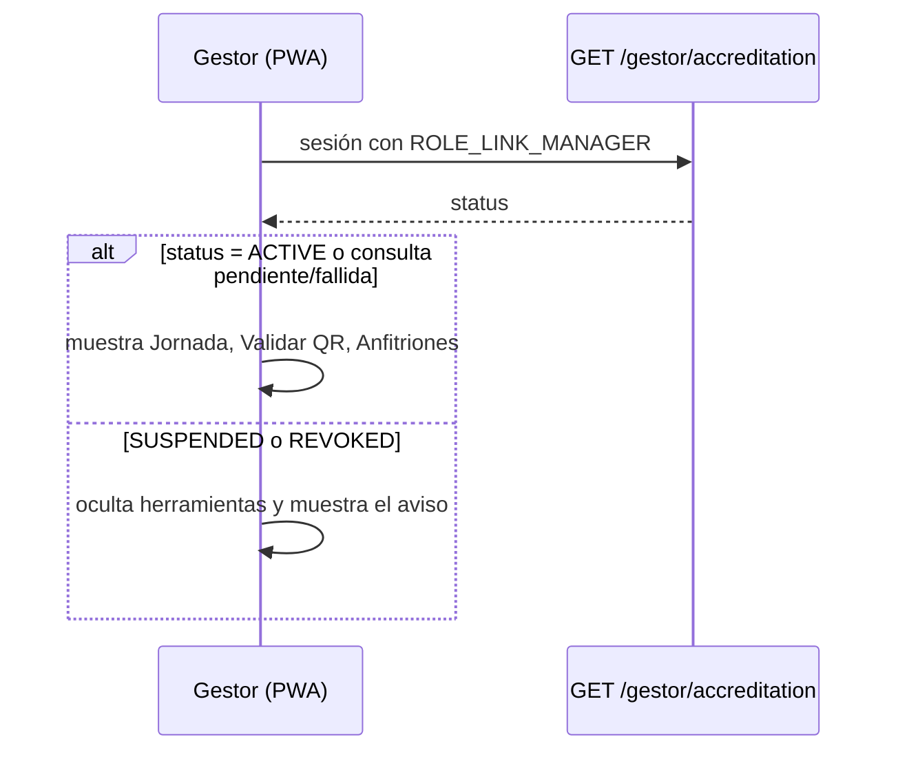

# ADR-0069: Mostrar el estado de la acreditación del gestor en la navegación

- **Estado:** Aceptado (2026-11-11)
- **Proyecto / Módulo:** Intégrate · `backend-api/` — `modules/catalog` (`GestorController`, servicio de lectura del estado) y `docs/api/` (`openapi.yaml`, `endpoints-index.md`); `frontend-pwa/` — `src/app/layouts` (`roleNavigation`, shells) y `features/enrollment`. Sin migración Flyway.
- **Fecha:** 2026-11-11
- **Trazabilidad:** hallazgo **H03** de la «Auditoría funcional de Intégrate» (2026-11-11); ADR-0007 (acreditación del gestor), ADR-0061 (operación del gestor), ADR-0067 (menú «Módulos»), `LinkManagerAdminServiceImpl.changeStatus`.

## Contexto

La acreditación de un gestor tiene tres estados: `ACTIVE`, `SUSPENDED` y `REVOKED`. Por diseño, solo revocar quita el rol `LINK_MANAGER`; suspender lo conserva y deja que el servidor rechace las operaciones del gestor suspendido (`ENROLLMENT_MANAGER_NOT_ACTIVE`). La sesión solo lleva los roles, y la barra de navegación se arma con ellos.

El resultado, que la auditoría comprobó con el gestor Jhon (suspendido): Administración lo muestra como «Suspendido», pero la PWA le sigue ofreciendo Jornada, Validar QR, Anfitriones y Enrolar anfitrión, y al abrir «Anfitriones» recibe un rechazo sin explicación. No es un fallo de seguridad (el servidor niega), es un fallo de claridad.

Restricción: `ModuleBoundariesTest.authDoesNotDependOnCatalog` impide que `auth` conozca el estado de la acreditación, que vive en `catalog`; por eso no puede viajar en la sesión sin un mecanismo nuevo entre módulos.

## Decisión

1. **Nuevo endpoint `GET /api/v1/gestor/accreditation`** en `GestorController`, para quien tenga `ROLE_LINK_MANAGER`. Responde `200 { "status": "ACTIVE" | "SUSPENDED" | "REVOKED", "accreditedOn": "YYYY-MM-DD" }`, sin caché. Funciona también con la acreditación suspendida o revocada (con un token que aún trae el rol): es justamente la consulta que debe poder hacerse.
2. **La PWA consulta ese estado** (React Query) solo cuando la sesión tiene `ROLE_LINK_MANAGER`. Si el estado no es `ACTIVE`:
   - la navegación oculta las entradas del gestor (Jornada, Validar QR, Anfitriones) y conserva Explorar, Mis experiencias y Mi cuenta;
   - las rutas de `/gestor` muestran un aviso claro («Tu acreditación está suspendida» o «revocada. Comunícate con la administradora»), en lugar del rechazo genérico.
3. **Mientras se consulta, o si la consulta falla (por ejemplo, sin conexión), se muestran las herramientas como hoy.** Un gestor en campo sin red no debe perder su operación por una consulta fallida; el servidor sigue siendo quien niega.
4. **El rechazo del servidor no cambia:** las consultas restringidas siguen respondiendo `ENROLLMENT_MANAGER_NOT_ACTIVE`. La interfaz solo explica y oculta.
5. **Vigencia:** el estado se considera fresco 5 minutos y se vuelve a consultar al iniciar sesión.
6. **Documentación y pruebas:** se actualizan `openapi.yaml` y `endpoints-index.md`. Pruebas de integración del endpoint (activo, suspendido y revocado con token aún válido; rol ajeno rechazado) y de la PWA (la barra oculta las entradas y muestra el aviso con estado suspendido; no las oculta mientras consulta ni ante un error de red). Se ejecutan las pruebas de arquitectura y el Quality Gate.

## Alternativas descartadas

- **Revocar el rol también al suspender:** el menú desaparecería solo, pero se pierde el aviso, se confunde la suspensión (reversible) con la revocación (definitiva) y se contradice el diseño de `changeStatus`.
- **Poner el estado en la sesión:** exige que `auth` conozca `catalog` (prohibido) o un puerto nuevo entre módulos, mucho más ancho que el problema.
- **Dejar todo como está:** el gestor suspendido sigue viendo herramientas que no puede usar, sin saber por qué.

## Consecuencias

- **Positivas:** el gestor suspendido entiende su situación; la barra deja de ofrecer lo que no puede usar; sin migración ni cambios en `auth`.
- **Negativas / riesgos asumidos:** una consulta más al entrar un gestor; hasta 5 minutos de desfase si la acreditación cambia con la sesión abierta (el servidor ya rechaza en ese lapso); si la consulta falla, la barra muestra las herramientas aunque el estado sea suspendido (se acepta a favor de la operación en campo).

## Contrato o esquema conceptual

