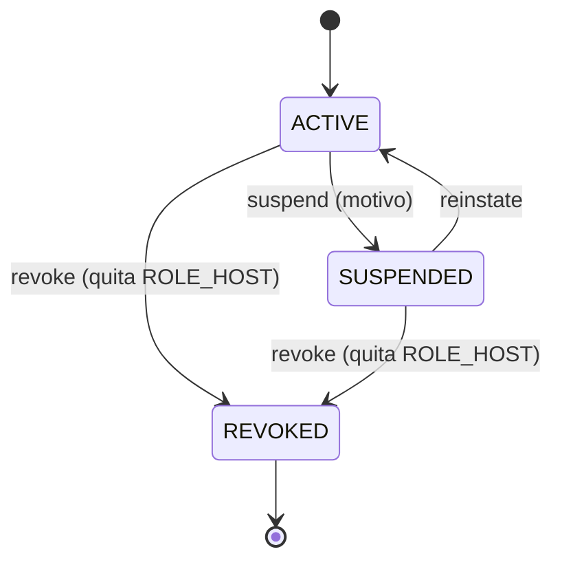

# ADR-0070: Suspender, reactivar y revocar a un anfitrión

- **Estado:** Aceptado (2026-11-11)
- **Proyecto / Módulo:** Intégrate · `backend-api/` — `modules/catalog` (`HostProfile`, servicio de administración de anfitriones, `AdminPeopleController` o un controlador nuevo, `HostExperienceController`), migración Flyway **V21**, `docs/api/`; `frontend-pwa/` — `features/admin` (Personas → Anfitriones) y la navegación del anfitrión.
- **Fecha:** 2026-11-11
- **Trazabilidad:** observación de la «Auditoría funcional de Intégrate» (2026-11-11, caso Fabio) y hallazgo de la carga de datos de demostración («retirar una experiencia no cancela sus reservas»); ADR-0007 (acreditación del gestor, mismo ciclo de vida), ADR-0057 (acciones de personas en hoja emergente), ADR-0064 (anfitrión también es turista), ADR-0069 (estado del gestor en la navegación).

## Contexto

Hoy el administrador puede **crear** un perfil de anfitrión (`POST /admin/host-profiles`) y suspender su asociación, pero no existe ninguna forma de **suspender, reactivar o revocar** a un anfitrión. Un anfitrión que sale de la plataforma conserva el rol `HOST`, su menú de anfitrión y su capacidad de crear experiencias y franjas. La auditoría lo vio con Fabio: figura «dado de baja» en los datos de demostración, pero su cuenta no se desactivó; solo se retiró su experiencia y se suspendió su asociación.

El gestor sí tiene ese ciclo (`ACTIVE`, `SUSPENDED`, `REVOKED`, ADR-0007): solo la revocación quita el rol y la suspensión se aplica rechazando sus operaciones. El perfil del anfitrión tiene un borrado lógico (`deleted_at`), pero no un estado, y no hay endpoint que lo use para una baja.

Restricciones: la cuenta no se borra físicamente (trazabilidad y auditoría encadenada, ADR-0035); `auth` no puede depender de `catalog`; y las reservas confirmadas representan dinero y personas, por lo que no se tocan sin una decisión expresa.

## Decisión

1. **Estado del anfitrión.** Se agrega `catalog.host_profiles.status` (`ACTIVE`, `SUSPENDED`, `REVOKED`; por defecto `ACTIVE`) con la migración **V21**, con las mismas transiciones del gestor: `ACTIVE ↔ SUSPENDED` y cualquiera → `REVOKED` (final).
2. **Endpoints de administración** (rol `ADMIN`, con motivo obligatorio: a diferencia de los endpoints equivalentes del gestor, que no piden motivo, aquí se exige y queda en la auditoría): `POST /api/v1/admin/host-profiles/{id}/suspend`, `.../reinstate` y `.../revoke`. Cada cambio queda en la auditoría.
3. **Efecto en el servidor.**
   - Con el perfil `SUSPENDED` o `REVOKED`, las operaciones de `HostExperienceController` (crear, editar, enviar a revisión, gestionar franjas) responden 403 `CATALOG_HOST_NOT_ACTIVE`.
   - **Revocar** además quita `ROLE_HOST` (`ROLE_TOURIST` se conserva, ADR-0064). **Suspender** conserva el rol, como con el gestor.
   - Un anfitrión suspendido o revocado deja de aparecer con nuevas franjas reservables en el catálogo público.
4. **Estado visible para el anfitrión.** `GET /api/v1/host/status` (rol `HOST`) con el mismo contrato y la misma conducta de la PWA que el ADR-0069: con estado distinto de `ACTIVE`, la navegación oculta el panel y las rutas muestran el aviso.
5. **Administración.** En Personas → Anfitriones se agregan las acciones Suspender, Reactivar y Revocar con confirmación y motivo, con el patrón de hoja emergente del ADR-0057.
6. **Reservas existentes: no se tocan automáticamente.** Una baja no cancela reservas confirmadas ni franjas con reservas; queda registrado como decisión pendiente (punto B).
7. **Documentación y pruebas.** `openapi.yaml`, `endpoints-index.md` y el modelo relacional. Pruebas de integración (transiciones válidas e inválidas con 409, rol ajeno con 403, el anfitrión suspendido no puede crear experiencias, la revocación quita `ROLE_HOST` y conserva `ROLE_TOURIST`), de arquitectura y de la PWA. Quality Gate completo.

## Puntos de decisión para el desarrollador

- **A. ¿Cascada con la asociación?** Hoy suspender una asociación no afecta a sus anfitriones. ¿Debe suspenderlos también, o se mantiene la baja de cada anfitrión como acto propio? Este ADR propone mantenerlos independientes.
- **B. Reservas y experiencias del anfitrión dado de baja.** ¿Se cancelan automáticamente sus reservas confirmadas con reembolso, se avisa a las turistas, o se resuelve a mano? Es un cambio de reglas de dinero (ADR-0034) y merece su propio ADR; aquí se deja fuera.
- **C. Experiencias publicadas.** ¿Pasan a `SUSPENDED` al suspender al anfitrión, o basta con ocultar sus franjas nuevas? El ADR propone ocultar las franjas nuevas y no cambiar el estado de las experiencias.

## Alternativas descartadas

- **Usar `deleted_at` como baja:** no distingue suspensión (reversible) de revocación y no deja motivo ni historial de transiciones.
- **Solo revocar el rol, sin estado:** no hay suspensión reversible ni motivo, y el perfil seguiría activo en el catálogo.
- **Borrar al usuario:** prohibido por trazabilidad y por la auditoría encadenada.
- **Cancelar reservas dentro de este ADR:** mezcla dos decisiones de naturaleza distinta (ciclo de vida de la cuenta y reglas de dinero).

## Consecuencias

- **Positivas:** una baja de anfitrión deja de ser un trámite incompleto; se pierde el acceso operativo con motivo y auditoría; el ciclo es el mismo que el del gestor, por lo que el código y la interfaz se reutilizan.
- **Negativas / riesgos asumidos:** una migración y tres endpoints nuevos; las reservas confirmadas de un anfitrión dado de baja siguen vigentes hasta que se decida el punto B; mientras tanto, un anfitrión suspendido sigue siendo dueño de franjas ya reservadas que no puede gestionar.

## Contrato o esquema conceptual

