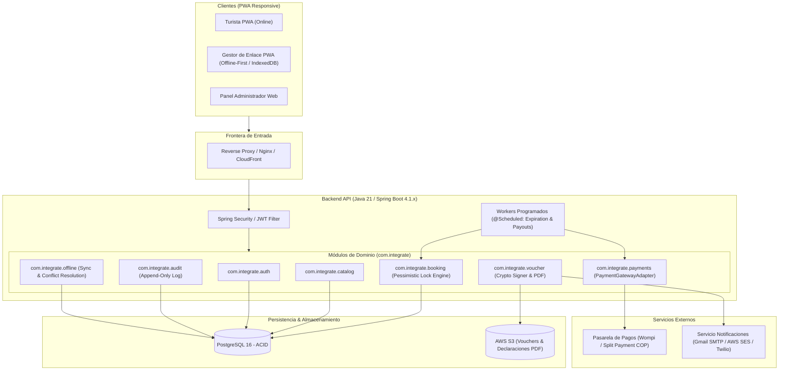

# Especificación Técnica de Requerimientos del Sistema Intégrate

**Proyecto:** Intégrate – Plataforma Transaccional de Turismo Comunitario  
**Versión:** 1.0.0  
**Fecha:** Octubre 2026  
**Estado:** Aprobado / Consolidado  
**Autores Técnicos:** Lead Software Architect & Senior Technical Project Manager  

---

## 1. Visión General y Alcance del Producto

### 1.1 Propósito del Sistema
**Intégrate** es un sistema web transaccional con arquitectura *offline-first* diseñado para digitalizar, estructurar, comercializar y proteger la cadena de valor del turismo comunitario, agroturismo y senderismo de memoria histórica liderado por colectivos de víctimas del conflicto armado interno y comunidades en condición de vulnerabilidad o desplazamiento en Colombia (amparadas bajo la Ley 1448 de 2011).

La plataforma erradica la sobreventa de cupos (*overbooking*) en senderos de conservación y reservas ecológicas con capacidad de carga ambiental limitada, mitiga la pérdida de ingresos y cancelaciones imprevistas mediante la automatización de la dispersión de fondos (*split payment* en COP) con custodia temporal (*escrow*), y habilita la operación y validación de visitas en territorios rurales sin conectividad celular a través de una figura comunitaria de intermediación asistida (*Gestor de Enlace Comunitario*) y una Aplicación Web Progresiva (PWA).

### 1.2 Actores Clave del Sistema
1. **Turista (Nacional / Internacional):** Usuario final que consulta el catálogo, selecciona fechas/franjas horarias, bloquea cupos atómicamente, suministra información médica y de contacto de emergencia, ejecuta el pago en línea en COP y recibe un voucher criptográfico en formato PDF/QR.
2. **Anfitrión Comunitario (Prestador Local):** Miembro de la comunidad campesina o víctima que acoge a los visitantes y presta la experiencia (guianza, gastronomía tradicional, talleres de memoria). Opera de forma autónoma o asistida.
3. **Gestor de Enlace Comunitario (Proxy Digital Local):** Líder comunitario acreditado formalmente por la Asociación, dotado de dispositivo móvil y competencias digitales básicas. Actúa como intermediario operativo para registrar propuestas de experiencias a nombre de anfitriones sin conectividad, descargar padrones locales de vouchers y validar asistencias en campo en modo 100% desconectado (*offline*).
4. **Asociación Comunitaria de Turismo:** Figura asociativa legal (Junta de Acción Comunal, Cooperativa Campesina o Asociación de Víctimas) titular del NIT y Registro Nacional de Turismo (RNT sombrilla), receptora colectiva de los desembolsos netos (85%) de la dispersión financiera.
5. **Administrador de la Plataforma:** Personal técnico y administrativo responsable de moderar y autorizar experiencias en catálogo, supervisar la auditoría legal de datos sensibles (Ley 1581 de 2012), gestionar contingencias de sincronización offline y conciliar dispersiones de pago.
6. **Sistemas Secundarios Externos:**
   - **Pasarela de Pagos / Split Payment:** Servicio financiero regulado por la Superintendencia Financiera de Colombia (adaptador Wompi / ePayco) para procesamiento multicanal (PSE, tarjetas, Nequi, Daviplata) y dispersión automatizada de fondos.
   - **Servicio de Notificaciones Transaccionales:** Orquestador omnicanal con prioridad en despacho formal por correo electrónico (Gmail API / AWS SES) y respaldo complementario vía WhatsApp/SMS (Twilio).

### 1.3 Límites del Producto (Dentro y Fuera del Alcance)

#### Dentro del Alcance (In-Scope)
- Gestión de identidades y control de acceso basado en roles (RBAC) para 4 roles de usuario.
- Captura y auditoría inmutable del consentimiento informado de Habeas Data (Ley 1581 de 2012 y Decreto 1377 de 2013) con anonimización y cifrado de datos sensibles (estatus de víctima).
- Catálogo territorial de experiencias con parametrización de capacidad de carga y franjas horarias.
- Motor de reservas transaccional con control de concurrencia pesimista en PostgreSQL (`SELECT ... FOR UPDATE`) y control de tiempo de vida (TTL de 15 minutos).
- Generación de vouchers criptográficos intransferibles firmados asimétricamente (JWT con RSA-256 o Ed25519) empacados en códigos QR y exportables a PDF.
- PWA *Offline-First* con almacenamiento local en IndexedDB y Service Workers para consulta local y validación en campo sin red.
- Descarga preventiva diaria de padrón de vouchers y delta de revocación local.
- Sincronización en segundo plano (*Background Sync*) y resolución determinista de conflictos contables que protege irrenunciablemente el 85% de la comunidad.
- Integración desacoplada con pasarela de pagos colombiana mediante `PaymentGatewayAdapter` (Mock en MVP / Pasarela regulada en prod) para cobro y dispersión (85% anfitrión/asociación, 15% plataforma).
- Política de cancelación automatizada (>72h: 85% turista / 15% plataforma; $\le$72h o No-Show: 0% turista / 85% anfitrión).

#### Fuera del Alcance (Out-of-Scope)
- Emisión, tarificación o intermediación directa de pólizas de seguro de asistencia médica (el sistema únicamente captura datos de EPS y contacto de emergencia del turista).
- Contratación, asignación de rutas o intermediación logística de transporte intermunicipal, aéreo o fluvial hacia las veredas.
- Captación masiva o custodia directa de fondos financieros en cuentas bancarias propias de Intégrate (el *escrow* y la dispersión se delegan en la pasarela de pagos vigilada).
- Control de inventario físico y despacho postal de productos tangibles no turísticos (artesanías, cosechas a granel).
- Algoritmos avanzados de georreferenciación y optimización de rutas en tiempo real satelital.

---

## 2. Requerimientos Funcionales (RF)

A continuación se especifican los 20 requerimientos funcionales del sistema, trazados de forma directa con los Casos de Uso CU-01 a CU-20 del sistema.

### Módulo: Gestión de Identidad, RBAC y Privacidad (CU-01, CU-02, CU-17)

#### RF-01: Autenticación de Usuarios y Control de Sesión
- **Caso de Uso:** CU-01
- **Descripción:** El sistema debe autenticar de forma segura a cualquier actor (Turista, Gestor de Enlace, Anfitrión, Administrador) mediante correo electrónico y contraseña hasheada, emitiendo un token criptográfico JSON Web Token (JWT) con sus respectivos roles y claims de autorización.
- **Criterios de Aceptación (Gherkin):**
  ```gherkin
  Escenario: Inicio de sesión exitoso
    Dado que un usuario registrado ingresa su correo electrónico válido y contraseña correcta
    Cuando envía la solicitud de autenticación al endpoint /api/v1/auth/login
    Entonces el sistema responde con código HTTP 200 OK
    Y retorna un access token JWT firmado con RS256 con expiración de 15 minutos (900 s)
    Y emite un refresh token rotativo de 7 días en una cookie HttpOnly, Secure y SameSite=Strict
    Y el payload del token contiene el ID de usuario y el arreglo de sus roles vigentes (RBAC).

  Escenario: Bloqueo por credenciales inválidas
    Dado que un usuario ingresa una contraseña errónea
    Cuando se superan 5 intentos fallidos consecutivos en menos de 10 minutos
    Entonces el sistema bloquea temporalmente la cuenta por 15 minutos y retorna código HTTP 423 Locked.
  ```
- **Casos Límite y Manejo de Errores:**
  - Envío de contraseñas con caracteres nulos o payloads maliciosos $\rightarrow$ Validación y sanitización estricta retornando HTTP 400 Bad Request.
  - Expiración de refresh token $\rightarrow$ Cierre de sesión y retorno de HTTP 401 Unauthorized forzando nuevo login.
  - El refresh token se rota en cada uso (`/api/v1/auth/refresh`); el anterior queda revocado con `replaced_by_id`.

#### RF-02: Captura y Auditoría de Consentimiento Habeas Data (Ley 1581 de 2012)
- **Caso de Uso:** CU-02
- **Descripción:** Durante el registro o en la primera interacción transaccional, el sistema debe recolectar la aceptación explícita de la política de tratamiento de datos personales y sensibles (declaración de condición de víctima o datos médicos), persistiendo una traza inmutable en base de datos.
- **Criterios de Aceptación (Gherkin):**
  ```gherkin
  Escenario: Captura obligatoria de consentimiento informado
    Dado que un turista o anfitrión se registra en la plataforma
    Cuando visualiza el modal con el texto de la política de privacidad v1.0
    Y selecciona el checkbox obligatorio de aceptación expresa
    Entonces el sistema registra en la tabla inmutable de auditoría: user_id, policy_version, timestamp_utc, ip_address y user_agent
    Y permite al usuario continuar con el uso del sistema.

  Escenario: Rechazo de política de datos
    Dado que el usuario no marca la aceptación de la política de datos
    Cuando intenta enviar el formulario de registro
    Entonces el sistema bloquea el registro con HTTP 422 Unprocessable Entity y un mensaje explicativo.
  ```
- **Casos Límite y Manejo de Errores:**
  - Actualización de versión de la política (ej. de v1.0 a v1.1) $\rightarrow$ El sistema detecta en el próximo login que el usuario no ha firmado la última versión y exige revalidación antes de transar.
  - Cifrado en reposo $\rightarrow$ Los campos relativos a condición de víctima o EPS deben cifrarse con AES-256 en la base de datos.

#### RF-03: Gestión y Asignación de Roles RBAC
- **Caso de Uso:** CU-17
- **Descripción:** El Administrador de la Plataforma debe ser el único facultado para modificar roles, suspender identidades y asignar anfitriones a la jurisdicción operativa de un Gestor de Enlace Comunitario.
- **Criterios de Aceptación:**
  - El sistema solo expone los endpoints de gestión de roles a identidades que porten el claim `ROLE_ADMIN`.
  - La vinculación de un `Anfitrion` a un `GestorEnlace` debe validar que ambos pertenezcan o estén avalados por la misma `AsociacionComunitaria`.
- **Manejo de Errores:** Retorno de HTTP 403 Forbidden si cualquier usuario no administrador intenta modificar privilegios.

---

### Módulo: Catálogo Territorial y Gestión Asistida (CU-03, CU-04, CU-05, CU-06, CU-18)

#### RF-04: Consulta de Catálogo Territorial y Aforos Disponibles
- **Caso de Uso:** CU-06
- **Descripción:** Los turistas y gestores de enlace podrán consultar y filtrar el catálogo público de experiencias activas (por región, dificultad física, comunidad anfitriona y franja de fechas), visualizando en tiempo real los cupos disponibles por cada franja horaria.
- **Criterios de Aceptación (Gherkin):**
  ```gherkin
  Escenario: Consulta pública del catálogo con aforo en tiempo real
    Dado que un turista accede a la sección de experiencias
    Cuando filtra por fecha y región geográfica
    Entonces el sistema devuelve únicamente experiencias con estado "APPROVED"
    Y por cada experiencia lista las franjas horarias con su capacidad de carga máxima y los cupos restantes disponibles.
  ```
- **Casos Límite y Manejo de Errores:**
  - Franja horaria agotada (cupos restantes = 0) $\rightarrow$ La interfaz debe inhabilitar el botón de reserva y mostrar el estado "Agotado", impidiendo peticiones al backend.

#### RF-05: Registro Autónomo de Propuesta de Experiencia
- **Caso de Uso:** CU-03
- **Descripción:** Un Anfitrión Comunitario que cuente con autonomía digital puede registrar una propuesta de experiencia turística detallando nombre, descripción etnocultural, capacidad de carga máxima por franja, recomendaciones de seguridad y tarifa en COP. La propuesta nace en estado `DRAFT` o `PENDING_REVIEW`.
- **Criterios de Aceptación:**
  - Validación de campos requeridos: aforo máximo $\ge 1$ y $\le 30$ personas (límite ambiental de sendero), precio en COP $> 0$.
  - La experiencia no se publica en el catálogo público hasta que cumpla el flujo de revisión (CU-05).

#### RF-06: Registro Asistido de Experiencia por Gestor de Enlace
- **Caso de Uso:** CU-04
- **Descripción:** El Gestor de Enlace puede registrar experiencias comunitarias y calendarios de disponibilidad en representación de uno o varios anfitriones de su comunidad que no posean conectividad o alfabetización digital.
- **Criterios de Aceptación:**
  - El Gestor debe seleccionar obligatoriamente al Anfitrión titular adscrito.
  - El sistema almacena una traza de auditoría que identifica al Gestor como creador técnico del registro y al Anfitrión como prestador y beneficiario económico.

#### RF-07: Revisión y Autorización de Experiencia Local
- **Caso de Uso:** CU-05
- **Descripción:** Flujo de moderación y aprobación donde el Gestor de Enlace y/o el Administrador de Plataforma validan la viabilidad técnica, capacidad de carga ecológica y aval asociativo antes de cambiar el estado de la experiencia a `APPROVED`.
- **Criterios de Aceptación:**
  - Solo las experiencias con estado `APPROVED` se indexan en el motor de búsqueda y catálogo de turistas.
  - Si una propuesta es rechazada, se debe almacenar obligatoriamente el motivo del rechazo para retroalimentación comunitaria.

#### RF-08: Moderación del Catálogo y Suspensión Preventiva
- **Caso de Uso:** CU-18
- **Descripción:** El Administrador puede suspender temporal o definitivamente una experiencia aprobada ante alertas climáticas, cierres ambientales de reservas o quejas comunitarias reiteradas.
- **Criterios de Aceptación:**
  - Al suspender una experiencia (`SUSPENDED`), sus franjas futuras quedan bloqueadas para nuevas reservas. Las reservas confirmadas previas entran en flujo de contingencia y notificación inmediata a los turistas afectados.

---

### Módulo: Motor de Reservas Concurrente y Bloqueo de Aforo (CU-07, CU-08)

#### RF-09: Bloqueo Pesimista de Aforo con Concurrencia Estricta
- **Caso de Uso:** CU-07
- **Descripción:** Cuando un turista inicia el checkout, el sistema debe ejecutar una transacción atómica ultrarrápida (< 200 ms) en PostgreSQL adquiriendo un bloqueo pesimista a nivel de fila (`SELECT ... FOR UPDATE`) sobre la franja horaria (`schedule`), verificar disponibilidad de cupos, debitar los cupos solicitados y generar una reserva en estado `PENDING` con fecha límite de pago `expires_at = NOW() + 15 minutos`.
- **Criterios de Aceptación (Gherkin):**
  ```gherkin
  Escenario: Bloqueo pesimista exitoso sin colisión
    Dado que existen 4 cupos disponibles para la franja horaria F1
    Cuando el turista solicita reservar 2 cupos
    Entonces el backend abre transacción, ejecuta SELECT ... FOR UPDATE sobre F1
    Y verifica que 2 <= cupos_disponibles
    Y descuenta los cupos (disponibles = 2)
    Y crea la reserva R1 con estado PENDING y expires_at en 15 minutos
    Y hace commit liberando el lock de base de datos en menos de 200 ms.

  Escenario: Rechazo por sobreventa en alta concurrencia (Tasa 0% Overbooking)
    Dado que quedan 2 cupos disponibles para la franja F1
    Cuando dos turistas intentan reservar simultáneamente 2 cupos cada uno en el mismo milisegundo
    Entonces el primer hilo toma el lock y completa la reserva
    Y el segundo hilo es puesto en espera transaccional, lee el aforo actualizado (0 cupos)
    Y el sistema rechaza su solicitud con código HTTP 409 Conflict y mensaje "Cupos insuficientes".
  ```
- **Casos Límite:** Solicitud de 0 o números negativos de cupos $\rightarrow$ Rechazo con HTTP 400.

#### RF-10: Reserva de Experiencia y Captura de Datos Médicos
- **Caso de Uso:** CU-08
- **Descripción:** El turista debe formalizar la reserva asociando su identificación civil (CC, CE, PA, PPT), nombre de EPS/seguro médico y nombre/teléfono de un contacto de emergencia familiar obligatorio antes de proceder a la pasarela de pago.
- **Criterios de Aceptación:**
  - El sistema no permite transicionar a la pasarela de pago si los campos de contacto de emergencia y EPS están vacíos.

#### RF-11: Expiración Automática de Cupos por TTL (Worker de Expiración)
- **Caso de Uso:** Derivado de CU-07 y Proceso 2
- **Descripción:** Un worker asíncrono programado (`@Scheduled` en Spring Boot) debe ejecutarse periódicamente (cada 60 segundos) para auditar las reservas en estado `PENDING` cuyo `expires_at` haya sido superado sin confirmación de pago.
- **Criterios de Aceptación:**
  - El worker selecciona las reservas vencidas bajo transacción, actualiza su estado a `EXPIRED` y restituye los cupos reservados a la columna `available_slots` de la franja horaria correspondiente.
  - La restitución debe ser atómica y emitir logs estructurados de auditoría.

---

### Módulo: Pagos, Split Payment y Políticas Financieras (CU-09, CU-11, CU-12, CU-13)

#### RF-12: Procesamiento de Pago y Split Payment Desacoplado
- **Caso de Uso:** CU-09
- **Descripción:** El sistema se comunica con el adaptador de pagos (`PaymentGatewayAdapter` mockeado en MVP y conector Wompi/ePayco en prod) para cobrar en COP mediante PSE, tarjetas o billeteras (Nequi/Daviplata). Al confirmarse el pago mediante webhook idempotente, el sistema calcula la dispersión: 85% para el anfitrión/asociación y 15% de comisión para la plataforma, manteniendo los fondos en custodia temporal (*escrow*).
- **Criterios de Aceptación (Gherkin):**
  ```gherkin
  Escenario: Procesamiento exitoso de Webhook de Pasarela
    Dado que existe una reserva en estado PENDING por valor de $100.000 COP
    Cuando la pasarela emite un webhook POST /api/v1/payments/webhook con firma criptográfica válida y estado "APPROVED"
    Entonces el sistema verifica la firma HMAC del webhook
    Y verifica que la transacción no haya sido procesada previamente (idempotencia)
    Y transiciona el estado de la reserva a "CONFIRMED"
    Y crea el registro de split payment: $85.000 COP para la Asociación y $15.000 COP para Intégrate
    Y dispara la generación asíncrona del voucher criptográfico.
  ```
- **Casos Límite y Manejo de Errores:**
  - Recepción de webhook duplicado $\rightarrow$ El sistema detecta el identificador de transacción existente en la tabla `payments` y responde inmediatamente HTTP 200 OK sin duplicar registros ni emitir doble voucher.
  - Pago rechazado o declinado $\rightarrow$ Se actualiza el pago a `REJECTED`, la reserva a `PAYMENT_FAILED` y se liberan de inmediato los cupos.

#### RF-13: Cancelación de Reserva y Liquidación de Reembolso Anticipado (> 72h)
- **Caso de Uso:** CU-11 y CU-12
- **Descripción:** Si el turista cancela formalmente su reserva con más de 72 horas de anticipación a la fecha de inicio de la experiencia ($\Delta t > 72\text{ h}$), el sistema liquida un reembolso del 85% del valor pagado al turista y retiene el 15% como comisión operativa de la plataforma.
- **Criterios de Aceptación:**
  - El sistema calcula la diferencia horaria estricta en UTC: $\Delta t = T_{\text{inicio}} - T_{\text{cancelación}}$.
  - Si $\Delta t > 72.0\text{ horas}$: Reserva pasa a `CANCELLED_REFUNDED`. Se ordena el reembolso del 85% a la pasarela y los cupos se reintegran al catálogo público.

#### RF-14: Liquidación de Retención Comunitaria ($\le$ 72h o No-Show)
- **Caso de Uso:** CU-13
- **Descripción:** Si el turista cancela con 72 horas o menos de anticipación ($\Delta t \le 72\text{ h}$) o no asiste a la experiencia (No-Show), el turista recibe un 0% de reembolso. El 85% del valor total se liquida íntegramente a favor del Anfitrión Comunitario/Asociación para cubrir la compra previa de insumos perecederos y jornales contratados.
- **Criterios de Aceptación:**
  - Reserva cancelada pasa a `CANCELLED_NO_REFUND`. El registro de dispersión del 85% se programa para liberación a la comunidad.
  - El 15% de comisión operativa queda retenido a favor de la plataforma.

---

### Módulo: Vouchers Criptográficos y Operación Territorial Offline (CU-10, CU-14, CU-15, CU-16, CU-19)

#### RF-15: Emisión de Voucher Criptográfico y Notificación Multicanal
- **Caso de Uso:** CU-10
- **Descripción:** Al confirmarse el pago, el backend genera un token digital compacto firmado asimétricamente (JWT con RSA-256 o Ed25519) con los datos del viaje (ID reserva, ID experiencia, titular, documento, cupos, fecha, vigencia). Este token se codifica en un código QR de alta densidad embebido en un PDF oficial almacenado en AWS S3 y enviado al correo Gmail del turista (con notificación complementaria vía WhatsApp/SMS).
- **Criterios de Aceptación:**
  - El payload del QR contiene: `jti` (UUID único del voucher), `bid` (ID reserva), `exp` (timestamp expiración), `doc` (cédula turista), `slots` (cupos), firmado con la clave privada del servidor.
  - El PDF se almacena en el bucket S3 con URL firmada temporal de descarga.
  - Se despacha el correo transaccional vía SMTP/API (Gmail/SES) con el PDF adjunto.

#### RF-16: Descarga Preventiva de Padrón Local y Lista de Revocación
- **Caso de Uso:** CU-14
- **Descripción:** La PWA del Gestor de Enlace Comunitario implementa una rutina de descarga preventiva que, al detectar conexión a internet o al inicio de la jornada laboral, descarga y sincroniza en su IndexedDB local (`IntegrateOfflineDB`): (1) el padrón de vouchers válidos para las experiencias asignadas a su comunidad, (2) la lista delta de revocación (vouchers cancelados), y (3) las llaves públicas criptográficas institucionales.
- **Criterios de Aceptación:**
  - La descarga almacena la clave pública institucional del backend en el Object Store `public_signing_keys`.
  - La lista de revocación se guarda en el Object Store `revocation_list`.
  - El padrón de reservas autorizadas del día se guarda en el Object Store `operational_roster`.
  - Ver especificación completa en [docs/architecture/offline_data_indexeddb.md](architecture/offline_data_indexeddb.md).

#### RF-17: Validación Territorial de Voucher en Modo Offline
- **Caso de Uso:** CU-15
- **Descripción:** En campo sin conectividad celular, el Gestor de Enlace escanea el código QR del turista con la cámara de su móvil a través de la PWA. La aplicación verifica matemáticamente la firma criptográfica con la clave pública almacenada en `public_signing_keys`, valida que la fecha coincida, comprueba que el ID del voucher no esté en `revocation_list` ni en `local_validations`, y marca el voucher en `local_validations` con estado `VALIDATED_OFFLINE` para imposibilitar su reuso o doble canje offline, encolando el evento en `sync_outbox`.
- **Criterios de Aceptación (Gherkin):**
  ```gherkin
  Escenario: Validación exitosa de voucher en territorio sin señal
    Dado que el Gestor de Enlace se encuentra en una zona rural sin conectividad móvil
    Cuando escanea el código QR del turista desde la PWA Intégrate
    Entonces la PWA descifra la firma con la clave pública RSA/Ed25519 desde public_signing_keys
    Y comprueba que el jti no figure en revocation_list ni en local_validations
    Y la pantalla muestra estado verde "VOUCHER VÁLIDO: Acceso Autorizado"
    Y guarda el registro en local_validations y encola la mutación en sync_outbox.

  Escenario: Detección de intento de doble canje o voucher revocado offline
    Dado que un turista intenta presentar un voucher previamente canjeado hace 10 minutos
    Cuando el Gestor escanea el QR en la misma o diferente terminal del territorio
    Entonces la PWA detecta el voucherId registrado en local_validations
    Y muestra pantalla de alerta roja "FRAUDE: Voucher Ya Consumido Localmente".
  ```

#### RF-18: Sincronización en Segundo Plano y Resolución Determinista de Conflictos
- **Caso de Uso:** CU-16 y CU-19
- **Descripción:** Al restablecerse la conectividad móvil, el Service Worker de la PWA ejecuta una sincronización en segundo plano (*Background Sync*) enviando la cola diferida de asistencias validadas en campo hacia el endpoint `/api/v1/offline/sync`. Si ocurre una colisión (ej. el turista canceló formalmente $>72\text{ h}$ pero usó el servicio fraudulentamente en campo por falta de sincronización de la lista negra), el servidor aplica la **política determinista de protección comunitaria**: el 85% de los fondos se garantiza de forma irrenunciable a la comunidad campesina; el canje se registra como `REJECTED_REVOKED`, la reserva pasa a `SYNC_CONFLICT`, la dispersión pasa de `CANCELLED` a `RELEASED` y el caso se deriva a la bitácora del Administrador para resolución de la contingencia financiera con el usuario.
- **Criterios de Aceptación:**
  - El endpoint de sincronización es idempotente.
  - Ante colisión comprobada, el saldo comunitario no se debita ni se revierte. Se genera una alerta de auditoría de severidad ALTA para gestión del Administrador (CU-19).

---

### Módulo: Auditoría y Supervisión Financiera (CU-20)

#### RF-19: Conciliación de Liquidaciones y Dispersión Definitiva
- **Caso de Uso:** CU-20
- **Descripción:** El sistema procesa la orden de dispersión bancaria final (*split payment payout*) a través del API de la pasarela de pagos hacia la cuenta o billetera digital (Nequi/Daviplata) de la Asociación/Anfitrión una vez se sincronice la asistencia válida en campo o transcurran 24 horas supletorias posteriores al evento sin disputas.
- **Criterios de Aceptación:**
  - Emisión de comprobante contable digital con desglose: valor bruto, comisión pasarela, comisión plataforma (15%), desembolso neto a la comunidad (85%).
  - Envío automático de notificación de pago a la cuenta Gmail de la Asociación.

#### RF-20: Bitácora Inmutable de Auditoría y Cumplimiento Normativo
- **Caso de Uso:** CU-20
- **Descripción:** El sistema mantendrá un registro de auditoría inmutable de solo inserción (*append-only*) para todas las operaciones críticas: consentimientos de Habeas Data, bloqueos de cupos, confirmaciones de pago, cancelaciones, validaciones offline e incidentes de sincronización.
- **Criterios de Aceptación:**
  - Prohibición estricta de sentencias `UPDATE` o `DELETE` a nivel de base de datos sobre tablas de auditoría.
  - Consulta y exportación de reportes de auditoría reservada exclusivamente al rol `ROLE_ADMIN`.

---

## 3. Requerimientos No Funcionales (RNF)

| ID | Categoría | Métrica / Especificación Técnica |
| :--- | :--- | :--- |
| **RNF-01** | **Seguridad & Habeas Data** | Cumplimiento estricto de la **Ley Estatutaria 1581 de 2012** y Decreto 1377 de 2013. Los datos personales sensibles (declaración de condición de víctima amparada por Ley 1448 de 2011, datos médicos/EPS) deben almacenarse cifrados en reposo utilizando **AES-256-GCM**. Las contraseñas deben hashearse con **BCrypt** (factor de costo $\ge 12$) o **Argon2id**. |
| **RNF-02** | **Latencia Transaccional de Aforo** | La adquisición del lock pesimista en base de datos (`SELECT ... FOR UPDATE`), validación de cupos, inserción de la reserva `PENDING` y liberación de la conexión al pool no debe exceder los **200 milisegundos** bajo condiciones normales de carga. |
| **RNF-03** | **Consistencia y Atomicidad (ACID)** | El motor transaccional de reservas y desembolsos debe ejecutarse sobre **PostgreSQL 16** con nivel de aislamiento `READ COMMITTED` o `REPEATABLE READ`, garantizando una tasa de sobreventa (*overbooking*) del **0.0% estricto**. |
| **RNF-04** | **Arquitectura Offline-First y Resiliencia** | La PWA del Gestor de Enlace debe ser plenamente operativa sin conexión a internet para la validación de vouchers y consulta de listas de la jornada mediante **Service Workers (Cache Storage)** e **IndexedDB**, garantizando persistencia local de hasta 10.000 registros de verificación. |
| **RNF-05** | **Criptografía y No Repudio del Voucher** | Los vouchers deben implementar firma digital asimétrica basada en estándares abiertos (**JWT con RS256 de 2048 bits o Ed25519**). La clave privada nunca debe exponerse fuera del backend. La validación en campo se realiza con la clave pública embebida localmente. |
| **RNF-06** | **Idempotencia en Pagos y Sincronización** | Todos los endpoints de procesamiento de webhooks de pago (`/api/v1/payments/webhook`) y de sincronización diferida (`/api/v1/offline/sync`) deben implementar mecanismos de clave de idempotencia (`idempotency_key`) para evitar dobles cobros, dobles desembolsos o registros duplicados ante reintentos de red. |
| **RNF-07** | **Accesibilidad Web** | El frontend debe cumplir con los lineamientos de accesibilidad **WCAG 2.1 nivel AA** y la norma técnica colombiana **NTC 5854**, garantizando contraste de color adecuado para uso bajo luz solar en campo, navegación por teclado y soporte de lectores de pantalla. |
| **RNF-08** | **Disponibilidad y Concurrencia** | El sistema debe soportar un mínimo de 100 transacciones de reserva simultáneas por segundo y mantener una disponibilidad del **99.9%** en el entorno cloud. |
| **RNF-09** | **Trazabilidad y Retención de Auditoría** | Los registros de auditoría de consentimiento de datos y logs de transacciones financieras deben ser inmutables y mantenerse almacenados por un periodo mínimo de **10 años** en cumplimiento de la normativa comercial y tributaria colombiana. |

---

## 4. Arquitectura y Stack Tecnológico

### 4.1 Patrón Arquitectónico Global
El sistema adopta una **Arquitectura en Capas Limpia (Clean Layered Architecture / Hexagonal)** en el Backend y una **Arquitectura Basada en Componentes Progresivos (PWA con Service Workers)** en el Frontend:
- **Frontend PWA:** React 18+ (con Vite), TypeScript, Tailwind CSS, Service Workers con Workbox, IndexedDB nativo (mediante Dexie.js o `idb`).
- **Backend API:** Java 21 LTS con Spring Boot 4.1.x (ADR-0002), Spring Security 7 (Stateless JWT), Spring Data JPA / Hibernate, Spring Scheduler.
- **Persistencia & Almacenamiento:** PostgreSQL 16 con migraciones controladas por Flyway; AWS S3 para almacenamiento de documentos PDF y comprobantes QR.
- **Entorno de Despliegue:** Orquestación local con Docker Compose; infraestructura productiva en AWS (ECS Fargate / EC2 para servicios de backend y PWA, AWS RDS para PostgreSQL).



### 4.2 Arquitectura del Backend: Módulos de Paquetes y Convenciones
El código fuente del backend (`backend-api`) se organiza bajo el patrón de **Arquitectura Hexagonal (Puertos y Adaptadores) / Clean Architecture Modular**, garantizando el aislamiento de dominios de negocio y el desacoplamiento estricto de capas.

Para el detalle normativo de responsabilidades, árbol completo de archivos, prohibiciones por capa y reglas de desacoplamiento escalar JPA, consultar [docs/architecture/backend_guidelines.md](architecture/backend_guidelines.md).

```text
com.integrate/
├── common/
│   ├── exception/ (ErrorCode, GlobalExceptionHandler, BusinessRuleException)
│   ├── payload/ (InvalidParam)
│   └── web/ (TraceIdFilter)
├── config/ (TimeConfig, AsyncJpaAuditConfig)
├── security/ (SecurityConfig, JwtAuthenticationFilter)
│   └── crypto/ (AesGcmEncryptor, QrDigitalSigner)
└── modules/
    ├── auth/ (controller, dto, entity, repository, service)
    ├── catalog/ (controller, dto, entity, repository, service)
    ├── booking/ (controller, dto, entity, repository, service, worker)
    ├── payment/ (controller, dto, entity, repository, service)
    ├── voucher/ (controller, dto, entity, repository, service)
    ├── offline/ (controller, dto, entity, repository, service)
    └── integration/ (adapter, audit, notification, storage)
```

**Regla de Oro de Persistencia (Desacoplamiento Escalar JPA):**
Queda estrictamente prohibido establecer relaciones `@ManyToOne` o `@OneToMany` directas entre entidades JPA que pertenezcan a diferentes esquemas de base de datos. La relación foránea debe persistirse únicamente mediante el identificador escalar (`UUID userId`, `UUID bookingId`), delegando la integridad referencial a PostgreSQL 16 para evitar ciclos y bloqueos en cascada.

---

## 5. Contratos de API REST Principales

> La especificación autoritativa (OpenAPI 3.1, DTOs, validaciones y catálogo de errores RFC 9457) está en [api/openapi.yaml](api/openapi.yaml) y [api/dtos_contrato_api.md](api/dtos_contrato_api.md). Los ejemplos de esta sección son ilustrativos.

### 5.1 Autenticación y Consentimiento
- **POST `/api/v1/auth/register`**
  - *Request Body:*
    ```json
    {
      "email": "turista@correo.com",
      "password": "PasswordSegura123*",
      "fullName": "Carlos Restrepo",
      "docType": "CC",
      "docNumber": "1094857483",
      "phone": "+573001234567",
      "consent": { "policyVersion": "v1.0", "purposes": ["PERSONAL_DATA"] }
    }
    ```
    Sin campo de rol: el autorregistro crea siempre un `TOURIST` (ADR-0005 §6).
  - *Response (201 Created):*
    ```json
    {
      "userId": "d3b07384-d113-4c9f-bb9b-734e56599b1a",
      "email": "turista@correo.com",
      "roles": ["ROLE_TOURIST"]
    }
    ```

- **POST `/api/v1/auth/login`**
  - *Request Body:* `{ "email": "turista@correo.com", "password": "PasswordSegura123*" }`
  - *Response (200 OK)* — el refresh token viaja en la cookie `refresh_token` (HttpOnly, 7 días):
    ```json
    {
      "accessToken": "eyJhbGciOiJSUzI1NiIsInR5cCI6IkpXVCJ9...",
      "tokenType": "Bearer",
      "expiresIn": 900,
      "user": {
        "id": "d3b07384-d113-4c9f-bb9b-734e56599b1a",
        "email": "turista@correo.com",
        "fullName": "Carlos Restrepo",
        "roles": ["ROLE_TOURIST"]
      },
      "requiresConsentUpdate": false,
      "pendingPolicyVersion": null,
      "pendingPurposes": []
    }
    ```

- **POST `/api/v1/auth/refresh`** — rota el refresh token y emite un nuevo access token.
- **POST `/api/v1/auth/logout`** — revoca la sesión de la cookie y la borra (204).
- **GET/POST `/api/v1/me/consents`** — estado y otorgamiento de consentimientos sobre la política vigente (RF-02).
- **POST `/api/v1/auth/register-assisted`** — registro de anfitriones por el Gestor de Enlace o el Administrador, con consentimiento `ASSISTED_PROXY` (RF-06).

### 5.2 Catálogo y Reservas con Bloqueo Concurrente
- **GET `/api/v1/experiences`**
  - *Query Params:* `region`, `minSlots`, `dateFrom`, `dateTo`
  - *Response (200 OK):* Lista paginada de experiencias aprobadas con sus franjas y cupos restantes.

- **GET `/api/v1/experiences/{id}/availability?dateFrom=&dateTo=&minSlots=`**
  - Público. Franjas `OPEN` futuras de una experiencia `APPROVED` (rango máximo 60 días, fechas locales `America/Bogota`) con `unitPriceCop`, `totalSlots` y `availableSlots`.

- **POST `/api/v1/bookings/lock`** (Ejecuta Bloqueo Pesimista en DB; cabecera obligatoria `Idempotency-Key`)
  - *Request Body:*
    ```json
    {
      "scheduleId": "8f8b3c1c-3b98-4c8d-b94d-7bc432a5e912",
      "requestedSlots": 2,
      "emergencyContact": { "fullName": "Laura Gómez", "phone": "+573109876543" },
      "participants": [
        { "fullName": "Juan Pérez", "docType": "CC", "docNumber": "1094000111", "medicalEps": "Sura", "isHolder": true },
        { "fullName": "María Gómez", "docType": "CC", "docNumber": "1094000222", "medicalEps": "Sanitas", "isHolder": false }
      ]
    }
    ```
  - *Response (201 Created):*
    ```json
    {
      "bookingId": "c5f3b7b2-8c4d-4e9e-a8f6-5912a7d6e41b",
      "status": "PENDING",
      "scheduleId": "8f8b3c1c-3b98-4c8d-b94d-7bc432a5e912",
      "experienceId": "3fa85f64-5717-4562-b3fc-2c963f66afa6",
      "lockedSlots": 2,
      "unitPriceCop": 80000,
      "totalAmountCop": 160000,
      "currency": "COP",
      "createdAt": "2026-10-04T20:20:00Z",
      "expiresAt": "2026-10-04T20:35:00Z",
      "ttlSecondsRemaining": 900
    }
    ```
  - *Response Error (409 Conflict, `application/problem+json`):*
    ```json
    {
      "type": "https://api.integrate.co/problems/insufficient-slots",
      "title": "Insufficient Available Slots",
      "status": 409,
      "detail": "The requested schedule does not have 4 available slots.",
      "instance": "/api/v1/bookings/lock",
      "code": "BOOKING_INSUFFICIENT_SLOTS",
      "traceId": "c4b9-8f21-4d1a",
      "availableSlots": 2
    }
    ```

### 5.3 Pagos y Webhook
- **POST `/api/v1/payments/checkout-session`**
  - Genera la orden de pago asociada al adaptador (Mock / Wompi) en pesos colombianos.
- **POST `/api/v1/payments/webhook/{mock|wompi}`**
  - Endpoint receptor de notificaciones de la pasarela; el proveedor se deduce del path. Requiere las cabeceras `X-Signature` (hex de `HMAC_SHA256(secreto, X-Timestamp + "." + raw_body)`) y `X-Timestamp`, con una ventana de ±300 s. La idempotencia se aplica por `(provider, eventId)`.

### 5.4 Sincronización Territorial Offline
- **GET `/api/v1/offline/day-roster?communityId={id}&date={YYYY-MM-DD}`**
  - Descarga preventiva para la PWA del Gestor: padrón de reservas válidas del día, lista de revocación delta y clave pública de verificación.
- **POST `/api/v1/offline/sync`**
  - *Request Body:* Lote de vouchers consumidos en campo:
    ```json
    {
      "syncBatchId": "3fa85f64-5717-4562-b3fc-2c963f66afa6",
      "deviceId": "GESTOR-MOVIL-004",
      "deviceSentAt": "2026-10-05T14:30:00Z",
      "validations": [
        {
          "localValidationId": "f47ac10b-58cc-4372-a567-0e02b2c3d479",
          "voucherId": "7e4b7b21-4f1b-4f9e-9b2f-7a5612c8e31a",
          "scannedAt": "2026-10-05T14:22:10Z",
          "signatureHash": "a4f89b...3c",
          "shortCode": "K7QM4XPA",
          "channel": "OFFLINE_PWA"
        }
      ]
    }
    ```
  - *Response (200 OK, resultado por ítem):*
    ```json
    {
      "syncBatchId": "3fa85f64-5717-4562-b3fc-2c963f66afa6",
      "deviceId": "GESTOR-MOVIL-004",
      "replayed": false,
      "deviceSentAt": "2026-10-05T14:30:00Z",
      "serverReceivedAt": "2026-10-05T14:30:01Z",
      "processedAt": "2026-10-05T14:30:02Z",
      "clockSkewSeconds": 1,
      "summary": { "received": 1, "confirmed": 1, "conflicts": 0, "rejected": 0 },
      "items": [
        {
          "localValidationId": "f47ac10b-58cc-4372-a567-0e02b2c3d479",
          "voucherId": "7e4b7b21-4f1b-4f9e-9b2f-7a5612c8e31a",
          "status": "CONFIRMED",
          "serverOutcome": "ACCEPTED",
          "bookingStatus": "EXECUTED",
          "incidentType": null,
          "incidentId": null,
          "message": "Canje exitoso"
        }
      ]
    }
    ```

---

## 6. Modelo de Datos Relacional (PostgreSQL 16)

La definición exhaustiva, inmutable y autoritativa del modelo de datos del sistema **Intégrate** se encuentra gobernada formalmente en [modelo_relacional.md](modelo_relacional.md). 

El sistema abandona cualquier esquema plano monolítico y opera sobre **8 esquemas de base de datos** aislados, administrados secuencialmente mediante Flyway (`V1` a `V9`):

1. **`auth` (`V2__auth_schema.sql`):** Identidad central de actores, catálogo de roles RBAC, asignaciones con vigencia, versiones de política de privacidad y bitácora de consentimiento inmutable de Habeas Data (Ley 1581 de 2012).
2. **`catalog` (`V3__catalog_schema.sql`):** División político-administrativa DIVIPOLA (DANE), asociaciones comunitarias (NIT/RNT), perfiles de anfitrión con atributos de víctimas cifrados en reposo con AES-256-GCM (Ley 1448 de 2011), experiencias y franjas horarias.
3. **`booking` (`V4__booking_schema.sql`):** Motor de reservas transaccional con adquisición de bloqueo pesimista (`SELECT ... FOR UPDATE`), retención temporal con TTL (15 minutos), padrón de participantes con datos de EPS protegidos e historial inmutable de estados.
4. **`payments` (`V5__payments_schema.sql`):** Transacciones de pago, bandeja idempotente de webhooks externos, reglas del split payment (85% asociación / 15% plataforma), cuentas de dispersión bancaria y lotes de desembolso contable.
5. **`voucher` (`V6__voucher_schema.sql`):** Vouchers criptográficos asociados 1:1 a reservas confirmadas, almacenamiento de hashes SHA-256, llaves públicas institucionales y listas de revocación.
6. **`offline` (`V7__offline_schema.sql`):** Registro de dispositivos autorizados de campo, auditoría de descargas de padrón, lotes transaccionales de sincronización (`sync_batches`), bitácora append-only de validaciones territoriales e incidentes de arbitraje.
7. **`audit` (`V8__audit_notification.sql`):** Bitácora encadenada criptográficamente (hash SHA-256 encadenado del registro anterior) para garantizar no repudio absoluto en transacciones críticas.
8. **`notification` (`V8__audit_notification.sql`):** Patrón *Transactional Outbox* para despacho asíncrono y desacoplado de notificaciones por correo electrónico y mensajería celular.

> Para consultar el DDL completo, justificación formal en Tercera Forma Normal (3FN), desnormalizaciones autorizadas (D1–D8), triggers de ciclo de vida (`fn_*_guard`) y roles de base de datos (`integrate_owner` vs `integrate_app`), referirse directamente al documento técnico:  
> 🔗 **[Documentación Integral del Modelo Relacional v1.0.0](modelo_relacional.md)**

---

## 7. Mecanismos Transaccionales Críticos y Algoritmos

### 7.1 Algoritmo de Bloqueo Pesimista de Aforo (< 200 ms)
```sql
-- Transacción ejecutada en Spring Boot con nivel de aislamiento READ_COMMITTED
BEGIN;

-- 1. Bloqueo exclusivo de fila (Pessimistic Write Lock)
SELECT id, available_slots, max_capacity 
FROM schedules 
WHERE id = :scheduleId 
FOR UPDATE;

-- 2. Validación de disponibilidad
IF available_slots >= :requestedSlots THEN
    -- Descontar inventario
    UPDATE schedules 
    SET available_slots = available_slots - :requestedSlots 
    WHERE id = :scheduleId;

    -- Crear reserva temporal con TTL de 15 minutos
    INSERT INTO bookings (
        id, tourist_id, schedule_id, slots_count, total_amount_cop, 
        status, expires_at, emergency_contact_name, emergency_contact_phone, medical_eps
    ) VALUES (
        gen_random_uuid(), :touristId, :scheduleId, :requestedSlots, :totalPrice, 
        'PENDING', NOW() + INTERVAL '15 minutes', :contactName, :contactPhone, :eps
    ) RETURNING id;

    COMMIT; -- Lock liberado en menos de 20 ms
ELSE
    ROLLBACK; -- Rechazo inmediato sin contención
    RAISE EXCEPTION 'Cupos insuficientes';
END IF;
```

### 7.2 Algoritmo del Booking Expiration Worker (`@Scheduled`)
```text
Función auditarReservasExpiradas():
  Bucle cada 60 segundos:
    Para cada reserva 'b' en bookings WHERE status = 'PENDING' AND expires_at < NOW():
      Iniciar Transacción:
        Bloquear schedule 's' con SELECT FOR UPDATE
        Actualizar s.available_slots = s.available_slots + b.slots_count
        Actualizar b.status = 'EXPIRED'
        Registrar evento en audit_trail
      Commit Transacción
```

### 7.3 Estructura Criptográfica del Token de Voucher (QR)
- **Header:**
  ```json
  {
    "alg": "RS256",
    "typ": "JWT"
  }
  ```
- **Payload:**
  ```json
  {
    "jti": "7e4b7b21-4f1b-4f9e-9b2f-7a5612c8e31a",
    "sub": "TOURIST_ID_UUID",
    "bid": "c5f3b7b2-8c4d-4e9e-a8f6-5912a7d6e41b",
    "exp_id": "8f8b3c1c-3b98-4c8d-b94d-7bc432a5e912",
    "doc": "CC-1094857483",
    "slots": 2,
    "valid_date": "2026-10-15",
    "iat": 1728072000,
    "exp": 1729036800
  }
  ```
- **Validación en Cliente PWA (IndexedDB + Web Crypto API):**
  1. Extraer payload y firma del QR.
  2. Verificar firma asimétrica contra la clave pública activa almacenada en el Object Store `public_signing_keys` de `IntegrateOfflineDB`.
  3. Comprobar que `valid_date == fecha_actual_dispositivo`.
  4. Comprobar que `voucherId` no figure en el Store `revocation_list` ni haya sido registrado previamente en `local_validations`.
  5. Si todas las aserciones son válidas: Registrar la validación en `local_validations` con resultado `VALIDATED_OFFLINE` y encolar el comando transaccional en `sync_outbox` para sincronización diferida al recuperar señal móvil. Retornar **ACCESO AUTORIZADO**.
  6. Para detalles de diseño, algoritmos de retroceso y esquemas de los almacenes locales, consultar [docs/architecture/offline_data_indexeddb.md](architecture/offline_data_indexeddb.md).

---

## 8. Conclusiones de la Especificación
Este documento consolida y reemplaza formalmente cualquier diseño previo o remanente del proyecto de comida (*FoodExpress*), fijando las bases técnicas inmutables para el desarrollo del sistema **Intégrate**, garantizando la protección estricta de la economía comunitaria y la consistencia transaccional del turismo rural de víctimas en Colombia.
