# Manual de usuario · Intégrate

Cómo usar la aplicación según tu rol: Turista, Gestor de Enlace, Anfitrión comunitario y Administrador.

> Documentación revisada el 11 de noviembre de 2026. Descarga la [versión HTML](manual-usuario.html) para abrirla en el navegador.

## Contenido

1. [Antes de empezar](#1-antes-de-empezar)
2. [Roles y permisos](#2-roles-y-permisos)
3. [Turista](#3-turista-role_tourist)
4. [Gestor de Enlace](#4-gestor-de-enlace-role_link_manager)
5. [Anfitrión comunitario](#5-anfitrión-comunitario-role_host)
6. [Administrador](#6-administrador-role_admin)
7. [Mensajes y problemas frecuentes](#7-mensajes-y-problemas-frecuentes)
8. [Registro histórico de la prueba del flujo](#8-registro-histórico-de-la-prueba-del-flujo)

## 1. Antes de empezar

Intégrate es una aplicación web progresiva (PWA): se abre desde el navegador del celular o del computador y está pensada primero para el teléfono. En pantallas anchas el catálogo cambia a una vista de escritorio con filtros laterales.

### Qué necesitas

- Un navegador actualizado (Chrome, Edge, Firefox o Safari).
- La dirección de Intégrate que te compartió el equipo o tu asociación. En el pie de la aplicación puedes abrir este **Manual de usuario**.
- Una cuenta. Los turistas la crean solos; los anfitriones la reciben de su Gestor de Enlace.

### Navegación general

- **Barra inferior** (celular): *Explorar* e *Ingresar* / *Mi cuenta*. Si tienes el rol de Gestor de Enlace o Anfitrión, toca **Módulos** para abrir las herramientas de tu rol. En computador, los accesos aparecen en la navegación.
- **Botón «Atrás»** en la barra superior: vuelve a la pantalla anterior conservando filtros y posición.
- **Acciones como Ver fechas, Reservar y Pagar** aparecen en el contenido, junto a la información que debes revisar.

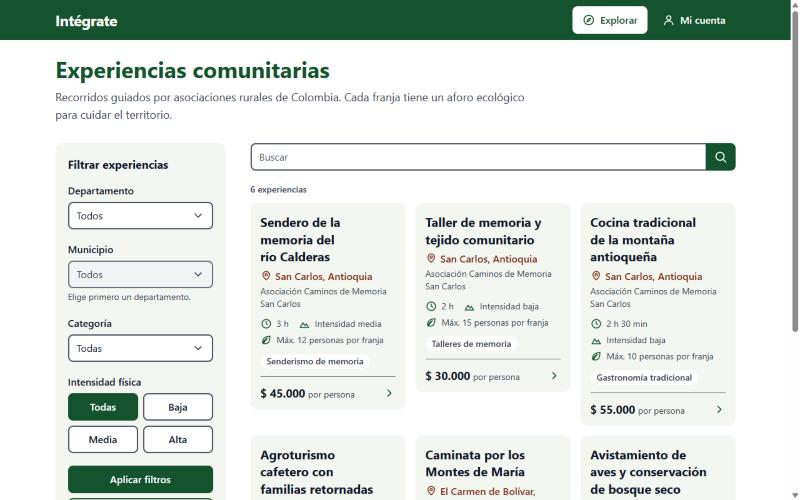 <em>Vista de escritorio del catálogo (pantallas anchas).</em>

### Cuentas de prueba (solo entorno local)

La semilla de desarrollo `infra/postgres/seed/dev_test_data.sql` crea un usuario por rol. Todas comparten una contraseña de prueba que está en `infra/env/.env.test-users` (archivo ignorado por Git; no se copia aquí).

| Correo | Roles | Asociación |
| :--- | :--- | :--- |
| `turista1@ejemplo.com` … `turista3@ejemplo.com` | Turista | — |
| `gestor1@ejemplo.com` | Gestor de Enlace · Turista | Caminos de Memoria San Carlos |
| `gestor2@ejemplo.com` | Gestor de Enlace · Turista | Cooperativa Campesina Montes de María |
| `anfitrion1@ejemplo.com` … `anfitrion3@ejemplo.com` | Anfitrión comunitario | Según la semilla |
| `admin@ejemplo.com` | Administrador · Turista | — |

> **Importante:** estas cuentas y la pasarela de pagos simulada existen solo en desarrollo. No se cobra dinero real.

## 2. Roles y permisos

Una misma persona puede tener varios roles; en *Mi cuenta* aparecen todos (por ejemplo «Turista · Gestor de Enlace»).

| Rol | Qué puede hacer en esta versión | Cómo obtiene la cuenta |
| :--- | :--- | :--- |
| Turista | Explorar y filtrar experiencias, reservar cupos, pagar, recibir el voucher con QR, gestionar sus autorizaciones de datos. | Se registra solo en «Crea una gratis». |
| Gestor de Enlace | Enrolar anfitriones de su asociación, emitir códigos de activación, descargar el padrón y registrar asistencias en campo. | Lo acredita el Administrador. |
| Anfitrión comunitario | Gestionar sus experiencias y horarios, consultar reservas confirmadas y revisar sus métricas. | Lo enrola su Gestor de Enlace. |
| Administrador | Administrar experiencias, asociaciones y personas, consultar auditoría y gestionar incidentes de sincronización y liquidaciones. | Configurado por el equipo de Intégrate. |

Las opciones que ves dependen de tus roles. Las herramientas del anfitrión y del gestor requieren que su acceso esté activo. La administración tiene su propio menú.

## 3. Turista ROLE_TOURIST

El recorrido completo es: **explorar → elegir fecha y franja → ingresar → datos de viajeros → pagar → voucher**. Puedes explorar sin cuenta; se te pide ingresar al momento de reservar y después vuelves al mismo punto.

### 3.1 Crear cuenta e ingresar

#### Crear tu cuenta

1. En la barra inferior toca **Ingresar** y luego **Crea una gratis**.
2. Escribe nombre completo, tipo y número de documento, celular (con indicativo, ej. `+57`), correo y una contraseña de **mínimo 12 caracteres**.
3. En *Autorización de datos* marca:
   - **Mis datos personales** (obligatorio).
   - **Datos de salud y contacto de emergencia** (opcional ahora, pero necesario para reservar; si no lo marcas, se te pedirá al reservar).
4. Toca **Crear cuenta**. La cuenta queda activa y entras de una vez.

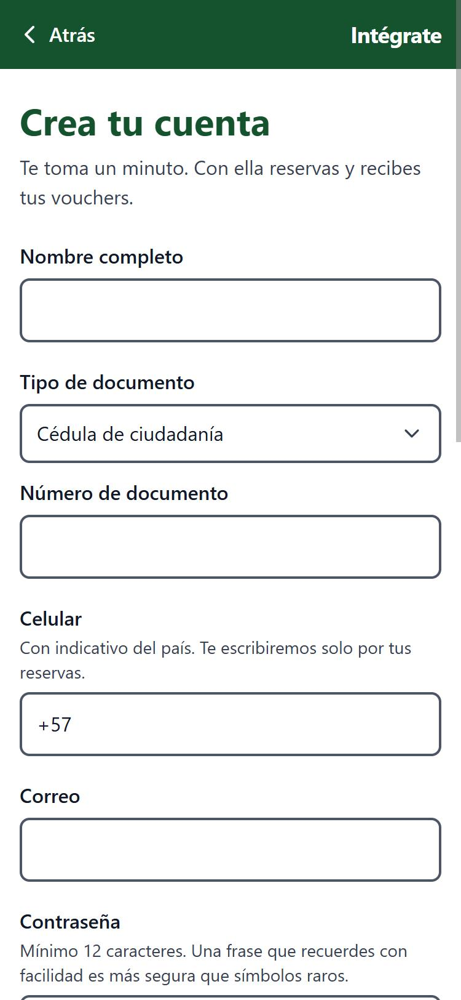 <em>Crear cuenta</em>

#### Ingresar

1. Toca **Ingresar** en la barra inferior (o se abre solo al intentar reservar).
2. Escribe tu correo y contraseña. El ícono del ojo muestra u oculta la contraseña.
3. Toca **Ingresar**. Si venías de una reserva, la aplicación te regresa a ella.

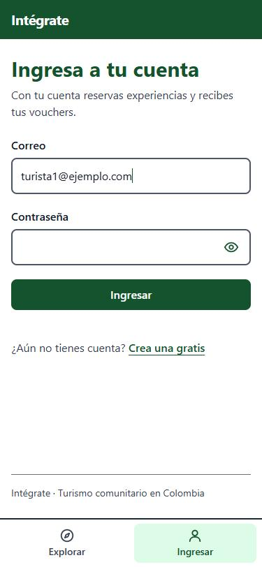 <em>Ingresar</em>

#### Recuperar tu contraseña

1. En **Ingresar**, toca **¿Olvidaste tu contraseña?** y escribe el correo de tu cuenta.
2. Si tienes acceso a ese correo, abre el enlace que recibas. Es válido por 15 minutos.
3. Escribe y repite la nueva contraseña, toca **Guardar contraseña** e ingresa con ella.

### 3.2 Explorar experiencias

#### Catálogo y búsqueda

La pantalla **Explorar** muestra las experiencias aprobadas. Cada tarjeta indica municipio, asociación que organiza, duración, intensidad física, aforo máximo por franja, categoría y precio por persona.

- Escribe en **Buscar** y toca la lupa para buscar por nombre.
- Toca una tarjeta para ver el detalle.

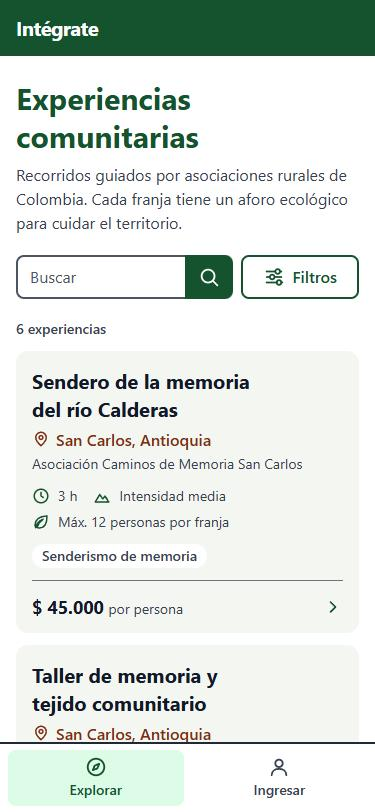 <em>Catálogo</em>

#### Filtrar

1. Toca **Filtros**.
2. Elige **Departamento** (luego se habilita **Municipio**), **Categoría** e **Intensidad física** (Todas, Baja, Media, Alta).
3. Toca **Ver resultados**. Con **Limpiar** quitas todos los filtros.

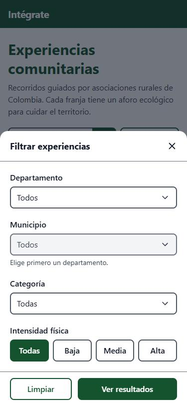 <em>Filtros</em>

#### Detalle de la experiencia

Muestra la descripción, el **punto de encuentro** (con enlace a Google Maps), las indicaciones del anfitrión y las recomendaciones de ropa, calzado, hidratación e implementos.

Abajo ves el precio por persona y el botón **Ver fechas**.

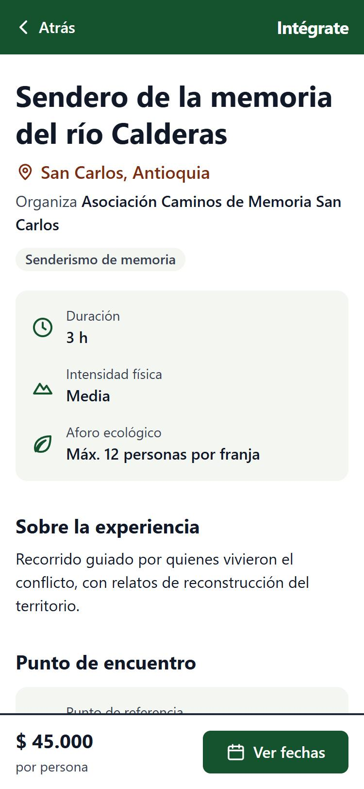 <em>Detalle</em>

### 3.3 Reservar

#### Elegir personas, fecha y franja

1. Ajusta **Personas** con los botones − y + (hasta 10 por reserva; para grupos más grandes haz varias reservas).
2. Elige el día en la semana. Los días con punto tienen cupos; los tachados están agotados. Con las flechas o el nombre del mes cambias de semana o abres el mes completo.
3. Selecciona una **franja horaria**; verás cuántos cupos quedan.
4. Revisa el total abajo y toca **Reservar**. Si no has ingresado, se te pedirá en este momento.

> Los cupos se confirman al reservar: la cifra mostrada es la de la última consulta.

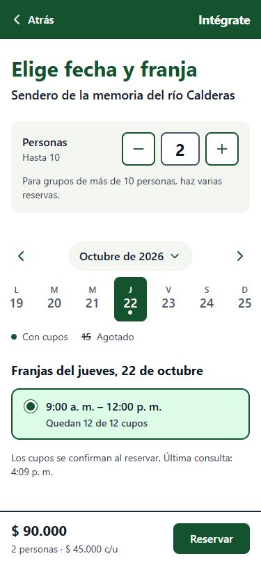 <em>Fecha y franja</em>

#### Datos de los viajeros

1. Por cada viajero escribe nombre completo, tipo y número de documento. El viajero 1 es el titular y se llena con tus datos. Si la aplicación lo ofrece, el titular puede compartir su **EPS**: es voluntaria, solo la da el titular y el anfitrión de la experiencia podrá consultarla en una emergencia. Puedes reservar sin ella.
2. Agrega un **contacto de emergencia** que *no* viaje con el grupo (nombre y celular).
3. Toca **Apartar cupos**.

> Estos datos no se guardan en el teléfono: si sales de la página antes de apartar los cupos, se borran.

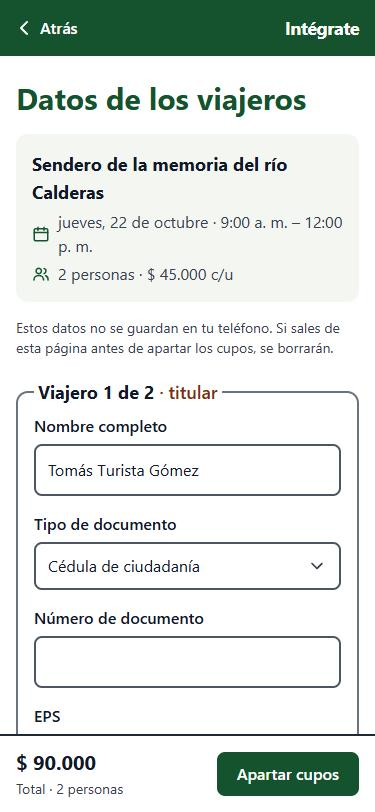 <em>Datos de viajeros</em>

### 3.4 Pagar

#### Pagar la reserva

1. Tienes **15 minutos** para pagar; el contador lo muestra arriba. Si se vence, los cupos se liberan.
2. Revisa el resumen: el 85 % del valor va a la asociación comunitaria.
3. Elige el método: **PSE**, **Tarjeta**, **Nequi** o **Daviplata**.
4. Toca **Pagar**. El pago se completa en la pasarela segura; Intégrate no ve los datos de tu tarjeta o banco.

> **En desarrollo** aparece la «Pasarela de pruebas» con los botones *Simular pago aprobado* y *Simular pago rechazado*. No se cobra dinero.

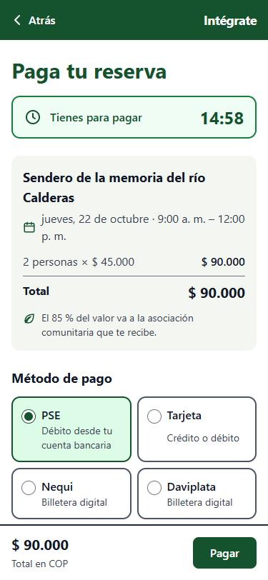 <em>Pago</em>

### 3.5 Reserva confirmada y voucher

#### Tu voucher

Con el pago aprobado verás **¡Reserva confirmada!** y el voucher, que también llega a tu correo:

- **Código QR**: preséntalo el día del recorrido. Usa **Mostrar QR a pantalla completa** para que se lea mejor.
- **Código de contingencia** (8 caracteres): sirve si el QR no se puede leer.
- **Descargar voucher (PDF/A)**: guárdalo para tenerlo sin conexión.

Si el voucher aún está «en emisión», espera unos segundos y toca **Volver a consultar**.

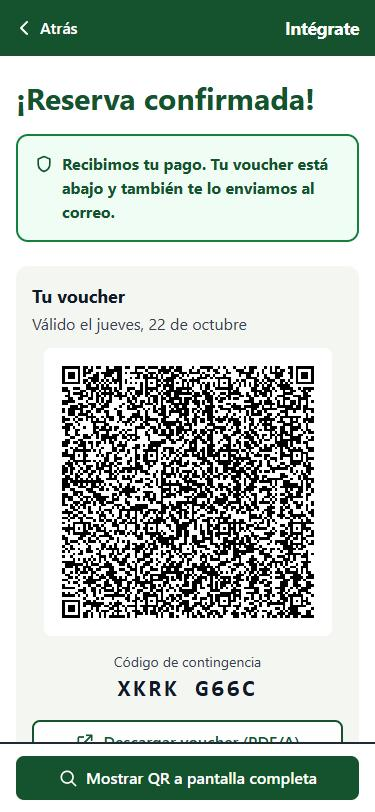 <em>Voucher con QR</em>

#### Ficha de viaje

Debajo del voucher está la **ficha de viaje**: experiencia, fecha y hora, punto de encuentro, asociación que te recibe, número de viajeros y valor pagado, más las recomendaciones de qué llevar.

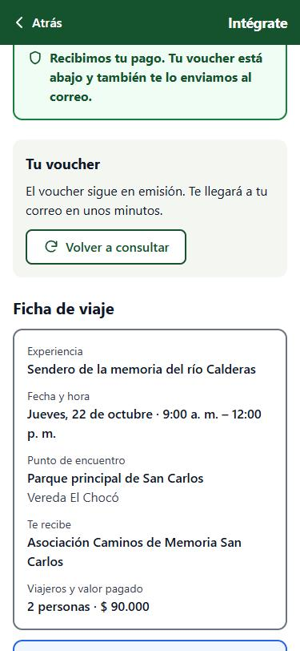 <em>Ficha de viaje</em>

### 3.6 Mi cuenta

#### Perfil, autorizaciones y salida

- Toca **Mi cuenta** en la barra inferior para ver tu nombre, correo y roles.
- En **Autorizaciones de datos** ves el estado de cada autorización. Si los datos de salud están «Sin autorizar», aparece el botón **Autorizar datos de salud para reservar**.
- Toca **Cerrar sesión** para salir; vuelves al catálogo.

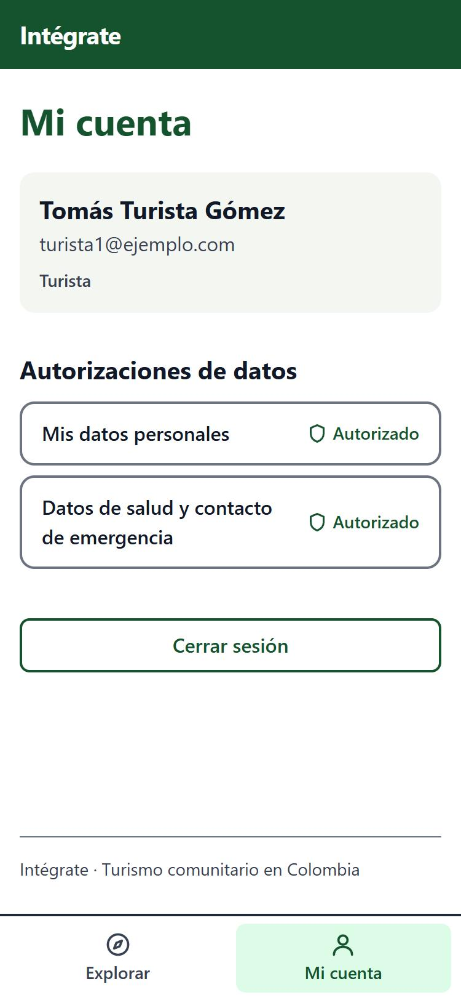 <em>Mi cuenta</em>

### 3.7 Mis experiencias

Abre **Mis experiencias** para consultar tus reservas y su estado. Selecciona una reserva para continuar un pago pendiente o volver a abrir su voucher si ya está confirmada. Descarga el voucher antes de viajar si esperas quedarte sin conexión.

## 4. Gestor de Enlace ROLE_LINK_MANAGER

El Gestor de Enlace es el puente entre Intégrate y la comunidad: registra a los anfitriones de su asociación (con su autorización firmada) y les entrega el código para activar su cuenta. Como también es turista, puede usar todo lo de la [sección 3](#3-turista-role_tourist).

### 4.1 Panel de jornada

#### Entrar al portal del gestor

Abre **Jornada** desde **Módulos** en el celular o desde la navegación en computador. Para el enrolamiento, usa estos accesos del **Panel de jornada**:

- **Enrolar anfitrión**: registrar a una persona nueva.
- **Mis anfitriones**: ver su estado y entregar códigos.

Desde **Jornada** también puedes descargar el padrón de hoy, validar QR, abrir **Contingencia manual** y revisar la **Cola de sincronización**.

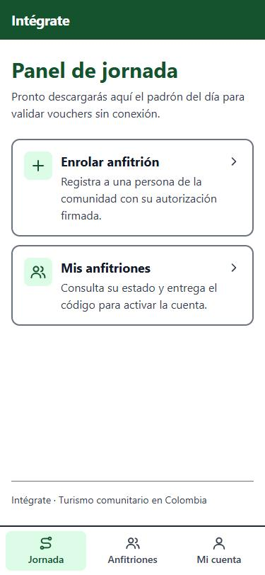 <em>Panel de jornada</em>

### 4.2 Enrolar un anfitrión

#### Paso 1 · Datos del anfitrión

El indicador **En línea** confirma que hay conexión. Nada de lo que escribas se guarda en el teléfono.

1. Nombre completo, tipo y número de documento.
2. Celular con indicativo (ej. `+57 300 123 4567`).
3. Correo (opcional). Si la persona no tiene, se le asigna uno interno terminado en `@comunidad.integrate.co` y recupera el acceso con un código tuyo.

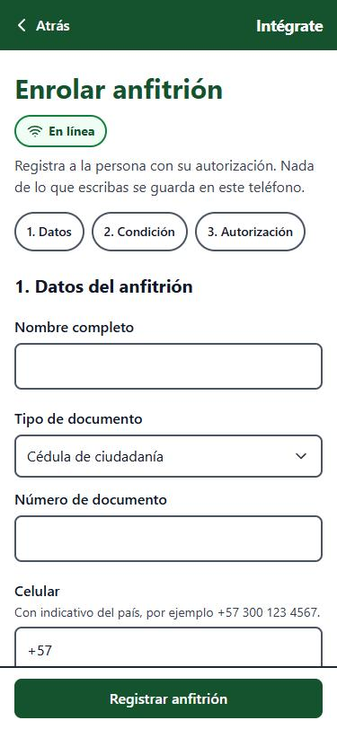 <em>Enrolar · datos</em>

#### Pasos 2 y 3 · Condición y autorización

1. **Condición de víctima**: responde Sí o No a si la persona es víctima del conflicto armado (Ley 1448). Es un dato sensible y se cifra. Si respondes **Sí**, puedes añadir el número de registro RUV, el hecho victimizante y un documento soporte en PDF de hasta 5 MB.
2. **Autorización de datos**: lee la política con la persona y marca las dos autorizaciones obligatorias (datos personales y condición de víctima; se piden siempre, sea o no víctima).
3. **Formato de consentimiento firmado**: toca **Elegir PDF** y carga el escaneo (máximo 5 MB). Puedes escanearlo con la opción «Escanear» de Google Drive, Archivos o Notas.
4. Toca **Registrar anfitrión**.

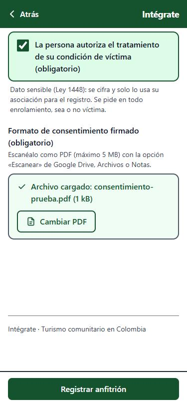 <em>Autorización y PDF</em>

### 4.3 Entregar el código de activación

#### Anfitrión registrado

Verás el nombre, el correo de acceso y el estado **Pendiente de activación**. Toca **Emitir código de activación**.

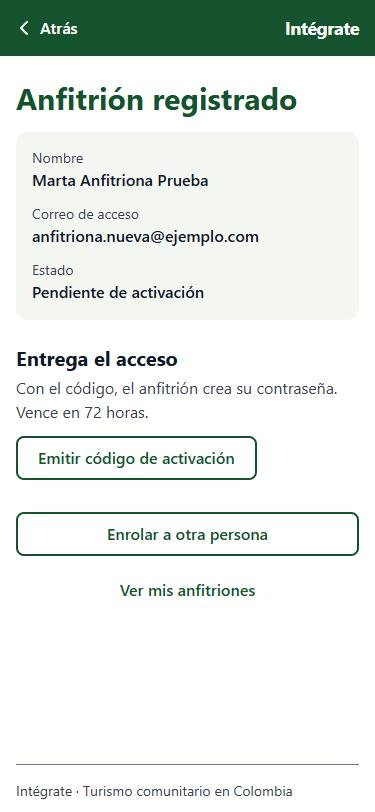 <em>Anfitrión registrado</em>

#### Código de activación

Aparece un código de 10 caracteres (formato `XXXXX-XXXXX`) que **vence en 72 horas**. Entrégalo **en persona** y explica al anfitrión:

1. Entrar a `/activar` en la aplicación.
2. Escribir su correo de acceso.
3. Escribir el código y crear su contraseña.

> El código **no se vuelve a mostrar**. Si se pierde, emite uno nuevo: el anterior deja de servir.

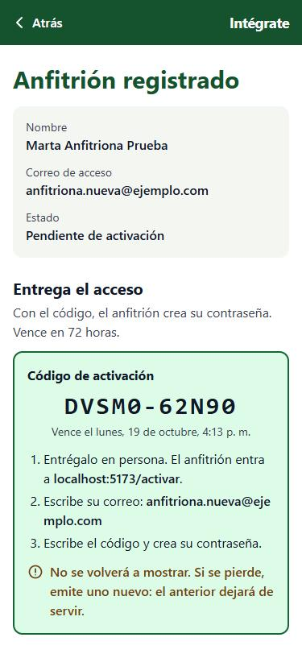 <em>Código emitido</em>

### 4.4 Mis anfitriones

#### Consultar y reemitir

En **Anfitriones** ves las personas de tu jurisdicción con su estado:

- Pendiente de activación: aún no ha usado el código. Tiene el botón **Emitir código de activación** (invalida el anterior).
- Activo: ya creó su contraseña.

El documento se muestra enmascarado (solo los últimos 4 dígitos). Con **+ Enrolar anfitrión** registras a otra persona.

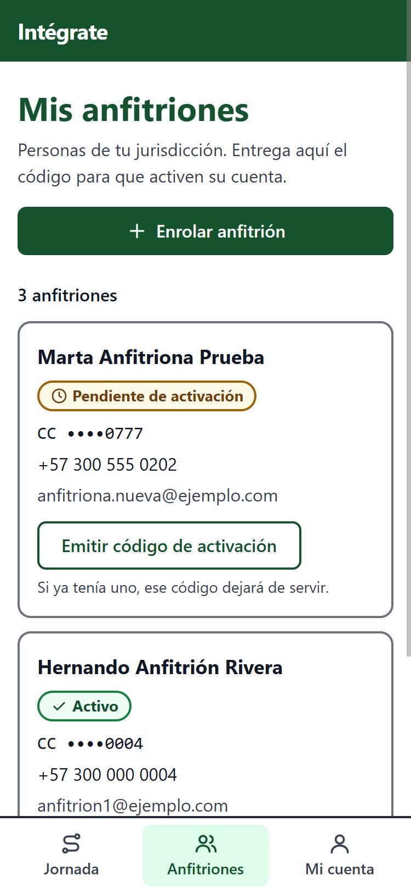 <em>Mis anfitriones</em>

### 4.5 Validar asistencia en campo

1. Antes de salir, con conexión y en el teléfono que llevarás, entra a **Jornada** y toca **Descargar padrón de hoy**. Revisa la fecha del padrón y el estado de disponibilidad sin conexión.
2. En campo, abre **Validar QR en campo**, toca **Activar cámara trasera**, concede el permiso y apunta al QR del voucher. Lee el resultado antes de registrar a la siguiente persona. Si el voucher ya figura como utilizado, revisa el historial de validaciones de la jornada.
3. Si no puedes leer el QR, abre **Contingencia manual**. Usa el código de ocho caracteres del voucher o busca al titular en el padrón descargado. Verifica la coincidencia antes de registrar la asistencia.
4. Al recuperar la conexión, abre **Cola de sincronización** en el mismo teléfono y toca **Sincronizar ahora** si quedan asistencias pendientes. Revisa el resultado y el historial antes de terminar la jornada.

## 5. Anfitrión comunitario ROLE_HOST

Si te enroló un Gestor de Enlace, pídele tu correo de acceso y código de activación. Si ya tenías una cuenta y un administrador te asignó el rol de anfitrión, vuelve a ingresar para ver tus opciones.

#### Activar la cuenta

1. Abre la aplicación en `/activar` (el gestor te indica la dirección).
2. Escribe el **correo** que te indicó el gestor.
3. Escribe el **código de activación** (10 letras y números, por ejemplo `7K3QD-M9X2P`).
4. Crea tu **nueva contraseña** (mínimo 12 caracteres) y repítela.
5. Toca **Activar cuenta**.

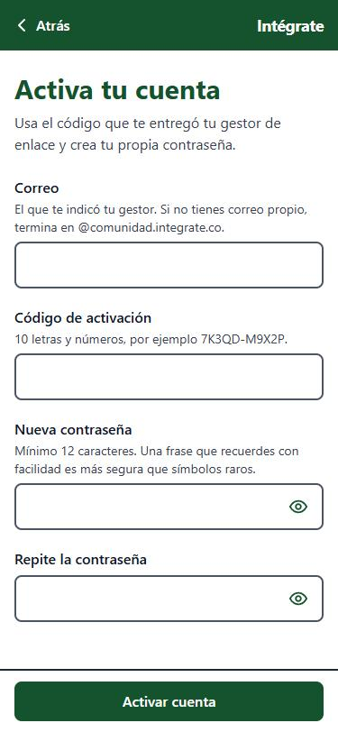 <em>Activar cuenta</em>

#### Cuenta activada

Verás **Cuenta activada**. Toca **Ingresar** y entra con tu correo y la contraseña que acabas de crear (ver [3.1](#31-crear-cuenta-e-ingresar)).

Si el código no funciona, aparece: «El código no es válido, venció o ya se usó. Pide uno nuevo a tu gestor.»

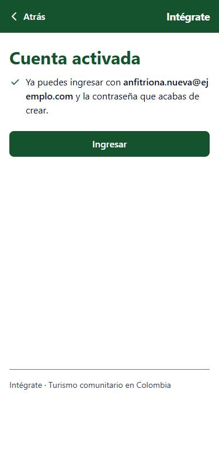 <em>Cuenta activada</em>

#### Mi cuenta del anfitrión

En **Mi cuenta** aparece el rol «Anfitrión comunitario» y tres autorizaciones: datos personales, **condición de víctima del conflicto armado** (registradas en el enrolamiento) y datos de salud. Si quieres reservar experiencias como viajero, toca **Autorizar datos de salud para reservar**.

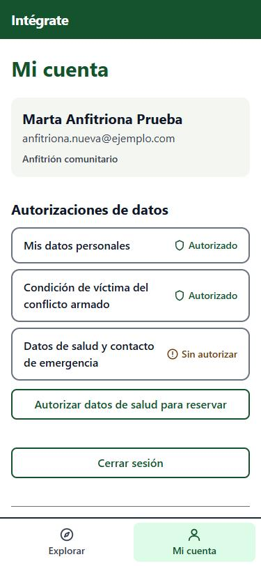 <em>Mi cuenta (anfitrión)</em>

### 5.1 Crear y gestionar experiencias

1. Abre **Experiencias del anfitrión** desde la navegación de tu rol. En el celular está dentro de **Módulos**.
2. Toca **Nueva experiencia**, completa los datos solicitados, incluido el punto de encuentro, y toca **Guardar borrador**.
3. En la lista, toca **Gestionar**. Revisa la ficha y usa **Verificar punto de encuentro** si aparece. Cuando el borrador esté listo, toca **Enviar a revisión**. Si lo rechazan, consulta el motivo, guarda las correcciones y vuelve a enviarlo.
4. En la ficha, abre **Horarios**. Si el estado lo permite, usa **Añadir horario**, completa los campos y toca **Guardar horario**. Puedes consultar los cupos y cancelar un horario cuando la ficha ofrezca esa acción.

### 5.2 Consultar reservas y métricas

- Abre **Anfitrión** para ver **Reservas confirmadas**. Usa los filtros para encontrar una jornada. Si hay una emergencia y tienes conexión, abre **Consultar EPS en emergencia** en la reserva correspondiente. El dato depende de que el titular lo haya compartido y autorizado.
- Abre **Mis métricas** y elige el mes para ver reservas, viajeros, ocupación de próximas jornadas y asistencia.

## 6. Administrador ROLE_ADMIN

Ingresa con tu cuenta de administrador para abrir **Resumen**. En el celular, toca **Módulos** en la barra inferior. En computador, elige la sección en la navegación de administración.

### 6.1 Consola de administración

| Sección | Qué puedes hacer |
| :--- | :--- |
| Resumen | Revisa indicadores, experiencias pendientes de moderación y accesos a las tareas administrativas. |
| Experiencias | Usa **Nueva experiencia** para registrar una. Para moderar, filtra por estado, toca **Gestionar**, revisa el punto de encuentro y elige la acción que corresponda. Si la consola señala que el punto de encuentro es dudoso, verifica la ubicación antes de confirmarla y aprobar la publicación. Si rechazas, suspendes o retiras una experiencia, registra el motivo. |
| Asociaciones | Usa **Nueva asociación** para registrarla o **Gestionar** para consultar y modificar una existente. |
| Personas | Elige la pestaña de rol y usa **Nuevo usuario**, **Nuevo gestor** o **Nuevo anfitrión**, según corresponda. Para una cuenta existente, busca por correo exacto o documento completo y revisa las acciones disponibles. Si asignas un rol, pide a la persona que vuelva a ingresar. |
| Incidentes | Filtra los incidentes de sincronización y abre el detalle. Cuando corresponda, usa **Resolver** o **Descartar** y registra la nota de cierre. |
| Liquidaciones | Filtra y abre el detalle del lote para consultar su estado y sus dispersiones. Si está pendiente de confirmación, puedes usar **Conciliar lote** con conexión. Consulta el comprobante cuando esté disponible. |
| Auditoría | Filtra la bitácora, abre los registros, exporta CSV o verifica la cadena. |
| Mi cuenta | Consulta tu perfil y cierra sesión. |

### 6.2 Acceso por rol

Si ves **Esta sección no está disponible para tu cuenta**, toca **Ir al inicio**. Si necesitas esa sección para tu trabajo, pide al equipo de Intégrate que revise tu rol.

## 7. Mensajes y problemas frecuentes

| Situación | Qué hacer |
| :--- | :--- |
| Al tocar «Reservar» me pide ingresar. | Es normal: ingresa o crea tu cuenta y la aplicación te devuelve a la reserva con la misma franja y número de personas. |
| Somos más de 10 personas. | Haz varias reservas; cada una admite hasta 10. |
| El día aparece tachado. | Está agotado. Elige otro día o cambia de semana con las flechas. |
| Se acabó el contador de pago. | Los cupos se liberaron. Vuelve a elegir la franja y reserva de nuevo. |
| Salí del formulario de viajeros y perdí los datos. | Por seguridad no se guardan en el teléfono. Vuelve a llenarlos. |
| El voucher dice «en emisión». | Toca «Volver a consultar» en unos segundos; también llegará a tu correo. |
| No puedo reservar porque faltan datos de salud. | En *Mi cuenta*, toca «Autorizar datos de salud para reservar». |
| «El código no es válido, venció o ya se usó». | (Anfitrión) Pide a tu gestor que emita un código nuevo; el anterior deja de servir. |
| «Esta sección no está disponible para tu cuenta». | Tu rol no tiene acceso. Si crees que deberías tenerlo, pide al equipo de Intégrate que revise tus permisos. |

## 8. Registro histórico de la prueba del flujo

Prueba manual realizada el **16 de octubre de 2026** en el entorno local (PWA en `localhost:5173`, API Spring Boot en `localhost:8081` con perfil `dev`, PostgreSQL, LocalStack y Mailpit en Docker), con la semilla de datos de prueba, en vista móvil de 375 × 812 px.

Estos resultados corresponden al recorrido de octubre. Las instrucciones añadidas en noviembre se cotejaron con las pantallas y rutas del proyecto.

| Rol | Paso | Resultado |
| :--- | :--- | :--- |
| Visitante | Ver catálogo (6 experiencias), abrir filtros, ver detalle | Correcto |
| Visitante | Elegir 2 personas y franja; «Reservar» redirige a Ingresar conservando la selección | Correcto |
| Turista | Ingresar con `turista1` y volver a la reserva | Correcto |
| Turista | Datos de 2 viajeros + contacto de emergencia → «Apartar cupos» | Correcto |
| Turista | Pago con PSE → «Simular pago aprobado» → Reserva confirmada con QR y código de contingencia | Correcto |
| Turista | Correo de confirmación de la reserva recibido en Mailpit | Correcto |
| Turista | Mi cuenta y Cerrar sesión | Correcto |
| Turista | Crear cuenta nueva con ambas autorizaciones (queda activa e inicia sesión) | Correcto |
| Gestor | Ingresar con `gestor1` → Panel de jornada | Correcto |
| Gestor | Enrolar anfitriona (3 pasos + PDF) → Pendiente de activación | Correcto |
| Gestor | Emitir código de activación y verlo en Mis anfitriones | Correcto |
| Anfitrión | Activar cuenta en `/activar` con el código → Cuenta activada → Ingresar | Correcto |
| Anfitrión / Admin | Ingresar, ver Mi cuenta; `/gestor` muestra «Sin acceso» | Correcto |
| Turista | Vista de escritorio del catálogo (1280 px) | Correcto |
| Turista | Pago rechazado, vencimiento de los 15 min, descarga del PDF del voucher | No probado en esta pasada |

Intégrate · Turismo comunitario en Colombia. Las capturas ilustran el recorrido de octubre con datos ficticios y pueden mostrar una interfaz anterior.
