# Manual de usuario · Intégrate

Cómo usar la aplicación según tu rol: Turista, Gestor de Enlace, Anfitrión comunitario y Administrador.
Cada paso se verificó recorriendo el flujo real en la aplicación.

> **Versión:** Fase 1 · MVP transaccional · Revisado el 16 de octubre de 2026. Versión navegable con estilos: [manual-usuario.html](manual-usuario.html) (descárguela y ábrala en el navegador).

## Contenido

1. [Antes de empezar](#1-antes-de-empezar)
2. [Roles y permisos](#2-roles-y-permisos)
3. [Turista](#3-turista-role_tourist)
4. [Gestor de Enlace](#4-gestor-de-enlace-role_link_manager)
5. [Anfitrión comunitario](#5-anfitrión-comunitario-role_host)
6. [Administrador](#6-administrador-role_admin)
7. [Mensajes y problemas frecuentes](#7-mensajes-y-problemas-frecuentes)
8. [Registro de la prueba del flujo](#8-registro-de-la-prueba-del-flujo)

## 1. Antes de empezar

Intégrate es una aplicación web progresiva (PWA): se abre desde el navegador del celular o del computador y está pensada primero para el teléfono. En pantallas anchas el catálogo cambia a una vista de escritorio con filtros laterales.

### Qué necesitas

- Un navegador actualizado (Chrome, Edge, Firefox o Safari).
- La dirección de la aplicación. En el entorno local de desarrollo es `http://localhost:5173`.
- Una cuenta. Los turistas la crean solos; los anfitriones la reciben de su Gestor de Enlace.

### Navegación general

- **Barra inferior** (celular): *Explorar* e *Ingresar* / *Mi cuenta*. El Gestor de Enlace ve además *Jornada* y *Anfitriones*.
- **Botón «Atrás»** en la barra superior: vuelve a la pantalla anterior conservando filtros y posición.
- **Botón de acción principal**: siempre fijo abajo (por ejemplo, «Ver fechas», «Reservar», «Pagar»).

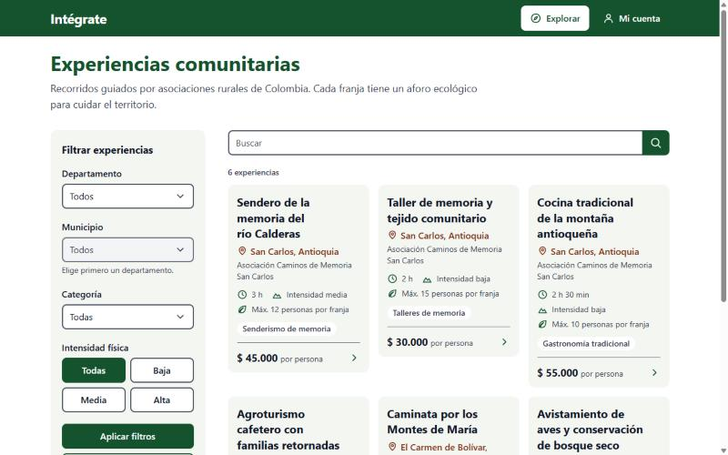 <em>Vista de escritorio del catálogo (pantallas anchas).</em>

### Cuentas de prueba (solo entorno local)

La semilla de desarrollo `infra/postgres/seed/dev_test_data.sql` crea un usuario por rol. Todas comparten una contraseña de prueba que está en `infra/env/.env.test-users` (archivo ignorado por Git; no se copia aquí).

| Correo | Roles | Asociación |
| :--- | :--- | :--- |
| `turista1@ejemplo.com` … `turista3@ejemplo.com` | Turista | — |
| `gestor1@ejemplo.com` | Gestor de Enlace · Turista | Caminos de Memoria San Carlos |
| `gestor2@ejemplo.com` | Gestor de Enlace · Turista | Cooperativa Campesina Montes de María |
| `anfitrion1@ejemplo.com` … `anfitrion3@ejemplo.com` | Anfitrión comunitario | Según la semilla |
| `admin@ejemplo.com` | Administrador · Turista | — |

> **Importante:** estas cuentas y la pasarela de pagos simulada existen solo en desarrollo. No se cobra dinero real.

## 2. Roles y permisos

Una misma persona puede tener varios roles; en *Mi cuenta* aparecen todos (por ejemplo «Turista · Gestor de Enlace»).

| Rol | Qué puede hacer en esta versión | Cómo obtiene la cuenta |
| :--- | :--- | :--- |
| Turista | Explorar y filtrar experiencias, reservar cupos, pagar, recibir el voucher con QR, gestionar sus autorizaciones de datos. | Se registra solo en «Crea una gratis». |
| Gestor de Enlace | Todo lo del turista, más: enrolar anfitriones de su asociación, emitir códigos de activación y consultar el estado de sus anfitriones. | Lo acredita el Administrador. |
| Anfitrión comunitario | Activar su cuenta con el código del gestor, ingresar, explorar el catálogo y gestionar sus autorizaciones de datos. | Lo enrola su Gestor de Enlace. |
| Administrador | Ingresar, explorar y reservar (también es turista) y ver su perfil. | Configurado por el equipo de Intégrate. |

> El portal propio del Anfitrión (crear experiencias y franjas) y el del Administrador (aprobar experiencias, verificar anfitriones) todavía no tienen pantallas en la aplicación. Si uno de estos roles intenta abrir una sección que no le corresponde, verá «Esta sección no está disponible para tu cuenta» (ver [sección 6](#6-administrador-role_admin)).

## 3. Turista ROLE_TOURIST

El recorrido completo es: **explorar → elegir fecha y franja → ingresar → datos de viajeros → pagar → voucher**. Puedes explorar sin cuenta; se te pide ingresar al momento de reservar y después vuelves al mismo punto.

### 3.1 Crear cuenta e ingresar

#### Crear tu cuenta

1. En la barra inferior toca **Ingresar** y luego **Crea una gratis**.
2. Escribe nombre completo, tipo y número de documento, celular (con indicativo, ej. `+57`), correo y una contraseña de **mínimo 12 caracteres**.
3. En *Autorización de datos* marca:
   - **Mis datos personales** (obligatorio).
   - **Datos de salud y contacto de emergencia** (opcional ahora, pero necesario para reservar; si no lo marcas, se te pedirá al reservar).
4. Toca **Crear cuenta**. La cuenta queda activa y entras de una vez.

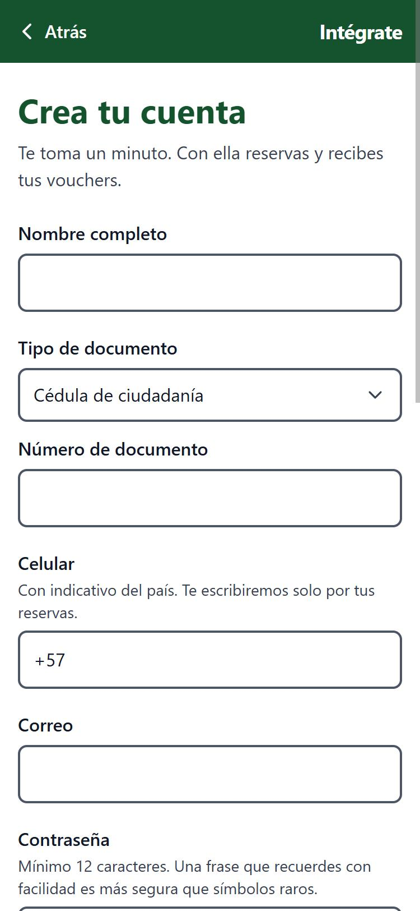 <em>Crear cuenta</em>

#### Ingresar

1. Toca **Ingresar** en la barra inferior (o se abre solo al intentar reservar).
2. Escribe tu correo y contraseña. El ícono del ojo muestra u oculta la contraseña.
3. Toca **Ingresar**. Si venías de una reserva, la aplicación te regresa a ella.

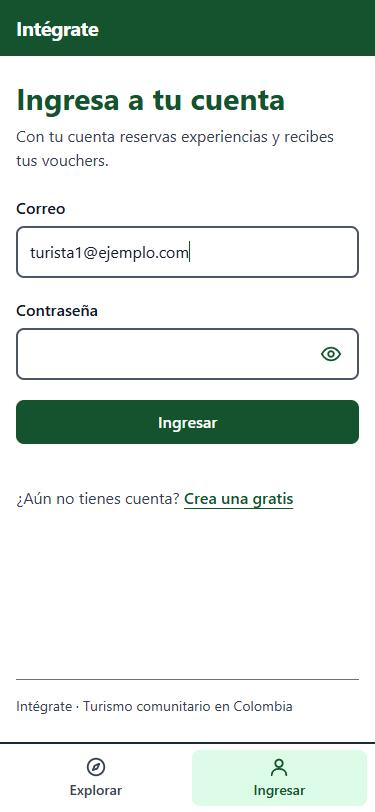 <em>Ingresar</em>

### 3.2 Explorar experiencias

#### Catálogo y búsqueda

La pantalla **Explorar** muestra las experiencias aprobadas. Cada tarjeta indica municipio, asociación que organiza, duración, intensidad física, aforo máximo por franja, categoría y precio por persona.

- Escribe en **Buscar** y toca la lupa para buscar por nombre.
- Toca una tarjeta para ver el detalle.

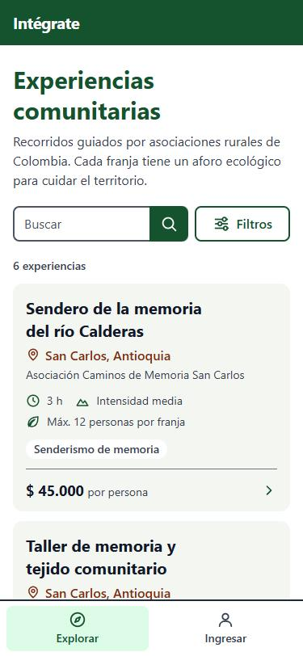 <em>Catálogo</em>

#### Filtrar

1. Toca **Filtros**.
2. Elige **Departamento** (luego se habilita **Municipio**), **Categoría** e **Intensidad física** (Todas, Baja, Media, Alta).
3. Toca **Ver resultados**. Con **Limpiar** quitas todos los filtros.

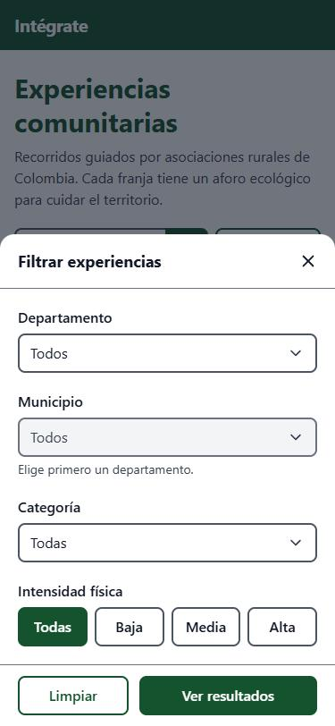 <em>Filtros</em>

#### Detalle de la experiencia

Muestra la descripción, el **punto de encuentro** (con enlace a Google Maps), las indicaciones del anfitrión y las recomendaciones de ropa, calzado, hidratación e implementos.

Abajo ves el precio por persona y el botón **Ver fechas**.

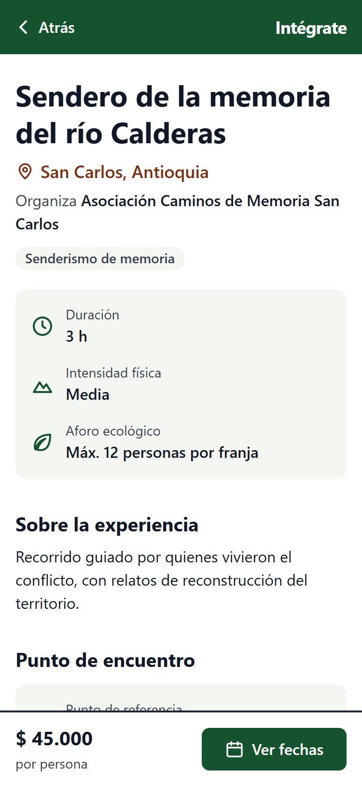 <em>Detalle</em>

### 3.3 Reservar

#### Elegir personas, fecha y franja

1. Ajusta **Personas** con los botones − y + (hasta 10 por reserva; para grupos más grandes haz varias reservas).
2. Elige el día en la semana. Los días con punto tienen cupos; los tachados están agotados. Con las flechas o el nombre del mes cambias de semana o abres el mes completo.
3. Selecciona una **franja horaria**; verás cuántos cupos quedan.
4. Revisa el total abajo y toca **Reservar**. Si no has ingresado, se te pedirá en este momento.

> Los cupos se confirman al reservar: la cifra mostrada es la de la última consulta.

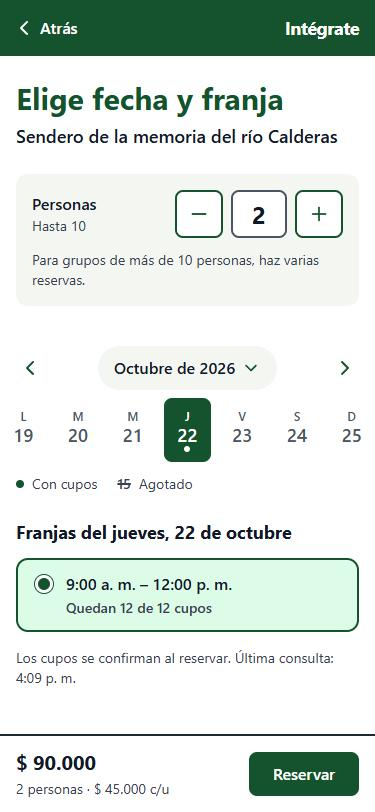 <em>Fecha y franja</em>

#### Datos de los viajeros

1. Por cada viajero escribe nombre completo, tipo y número de documento y **EPS** (para la póliza de turismo). El viajero 1 es el titular y se llena con tus datos.
2. Agrega un **contacto de emergencia** que *no* viaje con el grupo (nombre y celular).
3. Toca **Apartar cupos**.

> Estos datos no se guardan en el teléfono: si sales de la página antes de apartar los cupos, se borran.

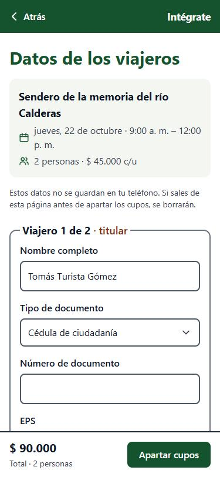 <em>Datos de viajeros</em>

### 3.4 Pagar

#### Pagar la reserva

1. Tienes **15 minutos** para pagar; el contador lo muestra arriba. Si se vence, los cupos se liberan.
2. Revisa el resumen: el 85 % del valor va a la asociación comunitaria.
3. Elige el método: **PSE**, **Tarjeta**, **Nequi** o **Daviplata**.
4. Toca **Pagar**. El pago se completa en la pasarela segura; Intégrate no ve los datos de tu tarjeta o banco.

> **En desarrollo** aparece la «Pasarela de pruebas» con los botones *Simular pago aprobado* y *Simular pago rechazado*. No se cobra dinero.

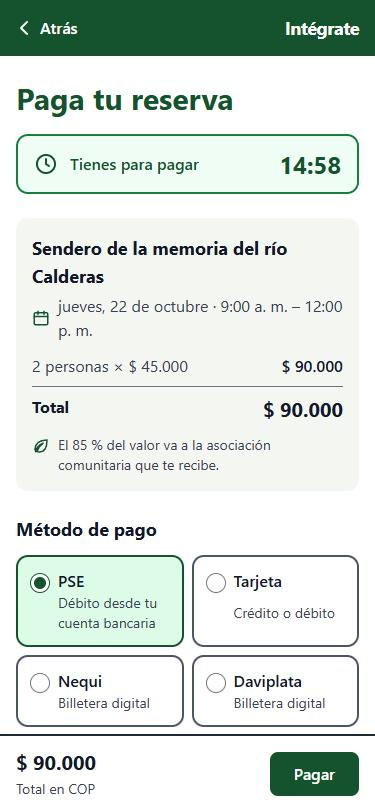 <em>Pago</em>

### 3.5 Reserva confirmada y voucher

#### Tu voucher

Con el pago aprobado verás **¡Reserva confirmada!** y el voucher, que también llega a tu correo:

- **Código QR**: preséntalo el día del recorrido. Usa **Mostrar QR a pantalla completa** para que se lea mejor.
- **Código de contingencia** (8 caracteres): sirve si el QR no se puede leer.
- **Descargar voucher (PDF/A)**: guárdalo para tenerlo sin conexión.

Si el voucher aún está «en emisión», espera unos segundos y toca **Volver a consultar**.

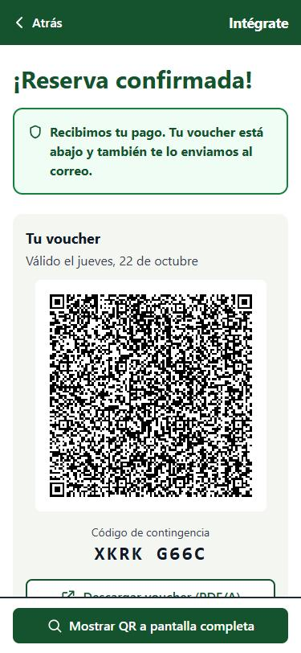 <em>Voucher con QR</em>

#### Ficha de viaje

Debajo del voucher está la **ficha de viaje**: experiencia, fecha y hora, punto de encuentro, asociación que te recibe, número de viajeros y valor pagado, más las recomendaciones de qué llevar.

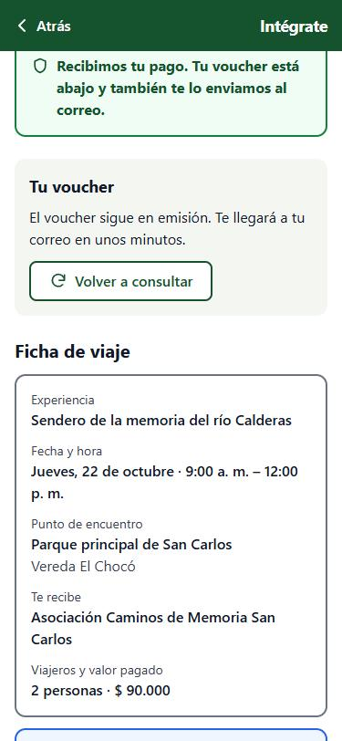 <em>Ficha de viaje</em>

### 3.6 Mi cuenta

#### Perfil, autorizaciones y salida

- Toca **Mi cuenta** en la barra inferior para ver tu nombre, correo y roles.
- En **Autorizaciones de datos** ves el estado de cada autorización. Si los datos de salud están «Sin autorizar», aparece el botón **Autorizar datos de salud para reservar**.
- Toca **Cerrar sesión** para salir; vuelves al catálogo.

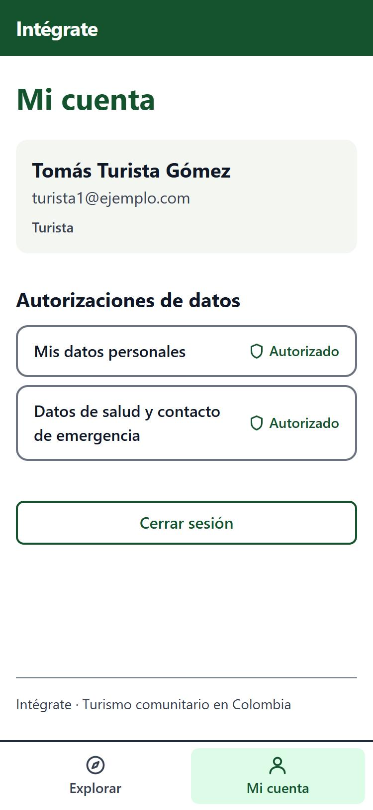 <em>Mi cuenta</em>

## 4. Gestor de Enlace ROLE_LINK_MANAGER

El Gestor de Enlace es el puente entre Intégrate y la comunidad: registra a los anfitriones de su asociación (con su autorización firmada) y les entrega el código para activar su cuenta. Como también es turista, puede usar todo lo de la [sección 3](#3-turista-role_tourist).

### 4.1 Panel de jornada

#### Entrar al portal del gestor

Al ingresar con una cuenta de gestor, la barra inferior muestra **Jornada**, **Anfitriones** y **Mi cuenta**. El **Panel de jornada** (`/gestor`) tiene dos accesos:

- **Enrolar anfitrión**: registrar a una persona nueva.
- **Mis anfitriones**: ver su estado y entregar códigos.

> Próximamente este panel permitirá descargar el padrón del día para validar vouchers sin conexión.

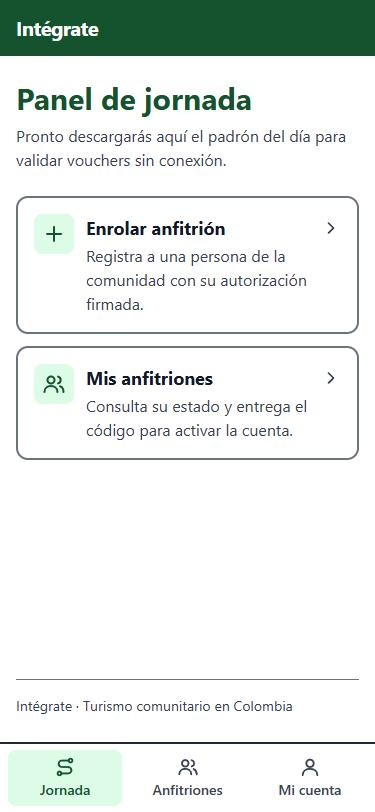 <em>Panel de jornada</em>

### 4.2 Enrolar un anfitrión

#### Paso 1 · Datos del anfitrión

El indicador **En línea** confirma que hay conexión. Nada de lo que escribas se guarda en el teléfono.

1. Nombre completo, tipo y número de documento.
2. Celular con indicativo (ej. `+57 300 123 4567`).
3. Correo (opcional). Si la persona no tiene, se le asigna uno interno terminado en `@comunidad.integrate.co` y recupera el acceso con un código tuyo.

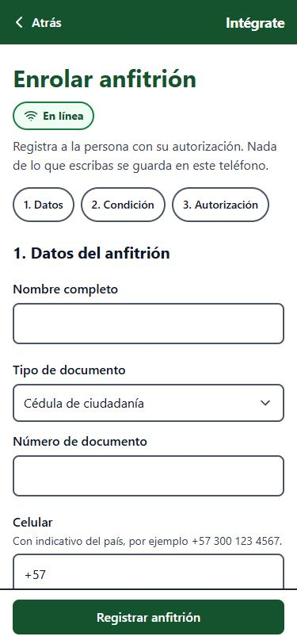 <em>Enrolar · datos</em>

#### Pasos 2 y 3 · Condición y autorización

1. **Condición de víctima**: responde Sí o No a si la persona es víctima del conflicto armado (Ley 1448). Es un dato sensible: se cifra y nadie lo ve en la aplicación.
2. **Autorización de datos**: lee la política con la persona y marca las dos autorizaciones obligatorias (datos personales y condición de víctima; se piden siempre, sea o no víctima).
3. **Formato de consentimiento firmado**: toca **Elegir PDF** y carga el escaneo (máximo 5 MB). Puedes escanearlo con la opción «Escanear» de Google Drive, Archivos o Notas.
4. Toca **Registrar anfitrión**.

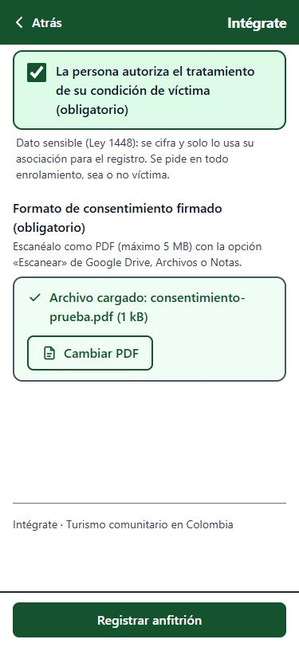 <em>Autorización y PDF</em>

### 4.3 Entregar el código de activación

#### Anfitrión registrado

Verás el nombre, el correo de acceso y el estado **Pendiente de activación**. Toca **Emitir código de activación**.

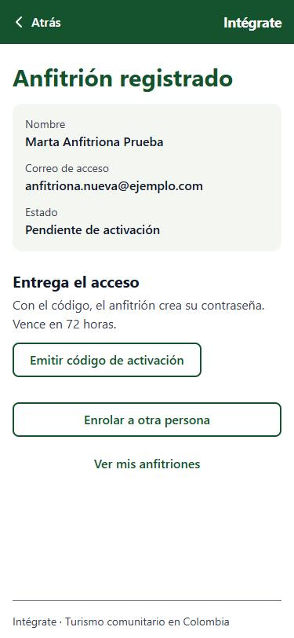 <em>Anfitrión registrado</em>

#### Código de activación

Aparece un código de 10 caracteres (formato `XXXXX-XXXXX`) que **vence en 72 horas**. Entrégalo **en persona** y explica al anfitrión:

1. Entrar a `/activar` en la aplicación.
2. Escribir su correo de acceso.
3. Escribir el código y crear su contraseña.

> El código **no se vuelve a mostrar**. Si se pierde, emite uno nuevo: el anterior deja de servir.

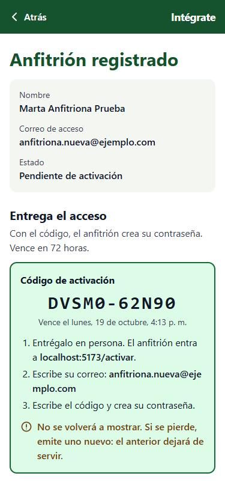 <em>Código emitido</em>

### 4.4 Mis anfitriones

#### Consultar y reemitir

En **Anfitriones** ves las personas de tu jurisdicción con su estado:

- Pendiente de activación: aún no ha usado el código. Tiene el botón **Emitir código de activación** (invalida el anterior).
- Activo: ya creó su contraseña.

El documento se muestra enmascarado (solo los últimos 4 dígitos). Con **+ Enrolar anfitrión** registras a otra persona.

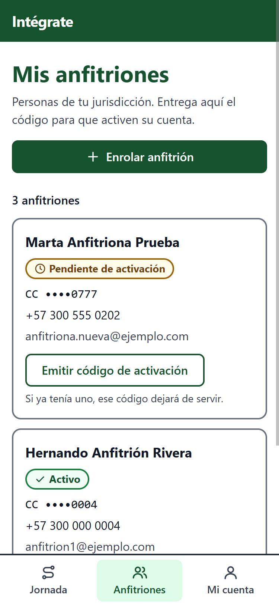 <em>Mis anfitriones</em>

## 5. Anfitrión comunitario ROLE_HOST

El anfitrión no se registra solo: su Gestor de Enlace lo enrola y le entrega un código de activación.

#### Activar la cuenta

1. Abre la aplicación en `/activar` (el gestor te indica la dirección).
2. Escribe el **correo** que te indicó el gestor.
3. Escribe el **código de activación** (10 letras y números, por ejemplo `7K3QD-M9X2P`).
4. Crea tu **nueva contraseña** (mínimo 12 caracteres) y repítela.
5. Toca **Activar cuenta**.

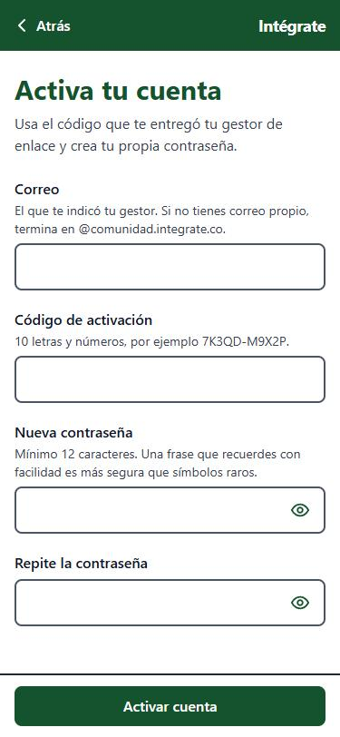 <em>Activar cuenta</em>

#### Cuenta activada

Verás **Cuenta activada**. Toca **Ingresar** y entra con tu correo y la contraseña que acabas de crear (ver [3.1](#31-crear-cuenta-e-ingresar)).

Si el código no funciona, aparece: «El código no es válido, venció o ya se usó. Pide uno nuevo a tu gestor.»

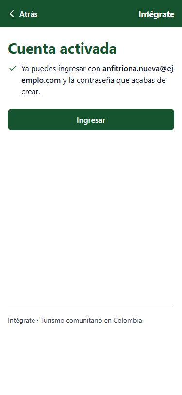 <em>Cuenta activada</em>

#### Mi cuenta del anfitrión

En **Mi cuenta** aparece el rol «Anfitrión comunitario» y tres autorizaciones: datos personales, **condición de víctima del conflicto armado** (registradas en el enrolamiento) y datos de salud. Si quieres reservar experiencias como viajero, toca **Autorizar datos de salud para reservar**.

> Por ahora el anfitrión usa el catálogo y su cuenta. La creación de experiencias y franjas desde la aplicación llegará en una fase posterior.

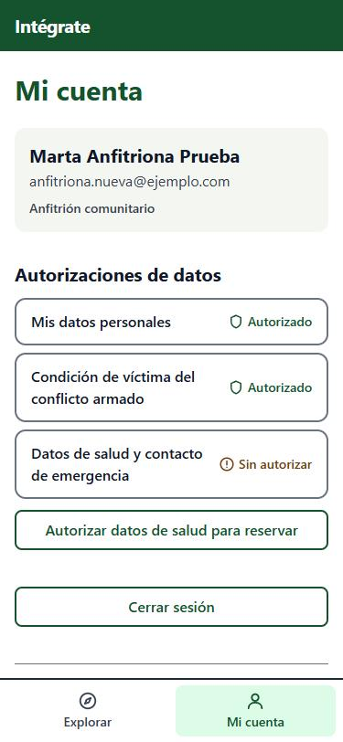 <em>Mi cuenta (anfitrión)</em>

## 6. Administrador ROLE_ADMIN

El Administrador ingresa como cualquier usuario (ver [3.1](#31-crear-cuenta-e-ingresar)). En esta versión su cuenta también tiene el rol Turista, así que puede explorar, reservar y pagar, y en **Mi cuenta** aparece «Turista · Administrador».

Las tareas administrativas (aprobar experiencias en revisión, verificar anfitriones, acreditar gestores) se realizan hoy fuera de la PWA y aún no tienen pantallas.

Si un Administrador o Anfitrión abre una sección reservada a otro rol, como `/gestor`, ve **«Esta sección no está disponible para tu cuenta»** y el botón **Ir al inicio**.

 <em>Sin acceso</em>

## 7. Mensajes y problemas frecuentes

| Situación | Qué hacer |
| :--- | :--- |
| Al tocar «Reservar» me pide ingresar. | Es normal: ingresa o crea tu cuenta y la aplicación te devuelve a la reserva con la misma franja y número de personas. |
| Somos más de 10 personas. | Haz varias reservas; cada una admite hasta 10. |
| El día aparece tachado. | Está agotado. Elige otro día o cambia de semana con las flechas. |
| Se acabó el contador de pago. | Los cupos se liberaron. Vuelve a elegir la franja y reserva de nuevo. |
| Salí del formulario de viajeros y perdí los datos. | Por seguridad no se guardan en el teléfono. Vuelve a llenarlos. |
| El voucher dice «en emisión». | Toca «Volver a consultar» en unos segundos; también llegará a tu correo. |
| No puedo reservar porque faltan datos de salud. | En *Mi cuenta*, toca «Autorizar datos de salud para reservar». |
| «El código no es válido, venció o ya se usó». | (Anfitrión) Pide a tu gestor que emita un código nuevo; el anterior deja de servir. |
| «Esta sección no está disponible para tu cuenta». | Tu rol no tiene acceso. Si crees que deberías tenerlo, pide al equipo de Intégrate que revise tus permisos. |

## 8. Registro de la prueba del flujo

Prueba manual realizada el **16 de octubre de 2026** en el entorno local (PWA en `localhost:5173`, API Spring Boot en `localhost:8081` con perfil `dev`, PostgreSQL, LocalStack y Mailpit en Docker), con la semilla de datos de prueba, en vista móvil de 375 × 812 px.

| Rol | Paso | Resultado |
| :--- | :--- | :--- |
| Visitante | Ver catálogo (6 experiencias), abrir filtros, ver detalle | Correcto |
| Visitante | Elegir 2 personas y franja; «Reservar» redirige a Ingresar conservando la selección | Correcto |
| Turista | Ingresar con `turista1` y volver a la reserva | Correcto |
| Turista | Datos de 2 viajeros + contacto de emergencia → «Apartar cupos» | Correcto |
| Turista | Pago con PSE → «Simular pago aprobado» → Reserva confirmada con QR y código de contingencia | Correcto |
| Turista | Correo de confirmación de la reserva recibido en Mailpit | Correcto |
| Turista | Mi cuenta y Cerrar sesión | Correcto |
| Turista | Crear cuenta nueva con ambas autorizaciones (queda activa e inicia sesión) | Correcto |
| Gestor | Ingresar con `gestor1` → Panel de jornada | Correcto |
| Gestor | Enrolar anfitriona (3 pasos + PDF) → Pendiente de activación | Correcto |
| Gestor | Emitir código de activación y verlo en Mis anfitriones | Correcto |
| Anfitrión | Activar cuenta en `/activar` con el código → Cuenta activada → Ingresar | Correcto |
| Anfitrión / Admin | Ingresar, ver Mi cuenta; `/gestor` muestra «Sin acceso» | Correcto |
| Turista | Vista de escritorio del catálogo (1280 px) | Correcto |
| Turista | Pago rechazado, vencimiento de los 15 min, descarga del PDF del voucher | No probado en esta pasada |

Intégrate · Turismo comunitario en Colombia. Manual generado a partir de la aplicación en la rama `feature/fase-1-mvp-transaccional`. Las capturas usan datos ficticios de la semilla de desarrollo.
