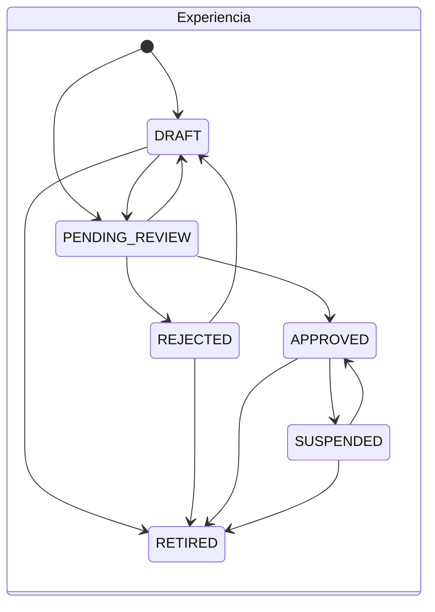
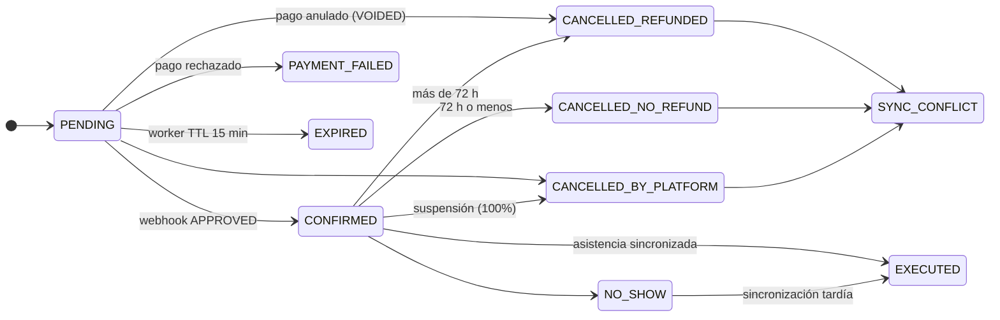

# Modelo Relacional – Sistema Intégrate

**Motor:** PostgreSQL 16 · **Migraciones:** Flyway · **Versión del modelo:** 1.0.0 (octubre 2026)
**Base:** `especificacion_tecnica.md` más las decisiones A1–I4 validadas en la fase de clarificación.

---

## 0. Artefactos y convenciones

| Artefacto | Ubicación | Ejecuta |
|---|---|---|
| Bootstrap de clúster: roles con login, base de datos y timeouts | `infra/postgres/init/00_bootstrap.sql` | superusuario, una sola vez |
| V1 Extensiones, esquemas, dominios y funciones comunes | `backend-api/src/main/resources/db/migration/V1__extensions_schemas_roles.sql` | `integrate_owner` (Flyway) |
| V2 auth · V3 catalog · V4 booking · V5 payments · V6 voucher · V7 offline | `.../db/migration/V2…V7` | Flyway |
| V8 Bitácora encadenada y outbox | `.../db/migration/V8__audit_notification.sql` | Flyway |
| V9 Endurecimiento de privilegios | `.../db/migration/V9__privileges_hardening.sql` | Flyway |
| V10 Alineación con el Contrato de API v1.0.0 | `.../db/migration/V10__api_contract_alignment.sql` | Flyway |
| Contrato de API (OpenAPI 3.1 y DTOs) | `docs/api/openapi.yaml`, `docs/api/dtos_contrato_api.md` | Guía de implementación |
| Directrices de arquitectura, pool HikariCP y reglas JPA | `docs/architecture/backend_guidelines.md` | Guía de implementación |

**Convenciones**

- **Claves primarias.** `UUID` (`gen_random_uuid()`) en las entidades que expone la API o el JWT. `BIGINT GENERATED ALWAYS AS IDENTITY` en historiales, logs y líneas de alto volumen. `SMALLINT IDENTITY` en catálogos pequeños. Los códigos DANE (DIVIPOLA) son clave natural oficial.
- **Estados.** Se modelan como `VARCHAR` con `CHECK` (A3). Las transiciones válidas las imponen triggers `fn_*_guard`.
- **Auditoría de fila.** Las columnas estándar son `created_at`, `updated_at` (mediante el trigger `common.set_updated_at`) y `created_by`, cuyo DEFAULT es `common.current_actor()`. Los maestros llevan además `deleted_at`.
- **Actor y motivo.** El backend debe ejecutar `SET LOCAL integrate.actor_id = '<uuid>'` al inicio de cada transacción, y `SET LOCAL integrate.status_reason = '<motivo>'` cuando cambie un estado. Con eso se alimentan `created_by` y los historiales sin pasar parámetros adicionales.
- **Cifrado (B4).** Las columnas `*_enc` usan el dominio `common.ciphertext` (BYTEA) y se cifran con AES-256-GCM en un `AttributeConverter` de JPA. Cada fila lleva `sensitive_key_version` para poder rotar llaves.
- **Integridad referencial.** Todas las FK son `ON DELETE RESTRICT ON UPDATE RESTRICT`. No hay borrado físico de datos de negocio (A4); las únicas excepciones están en V9 §3.
- **Dominios** (en `common`): `doc_type`, `doc_number`, `phone_e164`, `email`, `cop_amount` (pesos sin centavos), `percentage`, `sha256_hex`, `ciphertext` y `s3_key`.
- **Índices sobre FK.** Todas las FK de negocio tienen índice. Las FK de auditoría (`created_by`, `verified_by`, etc.) no lo tienen a propósito: los usuarios nunca se borran físicamente, así que la verificación de integridad nunca recorre esas columnas.

---

## 1. Diccionario de entidades y justificación de la 3FN

Criterio aplicado a cada tabla:

- **1FN:** valores atómicos y sin grupos repetidos.
- **2FN:** ningún atributo depende de una parte de una clave compuesta. Las PK compuestas son solo las de tablas puente sin atributos propios.
- **3FN:** ningún atributo no clave depende de otro atributo no clave.

Las excepciones se declaran en §2 como desnormalizaciones controladas.

### 1.1 `auth`

| Tabla | Propósito | PK | Claves alternativas | 3FN |
|---|---|---|---|---|
| `users` | Identidad de todo actor humano | `id` UUID | `(doc_type, doc_number)`, `lower(email)` | Todos los atributos describen a la persona. Los roles salen a `user_roles` (antes eran un atributo multivaluado). |
| `roles` | Catálogo RBAC | `id` SMALLINT | `code` | Atributos que dependen solo del rol. |
| `user_roles` | Asignación N:M con vigencia | `id` BIGINT | `(user_id, role_id)` vigente (índice parcial) | Las fechas de concesión y revocación dependen de la asignación, no del usuario ni del rol. |
| `privacy_policies` | Versiones de la política Ley 1581 | `id` SMALLINT | `version`; una sola `is_current` | El hash y la URL dependen de la versión. |
| `habeas_data_consents` | Otorgamiento o revocación por finalidad (append-only) | `id` BIGINT | — | IP, user agent y fecha dependen del acto. La versión de la política se obtiene por FK y no se repite. |
| `login_attempts` | Intentos de autenticación (operativa) | `id` BIGINT | — | Hecho atómico. |
| `refresh_tokens` | Sesiones revocables (solo hash) | `id` UUID | `token_sha256` | Hecho atómico; `replaced_by_id` es una autorreferencia. |

### 1.2 `catalog`

| Tabla | Propósito | PK | Claves alternativas | 3FN |
|---|---|---|---|---|
| `departments` / `municipalities` | DIVIPOLA | `code` (natural DANE) | `(department_code, name)` | El nombre depende del código. |
| `community_associations` | Titular de NIT y RNT; receptora del 85% | `id` UUID | `nit`, `rnt_number` | La ubicación se expresa con FK al municipio: el departamento no se repite. |
| `host_profiles` | Anfitrión: N:1 con asociación; datos de víctima cifrados | `id` UUID | `user_id` vigente | Los datos sensibles dependen del perfil, no del usuario (el usuario puede tener otros roles). |
| `link_manager_profiles` | Acreditación del gestor ante una sola asociación | `id` UUID | `user_id` vigente | Igual que el anterior. |
| `host_manager_assignments` | Gestor ↔ anfitrión con vigencia | `id` BIGINT | EXCLUDE sin solapamientos por anfitrión | Ver §2-D3 (`association_id`). |
| `categories` | Categorías temáticas | `id` SMALLINT | `code` | — |
| `experiences` | Experiencia turística | `id` UUID | — | La región se deriva del municipio; el anfitrión se referencia con FK. Ver §2-D2 (`rejection_reason`). |
| `experience_categories` | N:M | `(experience_id, category_id)` | — | Tabla puente pura. |
| `experience_images` | Galería S3 (1:N) | `id` BIGINT | `s3_object_key`; una sola portada | El texto alternativo depende de la imagen. |
| `experience_status_history` | Transiciones (append-only, por trigger) | `id` BIGINT | — | Hecho atómico. |
| `schedules` | Franja con aforo: objetivo de `FOR UPDATE` | `id` UUID | `(experience_id, start_time)` | Ver §2-D1 (`available_slots`). |

### 1.3 `booking`

| Tabla | Propósito | PK | Claves alternativas | 3FN |
|---|---|---|---|---|
| `bookings` | Reserva de N cupos de una franja | `id` UUID | — | Ver §2-D4 (`unit_price_cop`, `total_amount_cop`). El contacto de emergencia es un atributo de la reserva (E1). |
| `booking_participants` | Una persona por cupo, con EPS cifrada | `id` BIGINT | `(booking_id, doc_type, doc_number)`; un solo titular | Los datos dependen del participante en esa reserva. |
| `booking_status_history` | Ciclo de vida (append-only, por trigger) | `id` BIGINT | — | Hecho atómico. |
| `booking_cancellations` | Hecho jurídico de la cancelación (0..1 por reserva) | `id` BIGINT | `booking_id` | Ver §2-D5 (`hours_before_start`). |

### 1.4 `payments`

| Tabla | Propósito | PK | Claves alternativas | 3FN |
|---|---|---|---|---|
| `commission_policies` | Parámetros 85/15, 72 h y 24 h con vigencia | `id` SMALLINT | `code`; vigencias que no se solapan | Inmutable una vez aplicada. |
| `payout_accounts` | Cuentas o billeteras cifradas de la asociación (1:N) | `id` UUID | una por defecto por asociación | Ver §2-D6 (`account_last4`). |
| `payment_transactions` | Intento de cobro (1:N por reserva) | `id` UUID | `idempotency_key`, `(provider, gateway_transaction_id)`; un solo APPROVED por reserva | Los porcentajes no se copian: se obtienen de la política por FK. |
| `payment_webhook_events` | Bandeja idempotente de webhooks | `id` BIGINT | `(provider, idempotency_key)` | Payload crudo como evidencia. |
| `refunds` | Reembolsos (1:N por pago) | `id` UUID | `idempotency_key`, `gateway_refund_id` | El monto depende del reembolso. La suma ≤ cobro se impone por trigger. |
| `payout_batches` | Lote de pago a una asociación | `id` UUID | `idempotency_key`; un solo OPEN por asociación | El total **no** se almacena: se deriva en `v_payout_batch_totals`. |
| `disbursements` | 85% comunitario en custodia, uno por pago | `id` UUID | `payment_id` | Ver §2-D7 (`association_id`). |
| `settlement_receipts` | Comprobante contable (append-only) | `id` UUID | `receipt_number`, `payout_batch_id` | Ver §2-D8 (desglose congelado). |

### 1.5 `voucher`, `offline`, `audit` y `notification`

| Tabla | Propósito | PK | Claves alternativas | 3FN |
|---|---|---|---|---|
| `voucher.signing_keys` | Llaves públicas por `kid` | `id` SMALLINT | `kid`; una sola ACTIVE | — |
| `voucher.vouchers` | Voucher 1:1 con reserva CONFIRMED | `id` UUID | `booking_id`, `jti`, `token_sha256`, `short_code` | No se guardan `slots`, `doc` ni `valid_date`: se derivan de la reserva al firmar. |
| `offline.devices` | Dispositivo de un gestor o de un anfitrión (exactamente uno, V10) | `id` UUID | `device_identifier` | — |
| `offline.roster_downloads` | Traza de descargas de padrón (append-only) | `id` BIGINT | — | `association_id` es un parámetro de la petición, no una dependencia del dispositivo. |
| `offline.sync_batches` | Lote de Background Sync | `id` UUID (`syncBatchId` del cliente) | — | La PK del cliente da la idempotencia. |
| `offline.offline_validations` | Todo escaneo, incluidos dobles canjes (append-only) | `id` BIGINT | `(voucher_id, device_id, scanned_at)` | El gestor se deriva del dispositivo; `validated_by` es el usuario autenticado en la PWA. |
| `offline.sync_incidents` | Contingencias para el administrador | `id` UUID | `(validation_id, incident_type)` | La reserva se deriva por validación → voucher → reserva. |
| `audit.chain_head` | Cabeza de la cadena de hashes (fila única) | `id` = 1 | — | Infraestructura. |
| `audit.audit_trail` | Bitácora particionada por año, encadenada | `(id, created_at)` | — | Evento atómico. |
| `notification.notification_outbox` | Transactional outbox | `id` UUID | — | `recipient_address` es una copia como evidencia de envío. |

---

## 2. Desnormalizaciones controladas (decisiones deliberadas)

| # | Columna | Por qué rompe la 3FN estricta | Por qué se mantiene | Control |
|---|---|---|---|---|
| D1 | `schedules.available_slots` | Se deriva de `total_slots − Σ cupos activos` | Es la fila que se bloquea con `FOR UPDATE`; el SLA de 200 ms (RNF-02) no admite agregaciones | `CHECK 0 ≤ available ≤ total` y vista `booking.v_schedule_slot_reconciliation` |
| D2 | `experiences.rejection_reason` | Se deriva del último registro REJECTED del historial | Lectura directa para la retroalimentación (RF-07); aprobada explícitamente | El historial conserva todos los motivos |
| D3 | `host_manager_assignments.association_id` | Depende de `host_id` | Permite FK compuestas que garantizan "misma asociación" (RF-03) de forma declarativa | Las FK compuestas impiden cualquier divergencia |
| D4 | `bookings.unit_price_cop` y `total_amount_cop` | Se derivan de la experiencia y de los cupos | El precio cambia con el tiempo; el valor pactado es un hecho histórico | El trigger valida el precio vigente al insertar y `CHECK total = unit × slots` |
| D5 | `booking_cancellations.hours_before_start` | Se deriva de la franja y de `cancelled_at` | Es la evidencia jurídica de la regla de 72 h aplicada | Tabla append-only |
| D6 | `payout_accounts.account_last4` | Se deriva del número cifrado | Permite mostrar la cuenta sin descifrar | Solo 4 dígitos, no sensibles |
| D7 | `disbursements.association_id` | Se deriva por pago → reserva → franja → experiencia → anfitrión | La beneficiaria al momento de la venta es un hecho histórico (el anfitrión puede cambiar de asociación) | FK compuesta con el lote |
| D8 | `settlement_receipts.*_cop` | Se derivan de las dispersiones del lote | Documento contable legal, congelado al emitirse | Append-only y `CHECK bruto = neto + plataforma` |

---

## 3. Cardinalidades y relaciones

| Relación | Card. | Descripción funcional |
|---|---|---|
| users — user_roles — roles | N:M | Un usuario puede tener varios roles vigentes; la revocación conserva el historial. |
| users — habeas_data_consents | 1:N | Cada acto de consentimiento o revocación por finalidad y versión. |
| privacy_policies — habeas_data_consents | 1:N | Versión exacta aceptada. |
| users — refresh_tokens / login_attempts | 1:N | Sesiones e intentos. |
| departments — municipalities | 1:N | DIVIPOLA. |
| municipalities — community_associations / experiences | 1:N | Ubicación. |
| users — host_profiles | 1:0..1 vigente (1:N histórico) | Un perfil de anfitrión vigente por usuario. |
| users — link_manager_profiles | 1:0..1 vigente (1:N histórico) | Una acreditación vigente por usuario. |
| community_associations — host_profiles | 1:N | El anfitrión pertenece a una sola asociación (C2). |
| community_associations — link_manager_profiles | 1:N | El gestor está acreditado en una sola asociación (C2). |
| host_profiles — host_manager_assignments — link_manager_profiles | N:M temporal | En cada instante, un anfitrión tiene como máximo 1 gestor y un gestor tiene N anfitriones. |
| host_profiles — experiences | 1:N | Anfitrión titular y beneficiario. |
| users — experiences (`created_by`) | 1:N | Creador técnico (anfitrión o gestor; RF-06). |
| experiences — categories | N:M | Por medio de `experience_categories`. |
| experiences — experience_images | 1:N | Galería. |
| experiences — experience_status_history | 1:N | Moderación. |
| experiences — schedules | 1:N | Franjas con aforo propio ≤ capacidad de carga. |
| schedules — bookings | 1:N | Reservas que consumen cupos. |
| users — bookings (`tourist_id`) | 1:N | El turista que reserva y paga. |
| bookings — booking_participants | 1:N (exactamente `slots_count` antes de pagar) | Uno por cupo, con un solo titular. |
| bookings — booking_status_history | 1:N | Ciclo de vida. |
| bookings — booking_cancellations | 1:0..1 | Sin cancelaciones parciales (E5). |
| bookings — payment_transactions | 1:N (0..1 APPROVED) | Reintentos de pago (F1). |
| commission_policies — payment_transactions | 1:N | Política congelada por pago. |
| payment_transactions — payment_webhook_events | 1:N | Notificaciones recibidas. |
| payment_transactions — refunds | 1:N | Σ reembolsos ≤ cobro. |
| booking_cancellations — refunds | 1:0..N | Reembolso originado en una cancelación. |
| payment_transactions — disbursements | 1:0..1 | 85% comunitario. |
| community_associations — payout_accounts | 1:N | Cuentas de dispersión (C5). |
| community_associations — payout_batches — disbursements | 1:N:N | Lotes periódicos (F5); FK compuestas garantizan la misma asociación. |
| payout_accounts — payout_batches | 1:N | Cuenta destino del lote. |
| payout_batches — settlement_receipts | 1:0..1 | Comprobante del lote pagado. |
| bookings — vouchers | 1:0..1 | Un voucher por reserva confirmada (G1). |
| signing_keys — vouchers / roster_downloads | 1:N | `kid` de firma y llave entregada a la PWA. |
| link_manager_profiles — devices | 1:N | Dispositivos del gestor. |
| devices — roster_downloads / sync_batches / offline_validations | 1:N | Operación en campo. |
| sync_batches — offline_validations | 1:N | Líneas del lote. |
| vouchers — offline_validations | 1:N | Admite dobles canjes como evidencia (H1). |
| offline_validations — sync_incidents | 1:N (una por tipo) | Contingencias. |
| users — audit_trail / notification_outbox | 1:N | Actor y destinatario. |

---

## 4. Máquinas de estado (impuestas por trigger)





- **Dispersión:** `SCHEDULED ⇄ ON_HOLD → RELEASED → PAID`; `SCHEDULED|ON_HOLD → CANCELLED`. El paso `CANCELLED → RELEASED` solo se permite si la reserva está en `SYNC_CONFLICT`: es la protección irrenunciable del 85% (RF-18).
- **Pago:** `INITIATED → PENDING → APPROVED | REJECTED | ERROR | VOIDED`. `APPROVED`, `REJECTED` y `VOIDED` son estados finales.
- **Voucher:** `ISSUED → REVOKED | CONSUMED | EXPIRED`.

---

## 5. Diagrama relacional (Mermaid ERD)

> Los nombres van como `esquema_tabla` porque Mermaid no admite puntos. Leyenda: `PK` clave primaria, `FK` clave foránea, `UK` clave única. Los tipos se escriben sin longitud; la longitud exacta está en el DDL.

```mermaid
erDiagram
    auth_users {
        uuid id PK
        varchar email UK "lower(email) unico"
        varchar password_hash "BCrypt o Argon2id"
        varchar full_name
        varchar doc_type UK "CC CE PA PPT TI"
        varchar doc_number UK
        varchar phone "E.164"
        varchar status "ACTIVE SUSPENDED ANONYMIZED"
        varchar credential_status "ACTIVE PENDING_RESET"
        timestamptz locked_until
        timestamptz last_login_at
        timestamptz anonymized_at
        timestamptz created_at
        timestamptz updated_at
        uuid created_by FK
        timestamptz deleted_at
    }
    auth_roles {
        smallint id PK
        varchar code UK
        varchar name
        text description
        timestamptz created_at
        timestamptz updated_at
    }
    auth_user_roles {
        bigint id PK
        uuid user_id FK
        smallint role_id FK
        timestamptz created_at
        uuid created_by FK
        timestamptz revoked_at
        uuid revoked_by FK
        timestamptz updated_at
    }
    auth_privacy_policies {
        smallint id PK
        varchar version UK
        varchar title
        varchar document_url
        char content_sha256
        timestamptz effective_from
        boolean is_current "unica vigente"
        timestamptz created_at
        timestamptz updated_at
        uuid created_by FK
    }
    auth_habeas_data_consents {
        bigint id PK
        uuid user_id FK
        smallint policy_id FK
        varchar purpose "PERSONAL_DATA SENSITIVE_VICTIM HEALTH_EMERGENCY"
        varchar action "GRANTED REVOKED"
        inet ip_address
        varchar user_agent
        varchar channel "SELF_SERVICE ASSISTED_PROXY"
        uuid captured_by FK
        varchar physical_consent_form_s3_key
        timestamptz occurred_at
    }
    auth_login_attempts {
        bigint id PK
        uuid user_id FK
        varchar email_attempted
        inet ip_address
        varchar user_agent
        boolean succeeded
        varchar failure_reason
        timestamptz attempted_at
    }
    auth_refresh_tokens {
        uuid id PK
        uuid user_id FK
        char token_sha256 UK
        timestamptz issued_at
        timestamptz expires_at
        timestamptz revoked_at
        varchar revoke_reason
        uuid replaced_by_id FK
        inet ip_address
        varchar user_agent
    }

    catalog_departments {
        char code PK
        varchar name UK
        timestamptz created_at
    }
    catalog_municipalities {
        char code PK
        char department_code FK
        varchar name
        timestamptz created_at
    }
    catalog_community_associations {
        uuid id PK
        varchar nit UK
        varchar rnt_number UK
        varchar legal_name
        varchar association_type
        char municipality_code FK
        varchar address
        varchar contact_email
        varchar contact_phone
        varchar status
        timestamptz created_at
        timestamptz updated_at
        uuid created_by FK
        timestamptz deleted_at
    }
    catalog_host_profiles {
        uuid id PK
        uuid user_id FK "UK vigente"
        uuid association_id FK
        bytea victim_condition_enc "AES-GCM"
        bytea ruv_registration_number_enc "AES-GCM"
        bytea victimization_type_enc "AES-GCM"
        varchar support_doc_s3_key
        smallint sensitive_key_version
        boolean is_verified
        timestamptz verified_at
        uuid verified_by FK
        timestamptz created_at
        timestamptz updated_at
        uuid created_by FK
        timestamptz deleted_at
    }
    catalog_link_manager_profiles {
        uuid id PK
        uuid user_id FK "UK vigente"
        uuid association_id FK
        varchar accreditation_status
        date accredited_on
        varchar accreditation_doc_s3_key
        uuid accredited_by FK
        timestamptz created_at
        timestamptz updated_at
        uuid created_by FK
        timestamptz deleted_at
    }
    catalog_host_manager_assignments {
        bigint id PK
        uuid host_id FK
        uuid manager_id FK
        uuid association_id FK "FK compuestas"
        timestamptz valid_from
        timestamptz valid_to "EXCLUDE sin solape"
        timestamptz created_at
        timestamptz updated_at
        uuid created_by FK
    }
    catalog_categories {
        smallint id PK
        varchar code UK
        varchar name
        text description
        timestamptz created_at
        timestamptz updated_at
        uuid created_by FK
        timestamptz deleted_at
    }
    catalog_experiences {
        uuid id PK
        uuid host_id FK
        varchar title "GIN trigram"
        text description
        text safety_guidelines
        varchar physical_intensity "LOW MEDIUM HIGH"
        integer duration_minutes
        char municipality_code FK
        varchar vereda
        varchar meeting_point
        numeric latitude
        numeric longitude
        smallint max_capacity_per_slot "1 a 30"
        numeric unit_price_cop
        varchar timezone
        varchar status
        text rejection_reason
        timestamptz created_at
        timestamptz updated_at
        uuid created_by FK "gestor o anfitrion"
        timestamptz deleted_at
    }
    catalog_experience_categories {
        uuid experience_id PK, FK
        smallint category_id PK, FK
        timestamptz created_at
        uuid created_by FK
    }
    catalog_experience_images {
        bigint id PK
        uuid experience_id FK
        varchar s3_object_key UK
        varchar content_type
        varchar alt_text "WCAG"
        smallint sort_order
        boolean is_cover
        timestamptz created_at
        timestamptz updated_at
        uuid created_by FK
        timestamptz deleted_at
    }
    catalog_experience_status_history {
        bigint id PK
        uuid experience_id FK
        varchar from_status
        varchar to_status
        text reason
        uuid changed_by FK
        timestamptz changed_at
    }
    catalog_schedules {
        uuid id PK
        uuid experience_id FK "UK con start_time"
        timestamptz start_time
        timestamptz end_time
        smallint total_slots
        smallint available_slots "FOR UPDATE"
        varchar status "OPEN CLOSED CANCELLED"
        text cancellation_reason
        timestamptz created_at
        timestamptz updated_at
        uuid created_by FK
    }

    booking_bookings {
        uuid id PK
        uuid tourist_id FK
        uuid schedule_id FK
        smallint slots_count
        numeric unit_price_cop
        numeric total_amount_cop
        char currency
        varchar status
        timestamptz expires_at "TTL 15 min"
        timestamptz confirmed_at
        uuid idempotency_key "UK con tourist_id"
        char request_sha256
        bytea emergency_contact_name_enc
        bytea emergency_contact_phone_enc
        smallint sensitive_key_version
        timestamptz created_at
        timestamptz updated_at
        uuid created_by FK
    }
    booking_booking_participants {
        bigint id PK
        uuid booking_id FK
        varchar full_name
        varchar doc_type
        varchar doc_number
        bytea eps_enc
        smallint sensitive_key_version
        boolean is_holder "unico por reserva"
        timestamptz created_at
        timestamptz updated_at
        uuid created_by FK
    }
    booking_booking_status_history {
        bigint id PK
        uuid booking_id FK
        varchar from_status
        varchar to_status
        text reason
        uuid changed_by FK
        timestamptz changed_at
    }
    booking_booking_cancellations {
        bigint id PK
        uuid booking_id FK, UK
        varchar actor_type
        uuid cancelled_by FK
        text reason
        numeric hours_before_start
        varchar policy_applied
        numeric tourist_refund_pct
        timestamptz cancelled_at
    }

    payments_commission_policies {
        smallint id PK
        varchar code UK
        numeric community_pct "85"
        numeric platform_pct "15"
        numeric early_cancel_refund_pct "85"
        smallint cancellation_threshold_hours "72"
        smallint payout_grace_hours "24"
        timestamptz valid_from
        timestamptz valid_to
        timestamptz created_at
        timestamptz updated_at
        uuid created_by FK
    }
    payments_payout_accounts {
        uuid id PK
        uuid association_id FK
        varchar account_type
        varchar bank_code
        bytea account_number_enc
        char account_last4
        bytea holder_name_enc
        varchar holder_doc_type
        bytea holder_doc_number_enc
        smallint sensitive_key_version
        boolean is_default
        timestamptz verified_at
        timestamptz created_at
        timestamptz updated_at
        uuid created_by FK
        timestamptz deleted_at
    }
    payments_payment_transactions {
        uuid id PK
        uuid booking_id FK
        smallint commission_policy_id FK
        varchar provider
        varchar payment_method
        varchar idempotency_key UK
        varchar gateway_transaction_id UK
        varchar gateway_reference
        numeric amount_cop
        numeric gateway_fee_cop
        char currency
        varchar status
        varchar status_detail
        timestamptz approved_at
        timestamptz created_at
        timestamptz updated_at
        uuid created_by FK
    }
    payments_payment_webhook_events {
        bigint id PK
        varchar provider UK
        varchar idempotency_key UK
        uuid payment_id FK
        varchar event_type
        varchar gateway_status
        varchar signature
        boolean signature_valid
        jsonb payload "GIN"
        timestamptz received_at
        timestamptz processed_at
        text processing_error
        timestamptz updated_at
    }
    payments_refunds {
        uuid id PK
        uuid payment_id FK
        bigint booking_cancellation_id FK
        varchar reason
        numeric amount_cop
        varchar idempotency_key UK
        varchar gateway_refund_id UK
        varchar status
        text failure_reason
        timestamptz completed_at
        timestamptz created_at
        timestamptz updated_at
        uuid created_by FK
    }
    payments_payout_batches {
        uuid id PK
        uuid association_id FK
        uuid payout_account_id FK
        varchar status
        varchar idempotency_key UK
        varchar gateway_payout_id UK
        timestamptz submitted_at
        timestamptz paid_at
        text failure_reason
        timestamptz created_at
        timestamptz updated_at
        uuid created_by FK
    }
    payments_disbursements {
        uuid id PK
        uuid payment_id FK, UK
        uuid association_id FK
        numeric amount_cop "CEIL 85 pct"
        varchar status
        timestamptz release_at
        timestamptz released_at
        uuid payout_batch_id FK
        text cancellation_reason
        timestamptz created_at
        timestamptz updated_at
        uuid created_by FK
    }
    payments_settlement_receipts {
        uuid id PK
        bigint receipt_number UK
        uuid payout_batch_id FK, UK
        numeric gross_amount_cop
        numeric gateway_fee_cop
        numeric platform_fee_cop
        numeric net_community_cop
        varchar pdf_s3_key
        timestamptz issued_at
        uuid created_by FK
    }

    voucher_signing_keys {
        smallint id PK
        varchar kid UK
        varchar algorithm "RS256 EdDSA"
        text public_key_pem
        varchar status
        timestamptz valid_from
        timestamptz retired_at
        timestamptz created_at
        timestamptz updated_at
        uuid created_by FK
    }
    voucher_vouchers {
        uuid id PK
        uuid booking_id FK, UK
        uuid jti UK
        smallint signing_key_id FK
        char token_sha256 UK
        varchar short_code UK
        varchar status
        timestamptz expires_at
        varchar pdf_s3_key
        timestamptz revoked_at "delta revocacion"
        varchar revocation_reason
        timestamptz consumed_at
        timestamptz created_at "iat"
        timestamptz updated_at
        uuid created_by FK
    }

    offline_devices {
        uuid id PK
        varchar device_identifier UK "max 64"
        uuid manager_id FK "o host_id"
        uuid host_id FK "o manager_id"
        varchar label
        varchar platform
        varchar status
        timestamptz revoked_at
        timestamptz last_seen_at
        timestamptz created_at
        timestamptz updated_at
        uuid created_by FK
    }
    offline_roster_downloads {
        bigint id PK
        uuid device_id FK
        uuid association_id FK
        date roster_date
        smallint signing_key_id FK
        integer vouchers_included
        timestamptz revocations_watermark
        timestamptz downloaded_at
    }
    offline_sync_batches {
        uuid id PK "syncBatchId"
        uuid device_id FK
        integer items_received
        varchar status
        timestamptz device_sent_at
        char payload_sha256
        jsonb result_payload
        timestamptz processed_at
        text error_detail
        timestamptz created_at
        timestamptz updated_at
    }
    offline_offline_validations {
        bigint id PK
        uuid voucher_id FK "NO unico"
        uuid local_validation_id UK "localValidationId"
        varchar channel "OFFLINE_PWA ONLINE MANUAL_CODE"
        uuid sync_batch_id FK
        uuid device_id FK
        uuid validated_by FK
        timestamptz scanned_at
        char signature_sha256
        varchar local_result
        varchar server_outcome "ACCEPTED REJECTED_*"
        timestamptz created_at
    }
    offline_sync_incidents {
        uuid id PK
        bigint validation_id FK
        varchar incident_type
        varchar severity
        varchar status
        numeric financial_impact_cop
        text resolution_notes
        uuid resolved_by FK
        timestamptz resolved_at
        timestamptz created_at
        timestamptz updated_at
        uuid created_by FK
    }

    audit_chain_head {
        smallint id PK "siempre 1"
        bigint last_id
        char last_hash
        timestamptz updated_at
    }
    audit_audit_trail {
        bigint id PK "consecutivo sin huecos"
        timestamptz created_at PK "particion anual"
        varchar module
        varchar entity_name
        varchar entity_id
        varchar action
        varchar severity
        uuid actor_id FK
        inet actor_ip
        varchar user_agent
        uuid correlation_id
        jsonb before_data
        jsonb after_data
        jsonb details "GIN"
        char prev_hash
        char row_hash
    }
    notification_notification_outbox {
        uuid id PK
        varchar aggregate_type
        varchar aggregate_id
        varchar event_type
        varchar channel
        uuid recipient_user_id FK
        varchar recipient_address
        varchar template_code
        jsonb payload
        jsonb attachments
        varchar status
        smallint attempts
        smallint max_attempts
        timestamptz next_attempt_at
        text last_error
        varchar provider_message_id
        timestamptz sent_at
        timestamptz created_at
        timestamptz updated_at
    }

    auth_users ||--o{ auth_user_roles : "tiene"
    auth_roles ||--o{ auth_user_roles : "asignado en"
    auth_users ||--o{ auth_habeas_data_consents : "consiente"
    auth_privacy_policies ||--o{ auth_habeas_data_consents : "version aceptada"
    auth_users ||--o{ auth_login_attempts : "intenta"
    auth_users ||--o{ auth_refresh_tokens : "sesiona"
    auth_refresh_tokens |o--o| auth_refresh_tokens : "rotado por"

    catalog_departments ||--o{ catalog_municipalities : "contiene"
    catalog_municipalities ||--o{ catalog_community_associations : "ubica"
    catalog_municipalities ||--o{ catalog_experiences : "ubica"
    auth_users ||--o{ catalog_host_profiles : "perfil anfitrion"
    auth_users ||--o{ catalog_link_manager_profiles : "acreditacion gestor"
    catalog_community_associations ||--o{ catalog_host_profiles : "agrupa"
    catalog_community_associations ||--o{ catalog_link_manager_profiles : "acredita"
    catalog_host_profiles ||--o{ catalog_host_manager_assignments : "representado"
    catalog_link_manager_profiles ||--o{ catalog_host_manager_assignments : "representa"
    catalog_host_profiles ||--o{ catalog_experiences : "titular"
    auth_users ||--o{ catalog_experiences : "creador tecnico"
    catalog_experiences ||--o{ catalog_experience_categories : "clasifica"
    catalog_categories ||--o{ catalog_experience_categories : "agrupa"
    catalog_experiences ||--o{ catalog_experience_images : "galeria"
    catalog_experiences ||--o{ catalog_experience_status_history : "historial"
    catalog_experiences ||--o{ catalog_schedules : "franjas"

    catalog_schedules ||--o{ booking_bookings : "reservada en"
    auth_users ||--o{ booking_bookings : "turista"
    booking_bookings ||--|{ booking_booking_participants : "ocupan cupos"
    booking_bookings ||--o{ booking_booking_status_history : "historial"
    booking_bookings ||--o| booking_booking_cancellations : "cancelacion"

    booking_bookings ||--o{ payments_payment_transactions : "intentos de pago"
    payments_commission_policies ||--o{ payments_payment_transactions : "aplica"
    payments_payment_transactions ||--o{ payments_payment_webhook_events : "notifica"
    payments_payment_transactions ||--o{ payments_refunds : "reembolsa"
    booking_booking_cancellations ||--o{ payments_refunds : "origina"
    payments_payment_transactions ||--o| payments_disbursements : "85 pct comunidad"
    catalog_community_associations ||--o{ payments_payout_accounts : "cuentas"
    catalog_community_associations ||--o{ payments_payout_batches : "lotes"
    catalog_community_associations ||--o{ payments_disbursements : "beneficiaria"
    payments_payout_accounts ||--o{ payments_payout_batches : "destino"
    payments_payout_batches ||--o{ payments_disbursements : "agrupa"
    payments_payout_batches ||--o| payments_settlement_receipts : "comprobante"

    booking_bookings ||--o| voucher_vouchers : "voucher"
    voucher_signing_keys ||--o{ voucher_vouchers : "firma"

    catalog_link_manager_profiles ||--o{ offline_devices : "posee"
    catalog_host_profiles ||--o{ offline_devices : "posee"
    auth_users ||--o{ auth_habeas_data_consents : "captura asistida"
    offline_devices ||--o{ offline_roster_downloads : "descarga"
    catalog_community_associations ||--o{ offline_roster_downloads : "padron de"
    voucher_signing_keys ||--o{ offline_roster_downloads : "llave entregada"
    offline_devices ||--o{ offline_sync_batches : "sincroniza"
    offline_sync_batches ||--o{ offline_offline_validations : "contiene"
    offline_devices ||--o{ offline_offline_validations : "escanea"
    voucher_vouchers ||--o{ offline_offline_validations : "validado"
    auth_users ||--o{ offline_offline_validations : "valida"
    offline_offline_validations ||--o{ offline_sync_incidents : "genera"

    auth_users ||--o{ audit_audit_trail : "actor"
    auth_users ||--o{ notification_notification_outbox : "destinatario"
```

---

## 6. Guía de implementación para el backend

1. **Flyway:** `spring.flyway.user=integrate_owner`, `spring.datasource.username=integrate_api` y `spring.flyway.locations=classpath:db/migration`.
2. **Bloqueo de aforo (RF-09).** Antes de la transacción se busca `(tourist_id, idempotency_key)`. Si existe con el mismo `request_sha256`, se reproduce la reserva; si existe con otro, se responde 409. Si no existe, se abre la transacción `READ COMMITTED` con `SET LOCAL lock_timeout = '2s'`:
   1. `SELECT … FROM catalog.schedules WHERE id = ? FOR UPDATE`
   2. `UPDATE … SET available_slots = available_slots - ?` con un `@Modifying` nativo. Así no se reescriben todas las columnas y no se dispara el trigger de capacidad.
   3. `INSERT INTO booking.bookings` (el trigger valida la franja, el precio y el rol).
   4. `INSERT INTO audit.audit_trail` como **última** sentencia antes del `COMMIT`.
3. **Worker TTL (RF-11).** Busca `WHERE status = 'PENDING' AND expires_at < now()` (índice parcial `ix_bookings_pending_expiry`) con `FOR UPDATE SKIP LOCKED` y devuelve los cupos a la franja en la misma transacción.
4. **Webhook (RF-12).** Hace `INSERT … ON CONFLICT (provider, idempotency_key) DO NOTHING` en `payment_webhook_events`, donde `idempotency_key` es el `eventId`. El path `/webhook/mock` se persiste con `provider = 'MOCK'` y `/webhook/wompi` con `'WOMPI'`. Si no se insertó ninguna fila, el webhook está duplicado y se responde 200. Si se insertó, en la misma transacción se aplica:
   - `APPROVED`: pago APPROVED → reserva CONFIRMED → `disbursements` (CEIL 85%, `release_at` = fin de la franja + 24 h) → `notification_outbox`.
   - `DECLINED`: pago REJECTED → reserva PAYMENT_FAILED y devolución de cupos.
   - `VOIDED`: pago VOIDED → reserva CANCELLED_REFUNDED y devolución de cupos.
   - `ERROR`: pago ERROR; la reserva sigue PENDING.
5. **Sincronización (RF-18).** Hace `INSERT INTO offline.sync_batches` y una violación de PK significa lote repetido. Si `payload_sha256` coincide, se devuelve `result_payload`; si no, 409. Cada ítem se resuelve según `docs/api/dtos_contrato_api.md` §7.3. Ante un voucher revocado o una reserva cancelada con asistencia en campo:
   - la validación queda con `server_outcome = 'REJECTED_REVOKED'`;
   - la reserva pasa a `SYNC_CONFLICT`;
   - la dispersión pasa de `CANCELLED` a `RELEASED`;
   - se crea un `sync_incidents` HIGH `OVER_REDEMPTION_COMMUNITY_PROTECTED` con `financial_impact_cop`.
6. **Particiones de auditoría.** Un job anual ejecuta `SELECT audit.ensure_year_partition(EXTRACT(YEAR FROM now())::int + 1)` como `integrate_owner`. Pasados 10 años, la partición más antigua se elimina con `DETACH PARTITION`, después de archivarla.
7. **Integridad de la bitácora.** Un job de verificación diaria ejecuta `SELECT * FROM audit.verify_chain()`. Cualquier fila devuelta indica alteración.

---

## 7. Supuestos tomados durante la implementación (validar)

| # | Supuesto | Alternativa |
|---|---|---|
| S1 | El atributo `is_victim_protected` se persiste como `victim_condition_enc` (cifrado), igual que el hecho victimizante. Un booleano en claro revelaría la condición de víctima, en contra de B4 y R-05. En Java se expone como `isVictimProtected`. | Guardarlo en claro como `BOOLEAN` si se acepta ese riesgo. |
| S2 | `CANCELLED_NO_REFUND` **no** devuelve los cupos a la franja (RF-14 no lo indica). | Devolverlos para que se puedan revender. |
| S3 | Un pago aprobado **después** de vencer el TTL no revive la reserva: se reembolsa el 100% (`refunds.reason = LATE_APPROVAL`). | Reconfirmar la reserva si todavía hay cupos. |
| S4 | `NO_SHOW → EXECUTED` se permite para una sincronización tardía (R-02). | Tratarlo como incidente. |
| S5 | Los municipios DIVIPOLA (~1.100) y la política de privacidad v1.0 (requiere el hash del texto final) se cargan con una migración de datos posterior. | — |
| S6 | La tabla se llama `offline_validations` (nombre acordado) aunque también registre los canales `ONLINE` y `MANUAL_CODE`. | Renombrarla a `voucher_validations`. |
| S7 | Que el gestor o anfitrión tenga el rol correcto al crear su perfil se valida en la aplicación. En BD solo se valida el rol `TOURIST` al reservar. | Agregar triggers de rol por perfil. |
