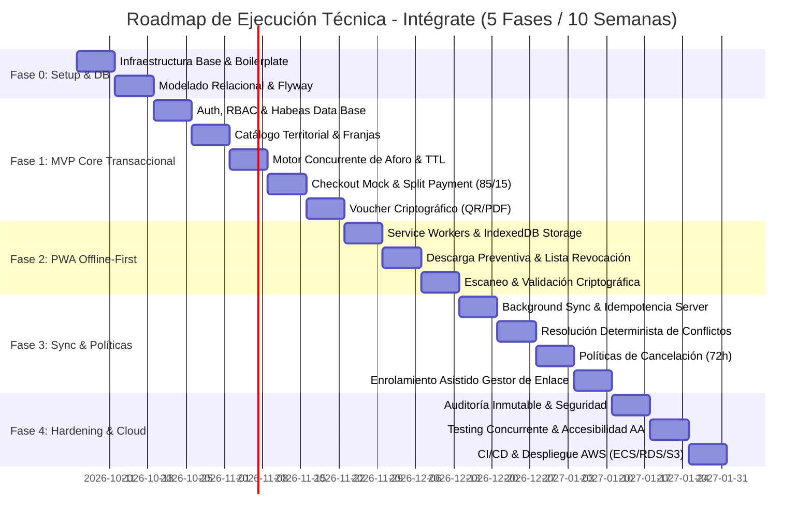

# Roadmap Técnico de Ejecución – Sistema Intégrate

**Proyecto:** Intégrate – Plataforma Transaccional de Turismo Comunitario  
**Versión:** 1.0.0  
**Fecha:** Octubre 2026  
**Metodología:** Agile / Scrumban con Gobernanza de Arquitectura Guiada por Dependencias  
**Rol Responsable:** Lead Software Architect & Senior Technical Project Manager  

---

## 1. Estrategia y Principios del Roadmap

El presente roadmap técnico de ejecución establece la secuencia lógica, técnica y temporal para la construcción, validación y despliegue del sistema **Intégrate**.

### Principios Rectores de Dependencia:
1. **Fundación Inmutable Primero:** No se escribe lógica de negocio sin un esquema relacional con transacciones ACID verificado y migraciones de base de datos automatizadas.
2. **Estabilización del Core Transaccional (MVP Fase 1):** Antes de abordar la complejidad de sincronización desconectada (*offline-first*), se consolida y prueba bajo estrés el flujo transaccional directo: autenticación, bloqueo pesimista de aforo (`SELECT ... FOR UPDATE`), retención de cupos con TTL (15 min), simulación de pagos con split payment (85/15) y emisión del voucher criptográfico.
3. **Resiliencia Territorial Desconectada (Fase 2):** Sobre el core transaccional ya estabilizado se construye la capacidad *offline* en el cliente mediante Service Workers, IndexedDB y validación de firma asimétrica en campo.
4. **Protección Comunitaria Determinista (Fase 3):** Los mecanismos de sincronización en segundo plano y resolución de colisiones implementan como regla inviolable la salvaguarda de los fondos (85%) para las comunidades campesinas y víctimas.
5. **Calidad, Cumplimiento Legal y Producción (Fase 4):** Hardening de seguridad, auditoría inmutable de Habeas Data (Ley 1581), accesibilidad WCAG 2.1 AA / NTC 5854 y despliegue cloud en AWS.

---

## 2. Cronograma de Fases Secuenciales de Desarrollo

---

## 3. Desglose Detallado de Tareas por Dependencia Técnica

### FASE 0: Entorno Base, Infraestructura y Persistencia (Semanas 1-2)
*Objetivo:* Establecer el entorno de desarrollo reproducirle, el pipeline de integración continua y el esquema de base de datos PostgreSQL con migraciones versionadas.

| ID Tarea | Nombre de la Tarea | Dependencias Técnicas | Desbloquea |
| :--- | :--- | :--- | :--- |
| **T-0.1** | Configurar repositorios, monorepo/multimódulo (`backend-api`, `frontend-pwa`) y pipeline CI base con GitHub Actions. | Ninguna | T-0.2, T-0.3 |
| **T-0.2** | Orquestar entorno de desarrollo local con Docker Compose (PostgreSQL 16, LocalStack S3 y Mailpit/SMTP). | T-0.1 | T-0.4 |
| **T-0.3** | Configurar boilerplate Backend (Java 21, Spring Boot 4.1.x, Spring Data JPA, Lombok, Validation) con paquetes limpios `com.integrate.*`. | T-0.1 | T-0.4, T-1.1 |
| **T-0.4** | Diseñar scripts de migración inicial con Flyway (`V1__initial_schema.sql`) con tipos ENUM, tablas base e índices transaccionales. | T-0.2, T-0.3 | T-1.2, T-1.3 |
| **T-0.5** | Configurar boilerplate Frontend PWA (React, Vite, TypeScript, Tailwind CSS, React Router DOM, Axios). | T-0.1 | T-1.1, T-1.2 |

---

### FASE 1: Core / MVP Transaccional (Semanas 3-5)
*Objetivo:* Implementar el flujo transaccional directo de punta a punta: desde la autenticación del turista y selección de experiencia, hasta el bloqueo atómico pesimista, pago simulado con split payment y emisión del voucher criptográfico.

| ID Tarea | Nombre de la Tarea | Dependencias Técnicas | Desbloquea |
| :--- | :--- | :--- | :--- |
| **T-1.1** | **Gestión de Identidad & RBAC Básico:** Endpoints de login/registro, generación de JWT stateless con claims de rol y Spring Security Filter. | T-0.3, T-0.4, T-0.5 | T-1.2, T-1.3 |
| **T-1.2** | **Catálogo Territorial & Parametrización de Franjas:** CRUD de experiencias y franjas horarias con capacidad de carga ecológica máxima. Interfaz de visualización pública. | T-0.4, T-1.1 | T-1.3 |
| **T-1.3** | **Motor de Concurrencia y Bloqueo Pesimista (`SELECT FOR UPDATE`):** Servicio `BookingConcurrencyEngine` con transacción de bloqueo a nivel de fila (<200 ms), descuento de cupos y creación de reserva en estado `PENDING`. | T-0.4, T-1.2 | T-1.4, T-1.5 |
| **T-1.4** | **Booking Expiration Worker (TTL 15 min):** Tarea asíncrona `@Scheduled` que audita periódicamente reservas `PENDING` vencidas y reintegra cupos a la franja horaria. | T-1.3 | T-1.5 |
| **T-1.5** | **Adaptador de Pagos Desacoplado & Split Payment:** Implementación de `PaymentGatewayAdapter` con componente Mock transaccional y endpoint de webhook que calcula la desagregación 85% / 15%. | T-1.3 | T-1.6 |
| **T-1.6** | **Generador de Voucher Criptográfico & PDF/QR:** Servicio que firma el payload JWT con clave privada RSA-2048, genera código QR de alta densidad, renderiza PDF y sube a AWS S3. | T-1.5 | T-1.7, T-2.1 |
| **T-1.7** | **Despacho de Notificación Transaccional:** Servicio de correo electrónico (Gmail API / SMTP) que despacha el comprobante y voucher oficial al turista. | T-1.6 | Fin Fase 1 |

---

### FASE 2: PWA Offline-First y Validación Territorial (Semanas 6-7)
*Objetivo:* Dotar a la PWA de capacidades de funcionamiento sin internet para que el Gestor de Enlace pueda descargar padrones locales y verificar vouchers mediante criptografía asimétrica en zonas desconectadas.

| ID Tarea | Nombre de la Tarea | Dependencias Técnicas | Desbloquea |
| :--- | :--- | :--- | :--- |
| **T-2.1** | **Infraestructura Offline en Cliente PWA:** Configuración de Service Workers con Workbox para caché de assets estáticos y esquema de IndexedDB para almacenamiento de datos locales. | T-0.5, T-1.6 | T-2.2 |
| **T-2.2** | **Módulo de Descarga Preventiva (Padrón Local & Llaves):** Funcionalidad en PWA para descargar el padrón de vouchers de la jornada, la lista delta de revocación y la clave pública RSA del servidor. | T-2.1, T-1.2 | T-2.3 |
| **T-2.3** | **Lector QR y Motor de Validación Asimétrica Offline:** Integración de escáner de cámara web/móvil y motor Web Crypto API que valida firma digital, expiración y consistencia contra IndexedDB. | T-2.2 | T-2.4 |
| **T-2.4** | **Marcación Local Anti-Doble Canje (RNF-18):** Lógica en IndexedDB que transiciona de inmediato el voucher a `CONSUMIDO_LOCAL` en el almacenamiento del dispositivo para impedir reutilizaciones offline. | T-2.3 | T-3.1 |

---

### FASE 3: Sincronización Diferida, Enrolamiento Asistido y Finanzas (Semanas 8-9)
*Objetivo:* Habilitar la sincronización en segundo plano con resolución de conflictos determinista, completar la gestión delegada del Gestor de Enlace y parametrizar las políticas de cancelación estricta.

| ID Tarea | Nombre de la Tarea | Dependencias Técnicas | Desbloquea |
| :--- | :--- | :--- | :--- |
| **T-3.1** | **Cola de Eventos Diferidos & Background Sync:** Mecanismo en Service Worker que encola las asistencias registradas localmente y las despacha automáticamente al recuperar conectividad celular. | T-2.4 | T-3.2 |
| **T-3.2** | **Endpoint de Sincronización Idempotente en Servidor:** Controlador `/api/v1/offline/sync` que procesa lotes de asistencias con clave de idempotencia y actualiza estados de reserva a `EXECUTED`. | T-3.1, T-1.3 | T-3.3 |
| **T-3.3** | **Motor de Resolución Determinista de Conflictos:** Algoritmo en backend que salvaguarda el 85% a favor de la comunidad campesina si un turista cancelado consume el servicio fraudulentamente, derivando la alerta al Admin. | T-3.2, T-1.5 | T-3.4, T-4.1 |
| **T-3.4** | **Motor de Políticas de Cancelación y Reembolso (72h):** Endpoints y lógica financiera que calculan $\Delta t$: si $>72\text{ h}$ reembolsa 85% al turista; si $\le 72\text{ h}$ o No-Show transfiere 85% a la Asociación. | T-1.5, T-3.3 | T-4.1 |
| **T-3.5** | **Módulo de Gestión Asistida (Proxy Digital):** Interfaz para que el Gestor de Enlace registre anfitriones y formule propuestas de experiencias a nombre de ellos. | T-1.1, T-1.2 | T-4.1 |

---

### FASE 4: Auditoría Legal, Hardening, Pruebas de Carga y Cloud (Semana 10)
*Objetivo:* Implementar la auditoría estricta de Habeas Data, asegurar la accesibilidad AA, realizar pruebas de estrés de aforo concurrente y desplegar la solución en infraestructura AWS.

| ID Tarea | Nombre de la Tarea | Dependencias Técnicas | Desbloquea |
| :--- | :--- | :--- | :--- |
| **T-4.1** | **Auditoría Inmutable Habeas Data (Ley 1581) & Cifrado AES-256:** Registro inmutable de consentimientos y cifrado a nivel de columna para datos de víctimas y médicos. Panel de auditoría para Admin. | T-3.3, T-3.4 | T-4.2 |
| **T-4.2** | **Pruebas de Estrés y Concurrencia de Aforo:** Suite de pruebas con JMeter/Gatling simulando 200 usuarios concurrentes compitiendo por los últimos 2 cupos para certificar tasa 0% sobreventa y latencia < 200 ms. | T-1.3, T-1.4 | T-4.3 |
| **T-4.3** | **Hardening de Accesibilidad (WCAG 2.1 AA / NTC 5854):** Ajuste de contrastes para luz solar en campo, navegación semántica por teclado y soporte de lectores de pantalla en la PWA. | T-2.3, T-3.5 | T-4.4 |
| **T-4.4** | **Pipeline CI/CD y Despliegue en AWS:** Configuración de contenedores en AWS ECS Fargate, base de datos en AWS RDS PostgreSQL, certificados SSL/TLS y bucket AWS S3 para almacenamiento de vouchers. | T-0.1, T-4.1, T-4.2 | Puesta en Producción |

---

## 4. Criterios de "Done" (Definition of Done - DoD) por Fase

Para considerar formalmente cerrada cada fase del proyecto, el equipo de desarrollo debe verificar y firmar el cumplimiento de los siguientes entregables:

### DoD Fase 0: Setup & Base de Datos
- [ ] Contenedores Docker de PostgreSQL y LocalStack arrancan de forma limpia con `docker-compose up`.
- [ ] Todas las migraciones de Flyway se aplican sin errores y se genera el esquema relacional con sus restricciones de integridad (`CHECK`, `FOREIGN KEY`).
- [ ] Los paquetes del backend están 100% aislados bajo `com.integrate.*` sin ninguna referencia o dependencia a nombres del dominio de comidas (*FoodExpress*).
- [ ] Pipeline de GitHub Actions compila el código y ejecuta análisis estático con SonarQube (0 vulnerabilidades críticas).

### DoD Fase 1: Core / MVP Transaccional
- [ ] El turista puede autenticarse, consultar experiencias y solicitar el bloqueo de cupos.
- [ ] Prueba de concurrencia unitaria/integrada valida que el bloqueo pesimista (`SELECT ... FOR UPDATE`) no permite sobreventa bajo hilos paralelos (0 colisiones).
- [ ] Las reservas abandonadas se cancelan automáticamente tras 15 minutos exactos y los cupos se liberan en el inventario.
- [ ] El webhook de pago calcula de forma comprobada la dispersión 85% comunidad / 15% plataforma.
- [ ] El voucher criptográfico se emite con firma digital válida y el PDF queda almacenado en S3 y enviado al correo del comprador.

### DoD Fase 2: PWA Offline-First y Validación Territorial
- [ ] La PWA se instala correctamente en dispositivos móviles (Android/iOS) y funciona en modo avión (desconectado).
- [ ] El Gestor de Enlace puede descargar con un clic el padrón de reservas y la clave pública institucional.
- [ ] El escáner QR de la PWA valida matemáticamente la autenticidad del voucher sin conexión celular.
- [ ] Todo voucher escaneado se almacena como `CONSUMIDO_LOCAL` en IndexedDB e impide inmediatamente su reuso local.

### DoD Fase 3: Sincronización Diferida y Políticas Financieras
- [ ] Al recuperar la conexión a internet, las asistencias encoladas se sincronizan automáticamente con el servidor en segundo plano.
- [ ] Ante un conflicto de sincronización por cancelación previa, el sistema ejecuta la resolución determinista: no descuenta el 85% de la comunidad y crea la incidencia contable para el Administrador.
- [ ] La regla de cancelación de 72 horas ejecuta con precisión matemática los reembolsos del 85% (>72h) o la retención total a favor del anfitrión ($\le$72h).
- [ ] El Gestor de Enlace puede crear y gestionar experiencias a nombre de anfitriones locales.

### DoD Fase 4: Auditoría, Hardening y Cloud
- [ ] Tabla de consentimientos de Habeas Data es inmutable (sin permisos de modificación ni eliminación) y los datos sensibles están cifrados con AES-256.
- [ ] Prueba de carga de 200 peticiones simultáneas sobre el endpoint de bloqueo responde en un tiempo promedio inferior a 200 ms y con 0% de sobreventa.
- [ ] Auditoría de accesibilidad Lighthouse certifica puntuación $\ge 90$ en accesibilidad cumpliendo WCAG 2.1 AA.
- [ ] El sistema se encuentra desplegado y operativo en AWS con HTTPS activo.

---

## 5. Matriz de Riesgos Técnicos y Planes de Contingencia

| ID Riesgo | Descripción del Riesgo Técnico | Probabilidad | Impacto | Nivel de Severidad | Estrategia de Mitigación y Contingencia |
| :--- | :--- | :--- | :--- | :--- | :--- |
| **R-01** | **Contención y Bloqueos Prolongados en Base de Datos:** Que peticiones de bloqueo pesimista queden en espera indefinida degradando la latencia del API. | Baja | Alto | **Medio** | Transacciones ultracortas (< 200 ms) liberando la conexión de inmediato tras descontar cupos; configuración de `lock_timeout = 2s` en PostgreSQL para abortar y responder con reintento controlado si hay sobrecarga. |
| **R-02** | **Fallas de Conectividad Prolongadas en Campo:** Que el Gestor de Enlace pase múltiples días sin sincronizar asistencias, demorando los pagos. | Alta | Medio | **Medio** | Dispersión supletoria automática programada en el servidor a las 24 horas del evento si no se registra reclamo del turista; módulo web de contingencia para ingreso manual con código alfanumérico. |
| **R-03** | **Fraude por Voucher Duplicado en Modo Desconectado:** Que un usuario comparta una captura de pantalla de su QR con un tercero y ambos intenten acceder en puntos rurales distintos. | Media | Alto | **Alto** | Marcación atómica inmediata en IndexedDB (`CONSUMIDO_LOCAL`) en el dispositivo del gestor; verificación visual obligatoria contra el documento de identidad oficial (CC/Pasaporte) impreso en el voucher. |
| **R-04** | **Reclamaciones por Cancelación con Discrepancia Offline:** Turista que canceló con reembolso pero consume el servicio en territorio desconectado. | Media | Medio | **Medio** | Regla de negocio determinista: el 85% de la comunidad es intocable y garantizado; la plataforma absorbe la contingencia inicial y el Administrador concilia legalmente con el usuario mediante la traza de auditoría. |
| **R-05** | **Fugas de Seguridad en Datos de Víctimas (Ley 1581):** Exposición de la condición de víctima de los anfitriones poniendo en riesgo su seguridad territorial. | Baja | Crítico | **Crítico** | Cifrado en reposo AES-256-GCM a nivel de campo en la base de datos; ofuscación y anonimización de identidades en todas las interfaces públicas del catálogo y logs del sistema. |
| **R-06** | **Fallas o Caídas del Proveedor Externo de Pagos:** Indisponibilidad de la pasarela durante fines de semana o temporadas altas de turismo. | Media | Alto | **Alto** | Desacoplamiento mediante el patrón `PaymentGatewayAdapter`; circuit breaker con Resilience4j para degradación elegante y reintentos automáticos de confirmación vía webhooks con firma HMAC. |

---

## 6. Aprobación y Traspaso a Ejecución

El presente roadmap técnico ha sido estructurado para garantizar el cumplimiento riguroso de los objetivos de la materia Ingeniería de Software III y los requerimientos del negocio comunitario. La ejecución técnica inicia de forma inmediata a partir de las tareas de la **Fase 0**.
