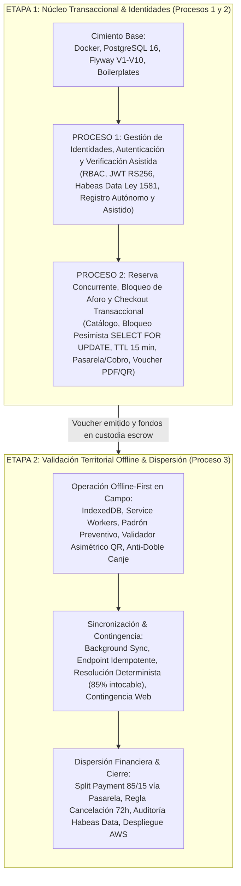

# Estado del Proyecto Intégrate (PROJECT_STATUS.md)

Última actualización: 2026-10-07  
Rol: Tech Lead, Arquitecto de Software y PM Técnico  
Ubicación: `docs/status/PROJECT_STATUS.md`  
Fuente de verdad operativa del proyecto.

---

## 1. Estado y Arquitectura Detectada

### 1.1 Diagnóstico de Artefactos Existentes
- **Documentación de Especificación y Requerimientos:**
  - `docs/especificacion_tecnica.md`: 20 Requerimientos Funcionales (RF-01 a RF-20 / CU-01 a CU-20) y No Funcionales (RNF-01 a RNF-30). Modelo de roles RBAC (Turista, Anfitrión, Gestor de Enlace, Administrador), políticas de Habeas Data (Ley 1581 / Ley 1448), split payment (85% comunidad / 15% plataforma) y política de cancelación (72h).
  - `docs/modelo_relacional.md`: Diseño de base de datos relacional PostgreSQL 16 con separación física en 8 esquemas de negocio (`auth`, `catalog`, `booking`, `payments`, `voucher`, `offline`, `audit`, `notification`), llaves compuestas, funciones trigger y políticas RLS.
  - `docs/roadmap_ejecucion.md`: Cronograma técnico estructurado en dos grandes etapas operativas por dependencia técnica y procesos delimitados.
  - `docs/architecture/backend_guidelines.md`: Estructura monolítica modular bajo Arquitectura Hexagonal / Clean Architecture (`com.integrate.*`), reglas de aislamiento de dependencias entre capas, convención de desacoplamiento escalar de entidades JPA.
  - `docs/architecture/offline_data_indexeddb.md`: Especificación de persistencia offline cliente con IndexedDB (`IntegrateOfflineDB`) y sincronización diferida.
  - `docs/api/openapi.yaml` y `docs/api/dtos_contrato_api.md`: Contratos OpenAPI 3.0 consolidados y estructura de DTOs Java.
  - `docs/rules/adr-workflow.md`: Protocolo obligatorio de registro de decisiones de arquitectura (ADR).
  - `docs/rules/git-workflow.md`: Protocolo obligatorio de flujo de trabajo en Git, ciclo de vida de estados, momentos de push y directrices de PR (`GIT-WF-001`).
  - `docs/security/security_secrets_policy.md`: Gobernanza de secretos y restricciones de seguridad para repositorios y flujos CI/CD.

- **Infraestructura y Persistencia Actual:**
  - `infra/docker/docker-compose.yml`: Stack Docker (PostgreSQL 16, LocalStack S3, Mailpit).
  - `infra/postgres/init/00_bootstrap.sql`: Script de aprovisionamiento de clúster PostgreSQL 16 (roles `integrate_owner`, `integrate_api`, `integrate_readonly`, base de datos `integrate`, timeouts de sesión y bloqueo pesimista).
  - `backend-api/src/main/resources/db/migration/`: Migraciones Flyway de `V1` a `V12` aplicadas en 9 esquemas (`V11`: municipios DIVIPOLA; `V12`: códigos de activación) y seed `R__dev_privacy_policy.sql` solo en `dev`/`test`.
  - `backend-api/`: Boilerplate Spring Boot 4.1.1 con Java 21, manejo global de errores RFC 9457 y módulos `auth` (JWT RS256, Argon2id, consentimientos, activación asistida), `catalog` (experiencias, franjas, moderación, consulta pública, enrolamiento asistido) `booking` (bloqueo pesimista de cupos, idempotencia, worker TTL) `payment` (adaptadores Mock y Wompi, webhook idempotente, escrow 85%) `voucher` (JWT RS256 en QR y PDF/A-2b, emisión asíncrona con barrido durable) y `notification` (transactional outbox y despacho SMTP con reintentos) operativos y testeados (150/150 pruebas exitosas). **Fase 1.1 (backend de la Etapa 1) completa.**
  - `frontend-pwa/`: Boilerplate Vite 8 + React 19 + TypeScript + Tailwind 4 y estructura base de carpetas.

### 1.2 Delimitación Formal de Plataforma: Aplicación Móvil (PWA Smartphone)
La aplicación cliente (`frontend-pwa`) está formal y contractualmente delimitada para operar como una **Aplicación Web Progresiva Móvil (Mobile-First / PWA para Smartphone)**:
- **Dispositivo y Factor de Forma Objetivo:** Smartphones (Android e iOS). Tanto el portal del Turista como el portal operativo del Gestor de Enlace Comunitario están diseñados primordialmente para teléfonos móviles.
- **Resolución y Viewport Base:** Diseñado con enfoque *Mobile-First estricto* para anchos de pantalla móvil estándar de **360 px a 430 px** (ej. 360×800, 375×667, 390×844, 412×915). En pantallas de mayor tamaño (desktop/tablets), la interfaz se presenta confinada en un contenedor móvil centrado (`max-w-md` / 430 px) con sombra perimetral simulando la experiencia de una app móvil nativa, garantizando fidelidad de diseño y evitando layouts dispersos.
- **Ergonomía Táctil y Zona del Pulgar (Thumb Zone):**
  - **Sticky Bottom Action Bar:** Botones de acción principal (CTAs como *"Bloquear Cupos"*, *"Confirmar y Pagar"*, *"Escanear QR"*) anclados de forma fija en la parte inferior de la pantalla para operarse cómodamente con una sola mano.
  - **Dimensiones Táctiles Mínimas:** Elementos interactivos con área de contacto $\ge 44 \times 44$ px (criterio WCAG 2.1 AA / Touch Target Size).
  - **Navegación Móvil Inferior:** Menú de navegación inferior (*Bottom Navigation Bar*) y cabeceras compactas con botón "Atrás" siempre visible.
  - **Cero Scroll Horizontal:** Bloqueo estricto de scroll lateral (`overflow-x: hidden`), tablas transformadas en tarjetas verticales móviles (*mobile cards*).
  - **Formularios Adaptados:** Inputs optimizados con atributos móviles nativos (`inputmode="numeric"` para cédula/teléfono, `inputmode="email"` y selectores de fecha nativos tipo rueda/modal).
- **Integración con Hardware Móvil y Capacidades PWA:**
  - **Instalabilidad:** Web App Manifest (`manifest.json` con `display: standalone`, `orientation: portrait`, `theme-color: #14532d`) para funcionamiento en pantalla completa sin barra de navegación del explorador.
  - **Cámara Trasera Móvil:** Lector QR configurado específicamente con `facingMode: 'environment'` para escaneo ágil con la cámara principal del dispositivo.
  - **Feedback Háptico:** Disparo de vibración táctil corta mediante `navigator.vibrate` al validar satisfactoriamente un voucher en territorio.
  - **Restricción de Recursos:** Persistencia local IndexedDB acotada a $< 10$ MB para no degradar memoria ni batería en smartphones de gama media/baja utilizados en zonas rurales.

---

## 2. Estructuración del Proyecto en Dos Etapas

Para alinearse rigurosamente con los **tres procesos de negocio transaccionales delimitados** en el *Plan de Gestión de la Calidad del Proyecto* y en la *Especificación Técnica*, la ejecución del sistema se consolida en **dos etapas estratégicas**:

### 2.1 Cobertura de Módulos por Etapa

#### **ETAPA 1: Procesos 1 y 2 (Núcleo de Identidades, Reserva Concurrente y Checkout)**
*Asegura la identificación de actores, la oferta de experiencias y la transacción segura con garantía de cero sobreventa.*
1. **Infraestructura & Base Común (Completado):** Docker Compose, PostgreSQL 16, esquemas relacionales, Flyway, RFC 9457 y trazabilidad `traceId`.
2. **Proceso 1 - Módulo Auth & Security (`auth`):**
   - Entidades de usuario, credenciales, sesiones y refresh rotativo con detección de reutilización.
   - Seguridad stateless con Resource Server JWT RS256 y control RBAC (Turista, Anfitrión, Gestor de Enlace, Administrador).
   - Captura y auditoría de consentimiento de Habeas Data (Ley 1581 / Ley 1448).
   - Flujo de enrolamiento asistido de anfitriones por parte del Gestor de Enlace Comunitario.
3. **Proceso 2 - Módulo Catálogo Territorial (`catalog`):**
   - Publicación y moderación de experiencias turísticas, municipios DIVIPOLA y franjas horarias con límite estricto de capacidad de carga ecológica.
4. **Proceso 2 - Módulo Reservas & Concurrencia (`booking`):**
   - Motor de bloqueo pesimista en base de datos (`SELECT ... FOR UPDATE`) para erradicar el overbooking (latencia < 200 ms).
   - Reserva temporal en estado `PENDING` con temporizador de expiración (TTL de 15 minutos).
   - Worker asíncrono `@Scheduled` para liberación automática de cupos vencidos.
5. **Proceso 2 - Módulo Pagos & Checkout Transaccional (`payments`):**
   - Adaptador desacoplado de pasarela colombiana (`PaymentGatewayAdapter`) para procesamiento en COP.
   - Procesamiento idempotente de webhooks de pago y retención de fondos en custodia (*escrow transaccional*).
6. **Proceso 2 - Módulo Voucher Criptográfico & Notificaciones (`voucher`, `notification`):**
   - Generación de JWT firmado asimétricamente con clave privada RSA-2048 empaquetado en código QR.
   - Renderizado del voucher oficial en PDF y almacenamiento seguro.
   - Despacho transaccional formal por correo electrónico (Gmail/SMTP) con soporte complementario de mensajería.
7. **Proceso 2 - Frontend PWA Móvil (Portal Turista en Smartphone):**
   - Interfaz mobile-first: catálogo en tarjetas verticales, selector táctil de franjas horarias con aforo, formulario de reserva móvil (contacto/EPS) y checkout transaccional con sticky bottom bar.

#### **ETAPA 2: Proceso 3 (Validación en Campo y Dispersión Financiera - Split Payment)**
*Asegura la operación continua en comunidades rurales desconectadas y la retribución económica exacta hacia las familias campesinas.*
1. **Proceso 3 - Arquitectura PWA Offline-First (`frontend-pwa`):**
   - Service Workers (Workbox) y base de datos local en el navegador IndexedDB (`IntegrateOfflineDB`).
   - Módulo de descarga preventiva diaria: padrón de reservas de la jornada, delta de revocación y clave pública RSA.
2. **Proceso 3 - Validación Territorial en Campo (Desconectada):**
   - Lector QR por cámara web/móvil y motor de validación criptográfica offline mediante Web Crypto API.
   - Marcación atómica inmediata en IndexedDB como `CONSUMIDO_LOCAL` para impedir el doble canje sin conexión (RNF-18).
   - Canal web de contingencia para ingreso manual del código alfanumérico ante falla física o descarga de la terminal móvil.
3. **Proceso 3 - Sincronización Diferida & Resolución de Conflictos (`offline`):**
   - Cola de eventos de asistencia local y disparo automático de Background Sync al detectar cobertura móvil.
   - Endpoint backend idempotente (`POST /api/v1/offline/sync`) para actualizar reservas a `EXECUTED`.
   - Motor de resolución determinista de conflictos: salvaguarda obligatoria del 85% de la comunidad ante cancelaciones desincronizadas, escalando la incidencia contable al Administrador.
4. **Proceso 3 - Dispersión Financiera Automatizada (Split Payment) & Cancelaciones (`payments`):**
   - Algoritmo de dispersión exacta: liquidación del 85% a la cuenta de la Asociación/Anfitrión y 15% de sostenibilidad a la plataforma.
   - Dispersión automática supletoria a las 24 horas del evento si no hubo reporte de inasistencia ni queja.
   - Ejecución automatizada de la política de cancelación de 72 horas (> 72 h: reembolso del 85% al turista; $\le$ 72 h o No-Show: 0% al turista y giro íntegro del 85% a la comunidad).
5. **Hardening, Calidad y Despliegue:**
   - Auditoría inmutable de Habeas Data con cifrado AES-256 en reposo (`audit`).
   - Pruebas de estrés y contención concurrente para certificar cero sobreventa.
   - Auditoría de accesibilidad WCAG 2.1 AA / NTC 5854 en interfaces de campo.
   - Pipeline de integración continua y despliegue cloud en AWS (ECS, RDS, S3).

---

## 3. Backlog Detallado de Tareas Técnicas por Etapa

### ETAPA 1: Identidades, Reserva Concurrente y Checkout Transaccional (Procesos 1 y 2)

#### Cimiento Base: Infraestructura y Persistencia (Fase 0 - Completada)
- [x] `T-0.1`: Crear `infra/docker/docker-compose.yml` y plantillas de variables de entorno `infra/env/.env.example` y `infra/env/.env.development` para PostgreSQL 16 con `00_bootstrap.sql` (ADR-0001).
- [x] `T-0.2`: Validar ejecución del contenedor PostgreSQL, roles (`integrate_owner`, `integrate_api`) y base de datos `integrate`.
- [x] `T-0.3`: Crear archivo `backend-api/pom.xml` con Spring Boot 4.1.1, Java 21, Spring Data JPA, Flyway, PostgreSQL Driver, Nimbus JOSE y Maven Wrapper (ADR-0002).
- [x] `T-0.4`: Configurar `IntegrateApplication.java` y perfiles `application.yml` y `application-dev.yml` con fail-fast de variables de entorno.
- [x] `T-0.5`: Ejecutar y verificar migración Flyway completa (`V1` a `V10`) sobre los 9 esquemas de base de datos.
- [x] `T-0.6`: Configurar estructura base común (errores RFC 9457 con `ProblemDetail`, `ErrorCode`, `GlobalExceptionHandler`, `TraceIdFilter`, ArchUnit) (ADR-0003).
- [x] `T-0.7`: Inicializar proyecto `frontend-pwa` con Vite + React + TypeScript + Tailwind CSS y diseño accesible (ADR-0004).

#### Fase 1.1: Backend - Núcleo Transaccional e Identidades (Procesos 1 y 2)
*Prioridad de ejecución: Construir, estabilizar y validar el 100% del backend de la Etapa 1 antes de iniciar desarrollos en frontend.*

##### Proceso 1 - Gestión de Identidades, Autenticación y Enrolamiento:
- [x] `T-1.1`: [Backend] Implementar entidades JPA, repositorios, DTOs y servicios de autenticación y RBAC (`modules/auth/`) con Argon2id y tokens JWT RS256 (ADR-0005).
- [x] `T-1.2`: [Backend] Implementar endpoints de autenticación (`/api/v1/auth/login`, `register`, `refresh`, `logout`, `/api/v1/me/consents`) con Spring Security Resource Server (ADR-0005).
- [x] `T-1.3`: [Backend] Implementar servicios y endpoints de enrolamiento asistido de anfitriones por el Gestor de Enlace (`/api/v1/gestor/hosts`), asignación de asociación comunitaria y persistencia inmutable de consentimientos de Habeas Data (Ley 1581 / Ley 1448).

##### Proceso 2 - Catálogo, Reserva Concurrente, Bloqueo de Aforo y Checkout:
- [x] `T-1.4`: [Backend] Implementar módulo de catálogo territorial (`modules/catalog/`): experiencias, municipios DIVIPOLA y franjas horarias con cupo ecológico máximo (ADR-0006).
- [x] `T-1.5`: [Backend] Implementar motor transaccional de reservas y concurrencia pesimista (`SELECT ... FOR UPDATE` en `modules/booking/`) garantizando tasa 0% de overbooking (<200 ms).
- [x] `T-1.6`: [Backend] Implementar worker asíncrono `@Scheduled` para liberación automática de cupos bloqueados ante abandono o expiración (TTL 15 min).
- [x] `T-1.7`: [Backend] Implementar adaptador desacoplado de pasarela de pago (`modules/payment/`) con procesamiento de cobro en COP y webhook idempotente.
- [x] `T-1.8`: [Backend] Implementar generador de vouchers criptográficos con firma asimétrica RSA-2048, código QR de alta densidad y exportación a PDF/A (`modules/voucher/`).
- [x] `T-1.9`: [Backend] Implementar servicio de notificaciones transaccionales vía correo electrónico (Gmail API / SMTP) para despacho del voucher y resumen de reserva.

#### Fase 1.2: Frontend - Interfaces PWA Móvil y Portales de Usuario (Procesos 1 y 2)
*Se implementa una vez el Backend transaccional se encuentre 100% operativo y certificado. Delimitación estricta a factor de forma móvil (viewport 360-430 px, contenedor centrado `max-w-md`, ergonomía táctil con sticky bottom bar y áreas $\ge 44\times 44$ px).*

##### Proceso 2 - Flujo Turista Móvil de Catálogo, Reserva y Checkout (Subdivisión detallada de T-1.10):
- [ ] `T-1.10`: [Frontend Móvil] Suite de interfaz móvil de catálogo, reserva y checkout en la PWA (Desglosada en subtareas operativas para smartphone):
  - [ ] `T-1.10a`: [Frontend Móvil] Implementar interfaz móvil de catálogo territorial: vista de exploración pública en tarjetas verticales, filtros por municipio DIVIPOLA en drawer/bottom-sheet táctil, tarjetas informativas con aforo ecológico y página de detalle móvil (itinerario, recomendaciones y tarifas en COP).
  - [ ] `T-1.10b`: [Frontend Móvil] Implementar selector táctil de fechas y franjas horarias con consulta de aforo y cupos disponibles en tiempo real, e inhabilitación visual de franjas agotadas (0 cupos).
  - [ ] `T-1.10c`: [Frontend Móvil] Implementar formulario móvil de formalización de reserva con captura de datos de identificación civil, contacto de emergencia, datos médicos/EPS obligatorios para póliza de turismo, inputs optimizados (`inputmode`) y aceptación explícita de Habeas Data.
  - [ ] `T-1.10d`: [Frontend Móvil] Implementar pantalla móvil de checkout transaccional con sticky bottom action bar, temporizador visual de expiración (cuenta regresiva TTL de 15 minutos), desglose de tarifas e integración visual con pasarela de pagos en COP (PSE, tarjetas y billeteras).
  - [ ] `T-1.10e`: [Frontend Móvil] Implementar pantalla móvil de confirmación de reserva exitosa con renderizado a pantalla completa del código QR criptográfico de alta densidad, ficha de viaje y botón de exportación a PDF/A del voucher oficial.

##### Proceso 1 - Autenticación y Enrolamiento en PWA Móvil:
- [ ] `T-1.11`: [Frontend Móvil] Implementar interfaz móvil de autenticación y registro de turistas en la PWA (login táctil, registro de nuevo usuario, control de sesión con refresh token y modal de consentimiento legal de Habeas Data).
- [ ] `T-1.12`: [Frontend Móvil] Implementar interfaz móvil de enrolamiento asistido en el portal del Gestor de Enlace (`/gestor/anfitriones/enrolamiento`) optimizada para operación en smartphone de campo con formulario táctil y captura de consentimiento de tratamiento de datos personales.

---

### ETAPA 2: Validación en Campo y Dispersión Financiera (Proceso 3)

#### Fase 2.1: Backend - Sincronización Diferida, Dispersión y Auditoría (Proceso 3)
*Prioridad de ejecución: Construir y validar primero la lógica backend de sincronización, reglas financieras y resolución de conflictos.*
- [ ] `T-2.1`: [Backend] Implementar endpoints de descarga preventiva de padrón de vouchers de la jornada y lista delta de revocación (`modules/offline/`).
- [ ] `T-2.2`: [Backend] Implementar endpoint transaccional de canje manual alfanumérico de contingencia (`POST /api/v1/offline/contingency/redeem`) con verificación contra padrón/revocación y prevención de doble canje.
- [ ] `T-2.3`: [Backend] Implementar endpoint idempotente de sincronización por lotes (`POST /api/v1/offline/sync`) y transición atómica de reservas a `EXECUTED`.
- [ ] `T-2.4`: [Backend] Implementar motor de resolución determinista de conflictos contables que proteja de forma irrenunciable el 85% de la comunidad campesina.
- [ ] `T-2.5`: [Backend] Implementar algoritmo de dispersión financiera automatizada (split payment 85% asociación/anfitrión y 15% plataforma) y dispersión supletoria a las 24 h.
- [ ] `T-2.6`: [Backend] Implementar ejecución automática de la política de cancelación de 72 horas (> 72 h reembolso 85%; $\le$ 72 h o No-Show liquidación íntegra a la comunidad).
- [ ] `T-2.7`: [Backend] Implementar bitácora inmutable de auditoría de Habeas Data (Ley 1581 / Ley 1448) con cifrado AES-256 en reposo (`modules/audit/`).

#### Fase 2.2: Frontend - PWA Móvil Offline-First y Validación Territorial (Proceso 3)
*Se implementa para smartphones de campo consumiendo los endpoints de descarga preventiva y sincronización ya certificados.*
- [ ] `T-2.8`: [Frontend Móvil] Configurar Service Workers (Workbox) y base de datos IndexedDB (`IntegrateOfflineDB`) para soporte 100% desconectado en smartphones rurales (< 10 MB).
- [ ] `T-2.9`: [Frontend Móvil] Implementar módulo móvil de descarga preventiva y almacenamiento de padrón local en IndexedDB para el Gestor de Enlace.
- [ ] `T-2.10`: [Frontend Móvil] Integrar lector QR con cámara trasera de smartphone (`facingMode: 'environment'`), respuesta háptica de vibración (`navigator.vibrate`) y motor de validación criptográfica offline mediante Web Crypto API.
- [ ] `T-2.11`: [Frontend Móvil] Implementar marcación atómica local anti-doble canje (`CONSUMIDO_LOCAL`) en IndexedDB al momento de la lectura (RNF-18).
- [ ] `T-2.12`: [Frontend Móvil] Implementar interfaz móvil de contingencia en PWA (módulo Gestor/Admin) para consulta y canje manual mediante código alfanumérico ante falla física de cámara.
- [ ] `T-2.13`: [Frontend Móvil] Implementar cola de eventos de asistencia diferida en smartphone y disparador automático de Background Sync al recuperar cobertura móvil.

#### Fase 2.3: Calidad, Hardening y Despliegue Cloud (QA & DevOps)
- [ ] `T-2.14`: [Backend/QA] Ejecutar pruebas de carga y estrés de contención pesimista de aforos (`SELECT ... FOR UPDATE`) con k6/JMeter (200 usuarios concurrentes, tasa 0% sobreventa y latencia < 200 ms).
- [ ] `T-2.15`: [Frontend/QA] Ejecutar auditoría y remediación de accesibilidad en PWA bajo estándares WCAG 2.1 AA / NTC 5854 (contraste solar en exteriores, navegación semántica por teclado y lectores de pantalla).
- [ ] `T-2.16`: [DevOps] Configurar pipeline de CI/CD final y despliegue de infraestructura cloud en AWS (ECS Fargate, RDS PostgreSQL, S3).

---

---

## 4. Bitácora de Avances

| Fecha | Tarea ID | Estado | Descripción del Avance | Archivos Afectados |
| :--- | :--- | :--- | :--- | :--- |
| 2026-10-05 | N/A | Completado | Inspección técnica inicial del repositorio, diagnóstico de dependencias y creación del archivo maestro `PROJECT_STATUS.md`. | `PROJECT_STATUS.md` |
| 2026-10-05 | T-0.1 | En desarrollo | Asignación de especificación técnica para Docker Compose y variables de entorno de base de datos. | `PROJECT_STATUS.md` |
| 2026-10-05 | N/A | Completado | Reubicación del archivo de seguimiento a carpeta dedicada `docs/status/`. | `docs/status/PROJECT_STATUS.md` |
| 2026-10-05 | T-0.1 | Completado | ADR-0001 aceptado. Docker Compose (PostgreSQL 16 por defecto; LocalStack S3 y Mailpit por perfiles), plantilla `.env.example`, `.gitignore` SEC-DIR-004, `.gitattributes` (LF), hook de bucket S3 y README de infra. Corrección de `backend_guidelines.md` §2 y §6.1. | `infra/docker/docker-compose.yml`, `infra/env/.env.example`, `infra/localstack/init/01_create_bucket.sh`, `infra/README.md`, `.gitignore`, `.gitattributes`, `docs/architecture/adr/ADR-0001-*.md` |
| 2026-10-05 | T-0.2 | Completado | Stack `--profile full` arriba y healthy. Bootstrap ejecutado: roles `integrate_owner/api/reporting` con login y timeouts, BD `integrate` (owner `integrate_owner`, UTC). Autenticación SCRAM verificada (contraseña errónea rechazada), bucket `integrate-vouchers-dev` creado, Mailpit 200, fail-fast sin env-file. | — |
| 2026-10-05 | T-0.3 | En desarrollo | Redacción de ADR-0002 para definición de stack base backend (Spring Boot 3.3.x, Java 21, Maven Wrapper, dependencias core/crypto/flyway/testing) y especificación técnica de `pom.xml`. | `docs/architecture/adr/ADR-0002-stack-base-backend-spring-boot.md`, `docs/status/PROJECT_STATUS.md` |
| 2026-10-05 | T-0.3 | Completado | ADR-0002 aceptado con cambio a Spring Boot 4.1.1 (3.3.x fuera de soporte OSS). `pom.xml` con starters modulares de Boot 4 (`webmvc`, `flyway`, `*-test`), Nimbus 10.10, `bcprov` 1.86 (solo Argon2, sin `bcpkix`), Testcontainers 2.0.5, ArchUnit 1.5.1, Lombok `optional` + `annotationProcessorPaths`. Maven Wrapper 3.3.4 `only-script` → Maven 3.9.16 con `distributionSha256Sum`. Verificado: `mvnw test-compile` BUILD SUCCESS y compilación de prueba (Lombok/Argon2/Nimbus) correcta. Referencias "Spring Boot 3.x" actualizadas en la documentación. | `backend-api/pom.xml`, `backend-api/mvnw`, `backend-api/mvnw.cmd`, `backend-api/.mvn/wrapper/maven-wrapper.properties`, `.gitignore`, `.gitattributes`, `docs/architecture/adr/ADR-0002-*.md`, `docs/architecture/backend_guidelines.md`, `docs/especificacion_tecnica.md`, `docs/roadmap_ejecucion.md` |
| 2026-10-05 | T-0.4 | En desarrollo | Asignación de especificación técnica para `IntegrateApplication.java` y perfiles de configuración `application.yml` y `application-dev.yml`. | `docs/status/PROJECT_STATUS.md` |
| 2026-10-05 | T-0.4 | Completado | `IntegrateApplication` en `com.integrate`. `application.yml`: DataSource `integrate_api` y Flyway `integrate_owner` por variables de entorno sin valores por defecto (fail-fast verificado: aborta sin `DATABASE_URL`), Hikari `integrate-api-pool` (connection-timeout 5s < statement_timeout 15s), Flyway con 9 esquemas (`common` + 8 de negocio; historial en `common`), `clean-disabled`, `ddl-auto: validate`, `open-in-view: false`, JDBC en UTC, errores HTTP sin stacktrace/mensaje. `application-dev.yml` importa `infra/env/.env.development` como properties. `.env.example` con `SERVER_PORT` y `DB_POOL_MAX_SIZE` opcionales. Verificado: `mvnw package` OK y arranque con perfil `dev` (Flyway desactivado, queda para T-0.5) en 3,5s con conexión a PostgreSQL como `integrate_api`; HTTP 401 por defecto (Spring Security). | `backend-api/src/main/java/com/integrate/IntegrateApplication.java`, `backend-api/src/main/resources/application.yml`, `backend-api/src/main/resources/application-dev.yml`, `infra/env/.env.example` |
| 2026-10-05 | T-0.5 | Completado | Migración Flyway `V1`→`V10` aplicada al arrancar con perfil `dev` (1,5s, 10/10 `success`; historial en `common.flyway_schema_history` con marcador `<< Flyway Schema Creation >>`). 49 tablas en 9 esquemas, todas propiedad de `integrate_owner`; extensiones `pg_trgm` y `btree_gist`. Privilegios verificados: `integrate_api` sin `CREATE` (DDL rechazado: `permission denied for schema auth`), con DML en `auth`, sin `UPDATE/DELETE/TRUNCATE` en `audit` (V9) y sin acceso a `flyway_schema_history`. Segundo arranque idempotente: 11 migraciones validadas, "No migration necessary". | — (sin cambios de código) |
| 2026-10-05 | T-0.6 | En desarrollo | Redacción de ADR-0003 (Propuesto): errores RFC 9457 con `ProblemDetail` nativo, catálogo `ErrorCode`, `GlobalExceptionHandler`, `TraceIdFilter` (`X-Trace-Id`), `Clock` UTC y reglas ArchUnit; eliminación del sobre `ApiResponse` por contradecir el contrato OpenAPI. | `docs/architecture/adr/ADR-0003-estructura-comun-errores-rfc9457-trazabilidad.md`, `docs/status/PROJECT_STATUS.md` |
| 2026-10-05 | T-0.6 | Completado | ADR-0003 aceptado. `ErrorCode` (21 códigos del catálogo §2; slugs nuevos `schedule-not-bookable` y `payment-provider-mismatch`, sin ejemplo en el contrato), `BusinessRuleException` con extensiones/cabeceras, `GlobalExceptionHandler` (422 validación con `invalidParams`, 400 `about:blank` sin reflejar la entrada, 404, 403 RBAC, 401, 503 + `Retry-After: 1` por lock/SQLState 55P03, 500 sin `detail`), `type` siempre presente (Spring 7 omitía `about:blank`), `InvalidParam`, `TraceIdFilter` (antes de Security; id entrante validado), `TimeConfig` (`Clock` UTC), `traceId` en el patrón de log. Pruebas: 18/18 (handler MVC, filtro, catálogo, ArchUnit). Verificado en ejecución real: 401 de Spring Security con `X-Trace-Id`. Guías y especificación sin `ApiResponse`. | `backend-api/src/main/java/com/integrate/common/**`, `backend-api/src/main/java/com/integrate/config/TimeConfig.java`, `backend-api/src/main/resources/application.yml`, `backend-api/src/test/java/com/integrate/**`, `docs/architecture/backend_guidelines.md`, `docs/especificacion_tecnica.md`, `docs/architecture/adr/ADR-0003-*.md` |
| 2026-10-05 | T-0.7 | En desarrollo | Asignación de especificación técnica para inicialización del frontend PWA (Vite, React, TypeScript, Tailwind CSS, estructura modular). Última tarea previa al hito de subida y cierre formal de Fase 0. | `docs/status/PROJECT_STATUS.md` |
| 2026-10-05 | T-0.7 | En desarrollo | Redacción de ADR-0004 (Propuesto): Vite 8, React 19, TypeScript 6 (TS 7 incompatible con `typescript-eslint`), Tailwind 4 CSS-first, React Router 8, ESLint 9 + `jsx-a11y` (ESLint 10 sin soporte), estructura por *features* con reglas de importación, cliente `fetch` con `ApiError` RFC 9457, `VITE_API_BASE_URL` fail-fast y proxy `/api` para la cookie `SameSite=Strict`. Service Worker/IndexedDB diferidos a T-2.1. | `docs/architecture/adr/ADR-0004-boilerplate-frontend-pwa-vite-react.md`, `docs/status/PROJECT_STATUS.md` |
| 2026-10-05 | T-0.7 | Completado | ADR-0004 aceptado, con enmienda: ESLint 10 + `eslint-plugin-jsx-a11y-x` (ESLint 9 marcado sin soporte por npm; `jsx-a11y` sin publicar desde 2024). `frontend-pwa/` con Vite 8.3, React 19.3, TS 6.0 estricto (`noUncheckedIndexedAccess`, `exactOptionalPropertyTypes`), Tailwind 4.3 con tokens AA/AAA y foco de doble anillo, React Router 8.4 (layouts Turista `/` y Gestor `/gestor`, 404, página de error con `traceId`), `createHttpClient` (`fetch`, `credentials: include`, token en memoria, `ApiError` RFC 9457 / `NetworkError`), `VITE_API_BASE_URL` fail-fast y proxy `/api`. Fronteras `shared`/`features`/`app` con ESLint (probadas con importaciones prohibidas). Verificado: `typecheck`, `lint` (0 avisos), `format:check`, 22/22 pruebas y `build` (100 KB gzip). En el navegador: pantalla de configuración incompleta sin `.env`, skip link como primer foco, navegación, 404 y vista móvil de 375 px sin scroll horizontal. Prueba de punta a punta contra el backend real (puerto 8081, porque Steam ocupa el 8080): 401 → `ApiError` con `X-Trace-Id`. `.gitignore` verificado en un repo temporal (`node_modules/`, `dist/` y `.env.development.local` excluidos; `.env.example` versionado). Sin commits (indicación del desarrollador). Cierre técnico de Fase 0. | `frontend-pwa/**`, `.claude/launch.json`, `docs/architecture/adr/ADR-0004-*.md`, `docs/status/PROJECT_STATUS.md` |
| 2026-10-05 | Fase 0 | Completado | Repositorio Git inicializado (`main`) y entrega de Fase 0 en un commit inicial con push a `origin`. Corrección de `.gitignore`: `ENV/` se anclaba a cualquier nivel y, con `core.ignorecase`, ignoraba `infra/env/` completo (incluida la plantilla `.env.example`); ahora `/ENV/`. Checklist SEC-DIR-004 verificado: `.env` reales ignorados y ninguna contraseña local presente en archivos versionados. | `.gitignore`, `docs/status/PROJECT_STATUS.md` |
| 2026-10-05 | T-1.1 / T-1.2 | En desarrollo | Inicio de Fase 1. Redacción de ADR-0005 (Propuesto): JWT RS256 validado con el resource server de Spring Security (sin filtro propio), llave de sesión por `JWT_SIGNING_KEY` (fail-fast), Argon2id directo (el prefijo `{argon2}` de `DelegatingPasswordEncoder` viola `ck_users_password_hash`), bloqueo 5/10 min con `FOR UPDATE`, refresh rotativo con detección de reutilización, 401/403 en RFC 9457. Brechas detectadas y propuestas: `/auth/register` (solo `TOURIST`), `/auth/logout` y `/auth/consents` ausentes del OpenAPI; `auth.privacy_policies` sin política vigente (→ `V11`); propagación de `integrate.actor_id`. Fuera de alcance: `register-assisted` y gestión de roles (T-3.4/T-3.5). | `docs/architecture/adr/ADR-0005-autenticacion-jwt-rbac-sesiones.md`, `docs/status/PROJECT_STATUS.md` |
| 2026-10-05 | T-1.1 / T-1.2 | En desarrollo | ADR-0005 aceptado con ajustes: `GET/POST /api/v1/me/consents` (en vez de `/auth/consents`); política de privacidad por seed repetible solo en `dev`/`test` (`v0.1` borrador), la `v1.0` aprobada llegará por migración antes de producción; primer `ADMIN` con `AdminBootstrapRunner` por variables `BOOTSTRAP_ADMIN_*`; ventana de gracia de 10 s en la detección de reutilización del refresh token. | `docs/architecture/adr/ADR-0005-*.md`, `docs/status/PROJECT_STATUS.md` |
| 2026-10-05 | T-1.1 | Completado | Dominio `auth`: 7 entidades (relaciones escalares; dominios `common.*` declarados en `columnDefinition` porque PostgreSQL los reporta como `Types.DISTINCT` y `ddl-auto: validate` los rechazaba), repositorios con `FOR UPDATE` (usuario y refresh token), DTOs del contrato y servicios: `AuthService` (verificación Argon2id fuera de transacción y hash ficticio para correos inexistentes; bloqueo 5 fallos/10 min → 15 min; rotación con `replaced_by_id`, gracia de 10 s y `REUSE_DETECTED` sobre todas las sesiones; logout idempotente; los rechazos confirman la transacción para no perder el intento), `RegistrationService` (solo `TOURIST`, 409 también ante la carrera del índice único, bootstrap del primer `ADMIN`), `ConsentService` (estado por finalidad y otorgamiento idempotente). Puerto `AccessTokenIssuer` implementado en `security/jwt` (RS256 + `kid`, `iss`, `jti`), llave por `JWT_SIGNING_KEY` con fail-fast (≥ 2048 bits, sin eco de la entrada), `Argon2PasswordEncoder` (19 MiB, t=2, p=1). Seed `R__dev_privacy_policy.sql` (v0.1) solo en `dev`/`test`. Starter `spring-boot-starter-security-oauth2-resource-server` agregado. Pruebas: 33 nuevas (Testcontainers con el mismo `00_bootstrap.sql`, la app como `integrate_api`); suite completa 51/51. | `backend-api/pom.xml`, `backend-api/src/main/java/com/integrate/{IntegrateApplication.java,modules/auth/**,security/**}`, `backend-api/src/main/resources/{application.yml,application-dev.yml,db/seed-dev/**}`, `backend-api/src/test/**`, `infra/env/.env.example` |
| 2026-10-05 | T-1.2 | Completado | `AuthController` (`login`, `register` 201 + `Location`, `refresh`, `logout` 204) y `MeConsentController` (`GET/POST /api/v1/me/consents`). Cookie `refresh_token` `HttpOnly; Secure; SameSite=Strict; Path=/api/v1/auth`, borrada en logout y en todo 401 de refresh; `Cache-Control: no-store` en respuestas con token. `SecurityConfig` stateless y deny-by-default con el resource server (claim `roles` → authorities, `@EnableMethodSecurity`); en los `POST` públicos de `/api/v1/auth/**` se ignora `Authorization` para que un access token expirado no bloquee el refresh. 401/403 de la cadena en RFC 9457 con `traceId` (`ProblemAuthenticationEntryPoint` con `WWW-Authenticate: Bearer`, `ProblemAccessDeniedHandler`). CORS por `CORS_ALLOWED_ORIGINS` (vacío por defecto). Actor propagado a PostgreSQL con `ActorPropagatingTransactionManager` (`set_config(..., true)` por transacción). Contrato actualizado (`openapi.yaml`: `register`, `logout`, `me/consents` y esquemas, verificado con SnakeYAML: parsea y todas las `$ref` resuelven; `dtos_contrato_api.md`; `especificacion_tecnica.md` §5.1 sin `role`; `backend_guidelines.md` sin `JwtAuthenticationFilter`; notas de implementación en ADR-0005). `GlobalExceptionHandlerTest` acotado a su controlador de prueba. Pruebas: 18 nuevas (15 de API sobre la cadena real + 3 ArchUnit), suite 69/69. Verificado de punta a punta con `curl` contra el backend real (perfil `dev`, puerto 8081): registro, login con cookie, 401 RFC 9457, consentimientos, refresh con Bearer adjunto, logout y refresh revocado. Se agregó a `infra/env/.env.development` (local, ignorado) una llave RSA de desarrollo y la configuración `backend-api` a `.claude/launch.json`. | `backend-api/src/main/java/com/integrate/{modules/auth/controller/**,security/**}`, `backend-api/src/main/resources/application.yml`, `backend-api/src/test/**`, `docs/api/{openapi.yaml,dtos_contrato_api.md}`, `docs/especificacion_tecnica.md`, `docs/architecture/{backend_guidelines.md,adr/ADR-0005-*.md}`, `infra/env/.env.example`, `.claude/launch.json` |
| 2026-10-05 | T-1.3 | En desarrollo | Redacción de ADR-0006 (Propuesto): catálogo con anfitrión autónomo (RF-05) y moderación del administrador (RF-07/RF-08), franjas en hora local con tope de aforo, consulta pública paginada sin datos del anfitrión (R-05), alta mínima de asociaciones y perfiles de anfitrión por `ADMIN`. Bloqueos detectados: `catalog.municipalities` vacía (FK obligatoria de experiencias) → migración `V11` con DIVIPOLA oficial (requiere autorizar la descarga de datos.gov.co); sin endpoints para crear asociaciones ni anfitriones. Flujos del Gestor de Enlace e imágenes diferidos. | `docs/architecture/adr/ADR-0006-catalogo-territorial-experiencias-franjas.md`, `docs/status/PROJECT_STATUS.md` |
| 2026-10-07 | N/A | Completado | Reestructuración del estado operativo del proyecto en dos etapas principales trazadas con el Plan de Calidad de Software: Etapa 1 con Procesos 1 y 2 (Identidades, Catálogo, Reserva Concurrente, TTL, Pagos/Voucher) y Etapa 2 con Proceso 3 (PWA Offline-First, Validación en Campo, Background Sync, Split Payment 85/15 y Hardening). | `docs/status/PROJECT_STATUS.md`, `docs/roadmap_ejecucion.md` |
| 2026-10-07 | N/A | Completado | Reordenamiento secuencial por prioridad técnica: ejecución del 100% del Backend por etapa antes de abordar Frontend (Fase 1.1 Backend T-1.1 a T-1.9 $\rightarrow$ Fase 1.2 Frontend PWA T-1.10a-e/T-1.11/T-1.12; Fase 2.1 Backend T-2.1 a T-2.7 $\rightarrow$ Fase 2.2 Frontend PWA Offline T-2.8 a T-2.13 $\rightarrow$ Fase 2.3 QA/DevOps T-2.14 a T-2.16). | `docs/status/PROJECT_STATUS.md` |
| 2026-10-07 | N/A | Completado | Delimitación formal de la plataforma cliente: aplicación orientada exclusivamente a Smartphone (Mobile-First estricto, viewport 360-430 px, contenedor centrado `max-w-md` en desktop, sticky bottom bar, cámara trasera para escaneo QR, feedback háptico y límites de cuota móvil). | `docs/status/PROJECT_STATUS.md` |
| 2026-10-07 | T-1.4 | Completado | ADR-0006 aceptado (con autorización de descarga DIVIPOLA). Nota de trazabilidad: la entrada "T-1.3 · ADR-0006" del 2026-10-05 y el commit `436e760` corresponden a esta tarea según la numeración por etapas. `V11__divipola_municipalities.sql` generada desde datos.gov.co (`gdxc-w37w`): 1.122 entidades (1.103 municipios, 18 áreas no municipalizadas, 1 isla), 33 departamentos coincidentes con V3. Módulo `catalog`: 8 entidades (columnas de víctima de `host_profiles` sin mapear a propósito, R-05), especificaciones JPA para la búsqueda pública, `StatusReasonContext` (`integrate.status_reason` para el historial). Admin: alta de asociaciones y anfitriones (`RoleAssignmentService` público de `auth` otorga `ROLE_HOST`); moderación approve/reject/suspend/reinstate/retire con validación previa de transiciones (409 `CATALOG_INVALID_STATUS_TRANSITION`) y cierre/reapertura de franjas futuras. Anfitrión: CRUD de propuestas (404 ante ajenas), franjas por lote atómico en hora local `America/Bogota` con tope de aforo (409 `CATALOG_SCHEDULE_CONFLICT`). Público: catálogo paginado (`PageResponse`) sin datos del anfitrión, detalle, disponibilidad del contrato (404/409/422, 60 días) y referencias DIVIPOLA/categorías. Cuatro códigos de error nuevos (incluido `CATALOG_ASSOCIATION_EXISTS`, desviación anotada en ADR-0006). `PgDomains` movido a `common/persistence`. Contrato: `openapi.yaml` (+20 operaciones, verificado: parsea y todas las `$ref` resuelven) y `dtos_contrato_api.md` §4.1. Pruebas: 12 nuevas (10 de API del catálogo + 2 ArchUnit de fronteras entre módulos); suite 81/81. Verificado de punta a punta con `curl` contra el backend `dev`: asociación → anfitrión → propuesta → franjas → revisión → aprobación → catálogo público y disponibilidad. | `backend-api/src/main/java/com/integrate/{common/**,modules/auth/**,modules/catalog/**,security/SecurityConfig.java}`, `backend-api/src/main/resources/db/migration/V11__divipola_municipalities.sql`, `backend-api/src/test/**`, `docs/api/{openapi.yaml,dtos_contrato_api.md}`, `docs/especificacion_tecnica.md`, `docs/architecture/adr/ADR-0006-*.md`, `docs/status/PROJECT_STATUS.md` |
| 2026-10-07 | N/A | Completado (obsoleta, ver corrección siguiente) | Alineación documental con la estructura por etapas: `roadmap_ejecucion.md` §3 renumerado con una versión **anterior** de la numeración de este archivo (Fase 0: T-0.1 a T-0.7; Etapa 1: T-1.1 a T-1.10; Etapa 2: T-2.1 a T-2.14) y §4 con DoD agrupados por etapa (la dispersión 85/15 pasa del DoD de la Fase 1 al de la Fase 3; se agregan al DoD de la Fase 1 el enrolamiento asistido y la PWA móvil). Notas de renumeración y enmienda de alcance en ADR-0005 y ADR-0006: el registro asistido y los datos de víctima pasan de "Fase 3" a T-1.3 (Etapa 1), con ADR propio pendiente. Referencias de tareas actualizadas en comentarios del backend (4), del frontend (4) y en `openapi.yaml`. Pendiente de decisión: el push de `git-workflow.md` §3 sigue diciendo "al culminar cada FASE". | `docs/roadmap_ejecucion.md`, `docs/architecture/adr/ADR-0005-*.md`, `docs/architecture/adr/ADR-0006-*.md`, `docs/api/openapi.yaml`, `backend-api/src/main/java/**` (comentarios), `frontend-pwa/src/**` (comentarios), `docs/status/PROJECT_STATUS.md` |
| 2026-10-07 | T-1.3 | Pendiente (corrección) | Corrección de estado: `T-1.3` vuelve a `[ ]`. Quedó marcada como completada en el commit `750647c` (reorganización por etapas), pero el enrolamiento asistido por el Gestor de Enlace **no está implementado**: no existen `/api/v1/gestor/hosts`, `register-assisted`, entidades de gestor (`link_manager_profiles`, `host_manager_assignments`) ni el cifrado AES-GCM de datos de víctima. Lo que existe hoy es el alta mínima de asociaciones y anfitriones por `ADMIN` (`POST /api/v1/admin/associations`, `POST /api/v1/admin/host-profiles`, T-1.4, ADR-0006 §3), sin datos de víctima ni consentimiento `ASSISTED_PROXY`. Siguiente paso: ADR de T-1.3. Además, la alineación de la entrada anterior usó una numeración superada; la numeración vigente es la del §3 de este archivo (Etapa 1: Fase 1.1 backend T-1.1 a T-1.9, Fase 1.2 frontend T-1.10a–e, T-1.11, T-1.12; Etapa 2: Fase 2.1 backend T-2.1 a T-2.7, Fase 2.2 frontend T-2.8 a T-2.13, Fase 2.3 QA/DevOps T-2.14 a T-2.16). `roadmap_ejecucion.md`, las notas de renumeración de ADR-0005/ADR-0006 y el comentario de `frontend-pwa/src/shared/api/errors.ts` quedan pendientes de realinear con ella. | `docs/status/PROJECT_STATUS.md` |
| 2026-10-07 | N/A | Completado | Realineación con la numeración vigente de este archivo (cierra lo pendiente de la corrección anterior). `roadmap_ejecucion.md`: principios (backend antes que frontend en cada etapa; 85/15 en la Etapa 2), gantt por fases 0, 1.1, 1.2, 2.1, 2.2 y 2.3, §3 con las 39 tareas del backlog (Fase 0: T-0.1 a T-0.7; Fase 1.1: T-1.1 a T-1.9; Fase 1.2: T-1.10a–e, T-1.11, T-1.12; Fase 2.1: T-2.1 a T-2.7; Fase 2.2: T-2.8 a T-2.13; Fase 2.3: T-2.14 a T-2.16) y §4 con DoD por fase. Notas de renumeración corregidas en ADR-0005 (refresh *single-flight* → T-1.11; endurecimiento → T-2.7 y T-2.16) y ADR-0006 (PWA → T-1.10a–e; AES de auditoría → T-2.7; cancelación de franjas con reservas → T-2.6), y nota nueva en ADR-0004 (SW/IndexedDB → T-2.8, catálogo/reserva → T-1.10a–e, cableado de sesión → T-1.11, cola offline → T-2.13; la delimitación móvil requiere enmendar ADR-0004 antes de T-1.10). Comentarios del frontend realineados (4). Hallazgos sin tarea asignada en el backlog: revisión RF-07 por el Gestor y creación de experiencias a nombre de anfitriones (RF-06); revocación de consentimientos y límite de intentos por IP. | `docs/roadmap_ejecucion.md`, `docs/architecture/adr/ADR-0004-*.md`, `docs/architecture/adr/ADR-0005-*.md`, `docs/architecture/adr/ADR-0006-*.md`, `frontend-pwa/src/**` (comentarios), `docs/status/PROJECT_STATUS.md` |
| 2026-10-07 | T-1.3 | En desarrollo | Redacción de ADR-0007 (Propuesto): enrolamiento asistido por el Gestor de Enlace. Se conserva `POST /api/v1/auth/register-assisted` del contrato y `/api/v1/gestor/**` agrupa las operaciones del gestor (subida prefirmada, listado de anfitriones, código de activación). Huecos resueltos: acreditación de gestores por `ADMIN` (`/api/v1/admin/link-managers`), subida prefirmada a un bucket S3 sensible con verificación `HeadObject`, cifrado AES-256-GCM en la aplicación (`common/crypto`, AAD por fila y columna, llave versionada por entorno) y activación asistida `PENDING_RESET → ACTIVE` con código de un solo uso de 72 h (`V12`). Pendiente de aceptación. | `docs/architecture/adr/ADR-0007-enrolamiento-asistido-gestor-enlace.md`, `docs/status/PROJECT_STATUS.md` |
| 2026-10-07 | T-1.3 | Completado | ADR-0007 aceptado; se confirma la política de push por **fase** de `git-workflow.md` §3: el push de esta rama se hará al cerrar la Fase 1.1 (T-1.9). **Acreditación de gestores** por `ADMIN` (`/api/v1/admin/link-managers` + `suspend`/`reinstate`/`revoke`, `ROLE_LINK_MANAGER` vía `RoleAssignmentService`); un gestor sin acreditación `ACTIVE` recibe 403 `ENROLLMENT_MANAGER_NOT_ACTIVE` aunque su JWT conserve el rol. **Registro asistido** `POST /api/v1/auth/register-assisted` (contrato vigente), en una transacción: • cuenta `PENDING_RESET` con secreto aleatorio y rol `HOST` (nueva interfaz pública `AssistedAccountService`); • consentimiento `ASSISTED_PROXY` × 2 con `captured_by`, la terminal del gestor y el formato físico; • `host_profiles` con datos de víctima cifrados AES-256-GCM (`common/crypto`, AAD por fila y columna, llave versionada `SENSITIVE_DATA_KEY_V1`); • asignación vigente con el gestor; la asociación es siempre la del gestor y el correo sintético es `{docType}{docNumber}@comunidad.integrate.co`. **Documentos:** subida prefirmada a un bucket S3 sensible (`/api/v1/gestor/uploads`, AWS SDK v2, `common/storage`), verificados con `HeadObject` (PDF ≤ 5 MB, prefijo por tipo, sin reutilizar). **Gestor:** `GET /api/v1/gestor/hosts` sin datos de víctima ni documento completo. **Activación asistida:** código de un solo uso de 72 h (`V12__credential_activation_codes.sql`, SHA-256, 5 intentos) y `POST /api/v1/auth/activate` público. Cuatro códigos de error nuevos. Desviaciones anotadas en ADR-0007 (422 en lugar de 400; credenciales S3 estáticas opcionales para `dev`, hallazgo de la verificación de punta a punta). Contrato: `openapi.yaml` (+6 operaciones, verificado: parsea y todas las `$ref` resuelven) y `dtos_contrato_api.md` §1, §2, §3.3 y §3.5. Pruebas: 18 nuevas (cifrado, códigos, 8 de API del enrolamiento con S3 en memoria, ArchUnit de `javax.crypto`); suite 99/99. Verificado de punta a punta contra el backend `dev` y LocalStack real: acreditación → URL prefirmada → `PUT` del PDF → registro asistido → listado → código → activación → login. | `backend-api/pom.xml`, `backend-api/src/main/java/com/integrate/{common/**,modules/auth/**,modules/catalog/**,security/**}`, `backend-api/src/main/resources/{application.yml,db/migration/V12__credential_activation_codes.sql}`, `backend-api/src/test/**`, `infra/{env/.env.example,docker/docker-compose.yml,localstack/init/01_create_bucket.sh}`, `docs/api/{openapi.yaml,dtos_contrato_api.md}`, `docs/especificacion_tecnica.md`, `docs/architecture/adr/ADR-0007-*.md`, `docs/status/PROJECT_STATUS.md` |
| 2026-10-09 | T-1.5 / T-1.6 | En desarrollo | Inicio del Proceso 2 restante de la Fase 1.1. Redacción de ADR-0008 (Propuesto): nuevo módulo `booking` con `POST /api/v1/bookings/lock` en una transacción `READ COMMITTED` (franja `FOR UPDATE` vía la interfaz pública nueva `catalog.SlotInventory`, descuento con `@Modifying` nativo, reserva `PENDING` con TTL 15 min, participantes con EPS y contacto de emergencia cifrados AES-256-GCM, auditoría como última sentencia), idempotencia por `(tourist_id, idempotency_key)` + `request_sha256` resistente a carreras, precondición `HEALTH_EMERGENCY` (428) y worker `@Scheduled` cada 60 s con `FOR UPDATE SKIP LOCKED` que pasa a `EXPIRED` y restituye cupos en orden de franja. Huecos resueltos: primer escritor de `audit.audit_trail` (`common/audit`; `chain_head` es un punto de serialización global, riesgo anotado para T-2.14), `StatusReasonContext` a `common/persistence`. Cambios de contrato propuestos: `GET /api/v1/bookings/{id}` (destino de `Location`) y `status` real en el replay. Pendiente de aceptación. | `docs/architecture/adr/ADR-0008-reserva-concurrente-bloqueo-pesimista-ttl.md`, `docs/status/PROJECT_STATUS.md` |
| 2026-10-09 | T-1.5 / T-1.6 | Completado | ADR-0008 aceptado; el desarrollador confirmó los tres puntos abiertos: `GET /api/v1/bookings/{bookingId}` se agrega al contrato, el replay devuelve el `status` real y la auditoría es síncrona al final de la transacción. **Inventario:** interfaz pública nueva `catalog.SlotInventory` (`reserve` con `FOR UPDATE` sobre la franja y descuento nativo `WHERE available_slots >= n`; `release` en orden de franja; ambos `MANDATORY`; `experienceOf` de solo lectura). **Lock** `POST /api/v1/bookings/lock`: • validación entre campos (422) e idempotencia `(tourist_id, idempotency_key)` + `request_sha256` canónico, con ventana de 24 h; la carrera de la misma clave se resuelve con `uq_bookings_idempotency`, revierte el descuento y responde como replay; • precondición `HEALTH_EMERGENCY` (428); • transacción `READ COMMITTED` con `lock_timeout` de rol (503 + `Retry-After: 1`); • EPS y contacto de emergencia cifrados AES-256-GCM (AAD por fila y columna); • primera escritura de `audit.audit_trail` (`common/audit`, `BOOKING_SLOTS_LOCKED`) como última sentencia. **Worker TTL** `@Scheduled` cada 60 s: `FOR UPDATE SKIP LOCKED`, `EXPIRED` con motivo `TTL_EXPIRED`, restitución agregada por franja y auditoría `BOOKING_EXPIRED`; se apaga en `test`. `StatusReasonContext` pasa a `common/persistence`. Contrato: `openapi.yaml` (`getBooking`, `status` como enum; verificado: parsea y todas las `$ref` resuelven) y `dtos_contrato_api.md` §1 y §5. Pruebas: 13 de API (incluida una de concurrencia: 20 hilos por 5 cupos dan 5×201 y 15×409, sin descuadre) y 2 reglas ArchUnit; suite 114/114. Verificado de punta a punta contra el backend `dev`: lock 201 en 83 ms, replay 200, `GET`, 409 con `availableSlots`, cadena de auditoría íntegra y, 15 min después, el worker expiró las reservas (`expired=1 releasedSlots=2`) y los cupos volvieron a 4/4. Hallazgo corregido: `createdAt` se trunca a microsegundos para que el 201 y el `GET` coincidan. Desviaciones anotadas en ADR-0008. | `backend-api/src/main/java/com/integrate/{common/audit/**,common/persistence/StatusReasonContext.java,modules/booking/**,modules/catalog/{repository/ScheduleRepository.java,service/SlotInventory.java,service/model/ReservedSlots.java,service/impl/**},security/SecurityConfig.java}`, `backend-api/src/main/resources/application.yml`, `backend-api/src/test/**`, `docs/api/{openapi.yaml,dtos_contrato_api.md}`, `docs/architecture/adr/ADR-0008-*.md`, `docs/roadmap_ejecucion.md`, `docs/status/PROJECT_STATUS.md` |
| 2026-10-09 | T-1.7 | En desarrollo | Redacción de ADR-0009 (Propuesto): módulo `payment` con el puerto `PaymentGatewayAdapter` (Mock, y Wompi según el punto A), inicio de pago `POST /api/v1/bookings/{id}/payment` (adición al contrato; un intento abierto por reserva, política vigente congelada), webhook con cuerpo crudo, firma en tiempo constante, idempotencia `ON CONFLICT (provider, idempotency_key)`, orden de bloqueos reserva → pago → franja y escrow como `disbursements` `SCHEDULED` por `CEIL(85%)` con `release_at` = fin de la franja + 24 h. Huecos resueltos: interfaz pública `booking.BookingPayments` para las transiciones originadas por el pago, `SlotInventory.settlementOf`, aprobación tardía → reembolso `LATE_APPROVAL` `REQUESTED` (ejecución en T-2.6) y disparo del voucher con `BookingConfirmedEvent` después del `COMMIT`, más un escaneo durable en T-1.8. Dos códigos de error nuevos. Pendiente de aceptación y de tres puntos de decisión (Wompi, ruta del inicio y simulador en `dev`). | `docs/architecture/adr/ADR-0009-pagos-adaptador-webhook-idempotente-escrow.md`, `docs/status/PROJECT_STATUS.md` |
| 2026-10-09 | T-1.7 | Completado | ADR-0009 aceptado, con tres puntos resueltos: Wompi entra ya, el inicio de pago va en `/bookings/{id}/payment` y hay simulador en `dev`. A raíz de la revisión del desarrollador sobre la firma de Wompi, se ajustó la ventana por proveedor (Mock ±300 s; Wompi hasta 25 h por sus reintentos de 30 min, 3 h y 24 h), se habilitó la rotación con dos secretos de eventos y la firma de integridad se recalcula en cada llamada. **Módulo `payment`:** • puerto `PaymentGatewayAdapter` con `MockPaymentGatewayAdapter` (HMAC) y `WompiPaymentGatewayAdapter` (firma de integridad del widget y checksum nativo), activados solo con sus secretos (fail-fast del proveedor activo); • `POST /api/v1/bookings/{id}/payment` con un intento abierto por reserva y la política vigente congelada; • webhooks con cuerpo crudo, verificación en tiempo constante y bandeja idempotente `ON CONFLICT (provider, idempotency_key)`; las firmas inválidas no se guardan y se auditan como `WARNING`; • orden de bloqueos reserva → pago → franja; • `APPROVED` → `CONFIRMED` + `disbursements` `SCHEDULED` por `CEIL(85%)` con `release_at` = fin de la franja + 24 h y `BookingConfirmedEvent` después del `COMMIT`; • `DECLINED`/`VOIDED` devuelven cupos; • aprobación tardía → `refunds` `LATE_APPROVAL` del 100% `REQUESTED`; • simulador `POST /api/v1/dev/payments/{id}/simulate` (perfiles `dev`/`test`). Nuevas interfaces públicas `booking.BookingPayments` y `SlotInventory.settlementOf`; `HmacSha256` en `common/crypto`. Dos códigos de error nuevos (`PAYMENT_BOOKING_NOT_PAYABLE`, `PAYMENT_AMOUNT_MISMATCH`). Contrato: `openapi.yaml` (+2 operaciones, Wompi con checksum nativo, `WebhookAck` ampliado; verificado: parsea y todas las `$ref` resuelven) y `dtos_contrato_api.md` §1, §2, §6 y §8. Pruebas: 17 nuevas y 2 reglas ArchUnit; suite 133/133. Verificado de punta a punta contra el backend `dev` con webhook firmado con `openssl`. Variables nuevas en `.env.example` (`PAYMENT_PROVIDER`, `PAYMENT_WEBHOOK_SECRET_MOCK`, `WOMPI_*`). Desviaciones anotadas en ADR-0009. **Pendiente sin tarea asignada:** conciliación periódica contra la API de Wompi (intentos colgados en `INITIATED` y webhooks perdidos tras una rotación mal hecha). | `backend-api/src/main/java/com/integrate/{common/crypto/HmacSha256.java,common/exception/ErrorCode.java,common/persistence/PgDomains.java,modules/payment/**,modules/booking/{entity/Booking.java,repository/BookingRepository.java,service/BookingPayments.java,service/model/PayableBooking.java,service/impl/BookingPaymentsImpl.java},modules/catalog/service/{SlotInventory.java,model/ScheduleSettlement.java,impl/SlotInventoryImpl.java},security/SecurityConfig.java}`, `backend-api/src/main/resources/application.yml`, `backend-api/src/test/**`, `infra/env/.env.example`, `docs/api/{openapi.yaml,dtos_contrato_api.md}`, `docs/architecture/adr/ADR-0009-*.md`, `docs/roadmap_ejecucion.md`, `docs/status/PROJECT_STATUS.md` |
| 2026-10-09 | T-1.8 | En desarrollo | Redacción de ADR-0010 (Propuesto): módulo `voucher` con JWT RS256 de claims mínimos (`jti`, `bid`, `sid`, `xid`, `vd` = fecha local, `doc` del titular, `slots`, `iat`, `exp`) firmado con una llave propia (`VOUCHER_SIGNING_KEY`, registrada y rotada en `voucher.signing_keys` al arrancar). El token no se guarda (G2): se re-deriva por la firma determinista y se verifica contra `token_sha256`. Código corto de 8 caracteres sin ambigüedades, emisión asíncrona (`@Async` sobre `BookingConfirmedEvent`) con barrido durable cada 60 s, QR con ZXing, PDF/A-2b con PDFBox en el bucket de vouchers (`VoucherDocumentStorage`) y `GET /api/v1/bookings/{id}/voucher` (adición al contrato, `VOUCHER_NOT_READY` 409). Dependencias nuevas: PDFBox 3 y ZXing. Puntos de decisión resueltos: RS256 (teléfonos de gama baja), solo documento y cupos en el QR, PDF/A-2b. Pendiente de aceptación. | `docs/architecture/adr/ADR-0010-voucher-criptografico-jwt-qr-pdf.md`, `docs/status/PROJECT_STATUS.md` |
| 2026-10-09 | T-1.8 | Completado | ADR-0010 aceptado. Puntos resueltos: **RS256** (en una primera respuesta se eligió Ed25519; se volvió a RS256 porque los usuarios tendrán teléfonos de gama baja y Web Crypto solo soporta Ed25519 en navegadores recientes), solo documento y cupos en el QR, PDF/A-2b. **Módulo `voucher`:** • JWS compacto RS256 propio, con serialización de orden fijo y firma `SHA256withRSA` del JDK; • llave propia `VOUCHER_SIGNING_KEY`/`_ID`, registrada y rotada en `voucher.signing_keys` al arrancar; • claims mínimos (`iss`, `jti`, `bid`, `sid`, `xid`, `vd`, `doc`, `slots`, `iat`, `exp`); • el token no se guarda: se re-deriva y se verifica contra `token_sha256`; • código corto de 8 caracteres; • emisión asíncrona `@Async` sobre `BookingConfirmedEvent` con un ejecutor acotado, más un barrido durable cada 60 s (confirmadas sin voucher y PDF pendientes); • QR vectorial con ZXing (corrección `L`) y PDF/A-2b con PDFBox 3.0.8 (Liberation Sans incrustada, `OutputIntent` sRGB, XMP `pdfaid`) en el bucket de vouchers (`VoucherDocumentStorage`); • `GET /api/v1/bookings/{id}/voucher` con URL prefirmada de 5 min y `VOUCHER_NOT_READY` (409 + `Retry-After`). Nuevas interfaces públicas `booking.BookingVouchers` y `catalog.ScheduleDirectory`; `RsaSigningKeys` pasa a `common/crypto`. Dependencias nuevas: `pdfbox`/`xmpbox` 3.0.8 y `zxing core` 3.5.4. Contrato: `openapi.yaml` (+1 operación y `VoucherResponse`) y `dtos_contrato_api.md` §1, §2 y §9. Pruebas: 6 de API (firma verificada, claims exactos, PDF/A, QR decodificado del PDF renderizado igual al token, barrido tras caída de S3, emisores concurrentes, rotación) y 2 reglas ArchUnit; suite 141/141. Verificado de punta a punta contra `dev` + LocalStack (firma con `openssl`, PDF descargado y revisado visualmente). **Pendiente para T-1.10e:** mostrar el QR a pantalla completa con el brillo al máximo en la PWA. | `backend-api/pom.xml`, `backend-api/src/main/java/com/integrate/{common/crypto/RsaSigningKeys.java,common/exception/ErrorCode.java,common/storage/**,modules/voucher/**,modules/booking/{repository/BookingParticipantRepository.java,service/BookingVouchers.java,service/model/VoucherSubject.java,service/impl/BookingVouchersImpl.java},modules/catalog/service/{ScheduleDirectory.java,model/ScheduleSummary.java,impl/ScheduleDirectoryImpl.java},security/jwt/JwtConfig.java}`, `backend-api/src/main/resources/application.yml`, `backend-api/src/test/**`, `infra/env/.env.example`, `docs/api/{openapi.yaml,dtos_contrato_api.md}`, `docs/architecture/adr/ADR-0010-*.md`, `docs/status/PROJECT_STATUS.md` |
| 2026-10-09 | T-1.9 | En desarrollo | Redacción de ADR-0011 (Propuesto): módulo `notification` sobre el transactional outbox existente (`notification.notification_outbox`). El correo `VOUCHER_ISSUED` (voucher en PDF adjunto y resumen de la reserva, sin EPS ni contacto de emergencia) se encola en la misma transacción que fija `pdf_s3_key`, una sola vez y con el adjunto ya en S3. El destinatario sale de `auth.UserDirectory` (los correos sintéticos se omiten). Despachador `@Scheduled` cada 15 s: reclamo con `FOR UPDATE SKIP LOCKED` → `PROCESSING`, envío SMTP fuera de la transacción, `SENT` / `FAILED` con backoff exponencial / `DEAD` con auditoría, rescate de `PROCESSING` viejos y `Message-ID` determinista. Dependencias propuestas: `spring-boot-starter-mail`, `spring-boot-starter-thymeleaf` y GreenMail (pruebas). Puntos resueltos: SMTP genérico con pruebas gratuitas (Mailpit en local, Gmail SMTP con contraseña de aplicación para un buzón real) y Thymeleaf. Pendiente de aceptación. | `docs/architecture/adr/ADR-0011-notificaciones-outbox-correo-voucher.md`, `docs/status/PROJECT_STATUS.md` |
| 2026-10-09 | T-1.9 | Completado | ADR-0011 aceptado, con transporte SMTP genérico y pruebas gratuitas (Mailpit en local, GreenMail en pruebas, Gmail SMTP con contraseña de aplicación para un buzón real) y plantillas Thymeleaf. **Módulo `notification`** sobre el transactional outbox existente: • `VOUCHER_ISSUED` (PDF adjunto y resumen de la reserva, sin EPS ni contacto de emergencia) se encola en la misma transacción que fija `pdf_s3_key`, una sola vez y con el adjunto ya en S3; • los correos sintéticos de anfitriones se omiten; • despachador `@Scheduled` cada 15 s: reclamo con `FOR UPDATE SKIP LOCKED` → `PROCESSING`, envío SMTP fuera de transacción, `SENT` / `FAILED` con backoff exponencial (1 min ×2, tope 6 h) / `DEAD` con auditoría a los 8 intentos; • rescate de `PROCESSING` abandonados y `Message-ID` determinista. `VoucherDocumentStorage.get` para el adjunto; `VoucherSubject.totalAmountCop`. Dependencias nuevas: `spring-boot-starter-mail`, `thymeleaf` (motor, sin starter web) y `greenmail` 2.1.14 (pruebas). Variables nuevas: `MAIL_FROM` y las SMTP opcionales (`SMTP_USERNAME`, `SMTP_PASSWORD`, `SMTP_AUTH`, `SMTP_STARTTLS`), documentadas en `.env.example` con el ejemplo de Gmail. Pruebas: 7 de integración contra GreenMail y 2 reglas ArchUnit; suite 150/150. Verificado de punta a punta contra `dev` + Mailpit: correo recibido con el PDF idéntico al de S3. Desviaciones anotadas en ADR-0011. **Cierre técnico de la Fase 1.1.** | `backend-api/pom.xml`, `backend-api/src/main/java/com/integrate/{common/storage/**,modules/notification/**,modules/voucher/service/impl/{VoucherEmail.java,VoucherIssuer.java},modules/booking/service/{model/VoucherSubject.java,impl/BookingVouchersImpl.java}}`, `backend-api/src/main/resources/{application.yml,mail/**}`, `backend-api/src/test/**`, `infra/env/.env.example`, `docs/architecture/adr/ADR-0011-*.md`, `docs/roadmap_ejecucion.md`, `docs/status/PROJECT_STATUS.md` |
